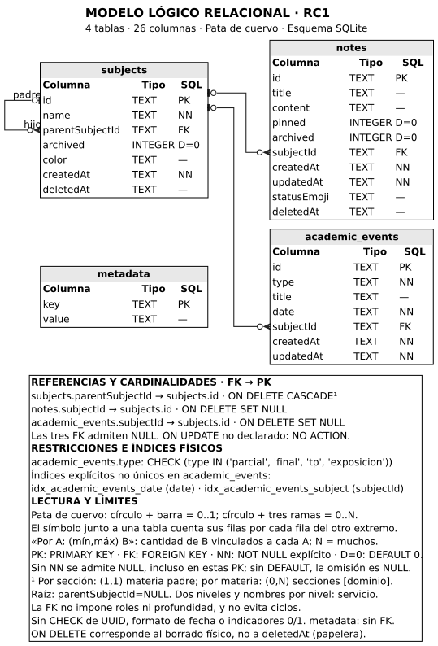

# Diagramas de Base de Datos — Lumapse

Esta carpeta documenta el diseño de datos en tres niveles de abstracción. Las **fuentes editables** se versionan y las **imágenes son artefactos derivados**. El conceptual utiliza notación Chen; el lógico conserva DBML y una figura DOT/SVG y el físico corresponde al DDL y las migraciones de SQLite.

- **Autor:** José David Sandoval
- **Motor:** SQLite mediante `@capacitor-community/sqlite`
- **Versión de referencia de los modelos revisados:** `0.6.0/600 — RC1`, fuente `bcefe6a`
- **Revisión de las figuras:** 2026-11-21; no constituye una nueva prueba del APK

## Contenido y autoridad

| Archivo | Nivel | Rol | Estado al corte |
|---|---|---|---|
| [`01-modelo-conceptual.dot`](./01-modelo-conceptual.dot) | Conceptual | Fuente Graphviz, notación Chen | Contraste con dominio, SQLite y jerarquía de la versión 0.6.0 RC1; detalle por roles |
| [`01-modelo-conceptual.svg`](./01-modelo-conceptual.svg) | Conceptual | Imagen vectorial derivada de DOT | Figura 4-3 del capítulo fuente; atributos seleccionados |
| [`02-normalizacion.md`](./02-normalizacion.md) | Lógico | Justificación de 1FN, 2FN y 3FN | Referencia textual |
| [`03-modelo-logico-relacional.dbml`](./03-modelo-logico-relacional.dbml) | Lógico | Fuente DBML | Sincronizada con el esquema ejecutable |
| [`03-modelo-logico-relacional.dot`](./03-modelo-logico-relacional.dot) | Lógico y anotaciones físicas | Fuente de la figura Graphviz | Transcripción contrastada con DDL y migraciones de 0.6.0 RC1 |
| [`03-modelo-logico-relacional.svg`](./03-modelo-logico-relacional.svg) | Lógico y anotaciones físicas | Imagen vectorial derivada | Figura 4-4 del capítulo fuente |
| [`04-modelo-fisico-ddl.md`](./04-modelo-fisico-ddl.md) | Físico | DDL consolidado, migraciones y reglas de aplicación | Contrastado con la fuente de 0.6.0 RC1; no es un script de actualización |
| [`src/services/sqlite/connection.js`](../../../src/services/sqlite/connection.js) | Físico ejecutable | Fuente de verdad del esquema | Autoridad final ante una divergencia |

La tabla `metadata` pertenece al esquema ejecutable, pero no al dominio académico. En la versión 0.6.0 RC1 conserva propiedades internas y el borrador del editor; se incluye en los niveles lógico y físico, no en el conceptual.

## Modelo conceptual de la versión 0.6.0 RC1


**Figura DB-1.** Modelo conceptual en notación Chen con cardinalidades de participación `(mín, máx)`. El panel a representa tres tipos de entidad y sus asociaciones de contenido. El panel b despliega la relación de `Subject` para distinguir materia raíz y sección hija, sin un lazo que sugiera autocontención de una instancia. Es un detalle del mismo tipo de entidad, no dos entidades o tablas nuevas.

- Rectángulos: tipos de entidad o sus apariciones por rol, identificadas explícitamente.
- Rombos: relaciones; óvalos: atributos; identificadores propios subrayados.
- La cardinalidad junto a una entidad indica en cuántos vínculos de esa relación participa. No se interpreta con la convención de extremos de pata de gallo.
- Una materia o sección puede agrupar cero o muchas notas y fechas: `(0,N)`. Cada nota o fecha admite cero o una materia o sección: `(0,1)`.
- En la jerarquía, una materia raíz no tiene padre y puede tener cero o muchas secciones: `(0,N)`. Cada sección tiene exactamente una materia padre: `(1,1)`. Los roles son excluyentes, la relación une registros distintos y no hay subsecciones.
- En el nivel lógico ambos roles se almacenan en `subjects`: raíz con `parentSubjectId = NULL`; sección con referencia a una raíz. Al crear una sección, el servicio comprueba que el padre exista y sea una materia raíz; la FK por sí sola no limita la profundidad ni distingue los roles.

### Atributos seleccionados y contraste

La figura muestra nueve atributos académicos seleccionados, no el inventario completo de columnas:

| Tipo de entidad | Atributos de la figura | Correspondencia en el dominio |
|---|---|---|
| `Subject` | identificador, nombre, color opcional | `id`, `name`, `color` |
| `Note` | identificador, título, contenido | `id`, `title`, `content` |
| `AcademicEvent` | identificador, tipo, fecha | `id`, `type`, `date` |

Los demás atributos y las referencias se detallan en el modelo lógico. El título de nota no implica una entrada manual obligatoria: se resuelve mediante el contrato de guardado explicado en 4.7.5. La selección no elimina propiedades de la app ni incorpora nuevas tablas.

Se contrastaron `src/domain/subjects.ts`, `notes.ts` y `academicEvents.ts`, el esquema y las migraciones de `src/services/sqlite/connection.js`, la profundidad en `SubjectService.validation.ts` y el título en `NoteTitleService.ts`. Esas fuentes no presentan diferencias respecto de `bcefe6a`; esta comparación documental no valida nuevamente el APK.

### Regenerar la figura actual

Con Graphviz instalado como herramienta documental externa a la app, desde la raíz del repositorio:

```bash
dot -Kneato -Tsvg docs/diagramas/database/01-modelo-conceptual.dot \
  -o docs/diagramas/database/01-modelo-conceptual.svg
```

Esta exportación utiliza Graphviz 16.1.2 y el motor Neato. La fuente fija posiciones para mantener una disposición vertical. No se agrega una dependencia ni un generador al proyecto de la app. La [documentación de Graphviz](https://graphviz.org/docs/) describe el lenguaje y la exportación; las [notas docentes de Virginia Tech sobre el modelo ER](https://courses.cs.vt.edu/cs4604/Spring21/pdfs/3-ermodel2.pdf) desarrollan el uso de roles en relaciones recursivas.

El SVG es monocromo, conserva texto vectorial y no necesita imágenes rasterizadas o etiquetas HTML incrustadas. La revisión de esta figura no sustituye la revisión del PDF A4: tipografía disponible, ancho útil, pie, márgenes de encuadernación y paginación. El ensamblado y LaTeX/PDF siguen fuera de esta unidad.

## Modelo lógico relacional



**Figura DB-2.** Cuatro tablas, 26 columnas, cuatro claves primarias y tres referencias opcionales. Las líneas en pata de gallo conectan los puertos de las columnas FK con la PK referenciada. Sus extremos muestran cardinalidades mínimas/máximas en ambos sentidos; las referencias inferiores identifican las columnas y las acciones de borrado físico. La autorreferencia de `subjects` distingue los extremos padre (`id`) e hijo (`parentSubjectId`), sin duplicar la tabla ni sugerir que un registro se contiene a sí mismo. Cada FK admite `(0,1)` destinos por fila de origen y cada destino admite `(0,N)` referencias de origen. En la jerarquía se identifica aparte el dominio: una sección tiene `(1,1)` materia padre y una materia admite `(0,N)` secciones; la fila raíz no tiene padre. En la pata de gallo, el símbolo junto a una tabla cuenta sus filas vinculadas a una fila del otro extremo: círculo y barra significan cero o una; círculo y tres ramas, cero o muchas. Las frases «Por A: (mín,máx) B» de las aclaraciones cuentan los B vinculados a cada A. La figura diferencia restricciones SQL y reglas del servicio: la profundidad de la jerarquía y la unicidad de nombres por nivel no son garantías de la FK.

La fuente DOT transcribe los tipos declarados, ocho `NOT NULL` explícitos, tres valores `DEFAULT 0`, el `CHECK` de tipos de evento y los dos índices explícitos no únicos. Las PK generan además índices implícitos de unicidad en estas tablas ordinarias. No se representa `TEXT PRIMARY KEY` como `NOT NULL`: SQLite admite nulos en estas PK al no ser tablas `STRICT` ni `WITHOUT ROWID` y no declarar `NOT NULL`. No se infiere una validación SQL de UUID, fechas o indicadores booleanos. Las acciones FK requieren su control habilitado en la conexión; esta revisión es documental, no una comprobación del motor nativo.

El [DBML](./03-modelo-logico-relacional.dbml) se mantiene como proyección estructural reproducible: su generador no proyecta `CHECK` ni índices y conserva `ON DELETE` como comentario. Sus notas semánticas no son un catálogo completo de usos: `metadata` también guarda el borrador de 0.6.0 RC1. La autoridad para restricciones es el DDL de `connection.js`, no las notas DBML ni una inferencia visual. El tratamiento de PK y las acciones por omisión se contrastaron con la documentación oficial de [CREATE TABLE](https://sqlite.org/lang_createtable.html) y [claves foráneas de SQLite](https://sqlite.org/foreignkeys.html).

### Regeneración y contraste

Desde la raíz, con Graphviz 16.1.2 como herramienta externa:

```bash
npm run check:dbml
npm run check:schema
dot -Kneato -n2 -Tsvg docs/diagramas/database/03-modelo-logico-relacional.dot \
  -o docs/diagramas/database/03-modelo-logico-relacional.svg
```

Los dos verificadores no certifican todas las restricciones: complementar con el contraste de cada fila, PK, FK, `NOT NULL`, `DEFAULT`, `CHECK`, índice y acción referencial contra el esquema y sus migraciones. No modificar el esquema congelado para adaptarlo a la figura. Si cambia la documentación, editar primero DOT y regenerar SVG; no editar el SVG manualmente. Neato con `-n2` conserva las posiciones y los recorridos ortogonales fijados en puntos: comprobar los puertos y sus coordenadas si cambia el tamaño de una tabla. Los símbolos compuestos se generan con `crowodot` junto a las FK y `teeodot` junto a las PK (`dir=both`); la primera forma queda más cerca de la tabla, según la [documentación de flechas de Graphviz](https://graphviz.org/doc/info/arrows.html). No interpretar el sentido FK → PK como una flecha de navegación.

El SVG es monocromo y conserva texto vectorial nativo. El control visual a 160 mm de ancho ocupa aproximadamente 236 mm de alto, con letra mínima de 10,1 puntos; se revisó en un control A4 con márgenes superior e inferior de 15 mm, interior de 30 mm y exterior de 20 mm. Es una referencia de legibilidad, no la maquetación definitiva. La revisión de márgenes, pie y paginación del PDF queda para el cierre del informe. El PNG anterior se retira para no conservar dos ilustraciones vigentes del mismo modelo; sigue recuperable en Git.

## Modelo físico de la versión 0.6.0 RC1

El [documento físico](./04-modelo-fisico-ddl.md) distingue el DDL consolidado de la
secuencia real de inicialización: cuatro tablas y 26 columnas, siete adiciones de
compatibilidad condicionadas a `PRAGMA table_info`, y creación idempotente de
eventos e índices. Las comprobaciones de existencia no reparan definiciones
arbitrariamente diferentes ni ignoran errores SQL por su mensaje.

El capítulo 4 incorpora el esquema completo en la sección 4.7.2.3, en bloques por
tabla. La explicación separa restricciones SQL, reglas de los servicios y usos de
`metadata`, incluido el borrador. El contraste documental no modifica la app,
no acredita nuevas pruebas nativas ni cierra la revisión del PDF final.

## Flujo metodológico

```text
Modelo conceptual (DOT → Graphviz → SVG)
        ↓
Normalización (1FN → 2FN → 3FN)
        ↓
Modelo lógico (DBML parcial + figura DOT → Graphviz → SVG)
        ↓
Modelo físico (DDL y migraciones en connection.js)
```

Las anotaciones físicas de la figura lógica explicitan la implementación sin confundirla con las reglas del dominio. La comparación documental con la fuente de 0.6.0 RC1 no constituye una nueva prueba funcional del APK.

## Criterios de cierre

- Las fuentes editables coinciden con `connection.js` y con la documentación física.
- Los verificadores de esquema del repositorio finalizan correctamente.
- Cada imagen utilizada en el informe procede de su fuente editable vigente.
- Las imágenes representan visualmente el alcance de las fuentes; la legibilidad al tamaño final de informe y diapositivas se valida durante la maquetación.
- El capítulo fuente identifica la versión `0.6.0/600` RC1; las versiones anteriores se conservan sólo como antecedentes o atribución de evidencia histórica. El checkpoint ensamblado no se modifica manualmente.
