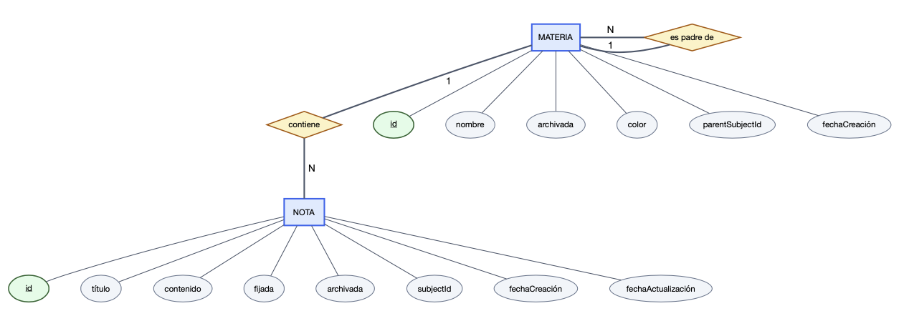
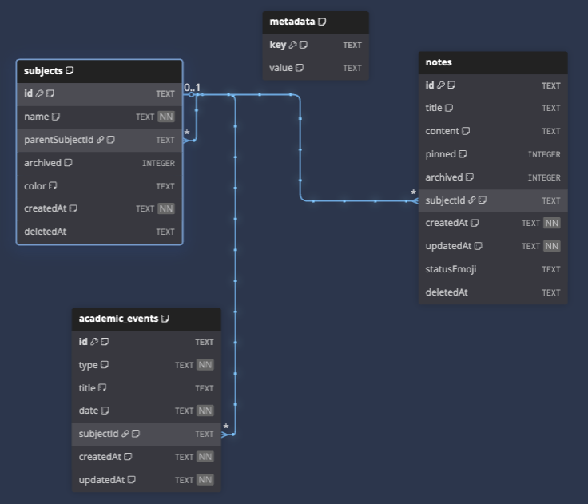

# Diagramas de Base de Datos — Lumapse

Esta carpeta documenta el diseño de datos en tres niveles de abstracción. Las **fuentes editables** se versionan en el repositorio y las **imágenes son artefactos derivados**. Mermaid se utiliza para la representación conceptual del informe; las fuentes DOT/Chen y DBML conservan sus respectivos flujos de exportación.

- **Autor:** José David Sandoval
- **Motor:** SQLite mediante `@capacitor-community/sqlite`
- **Versión de referencia del conceptual Mermaid:** `0.6.0/600 — RC1`, fuente `bcefe6a`
- **Revisión del conceptual Mermaid:** 2026-11-21; no constituye una nueva prueba del APK

## Contenido y autoridad

| Archivo | Nivel | Rol | Estado al corte |
|---|---|---|---|
| [`01-modelo-conceptual.mmd`](./01-modelo-conceptual.mmd) | Conceptual | Fuente Mermaid, pata de cuervo | Contrastada con dominio, SQLite y reglas de jerarquía de la RC1 |
| [`01-modelo-conceptual.svg`](./01-modelo-conceptual.svg) | Conceptual | Imagen vectorial derivada de Mermaid | Representación utilizada en la figura 4-3 del capítulo fuente |
| [`01-modelo-conceptual-der-chen.dot`](./01-modelo-conceptual-der-chen.dot) | Conceptual | Fuente Graphviz | Antecedente Chen revalidado con `v0.5.0`; no modificado por el cambio de representación |
| [`01-modelo-conceptual-der-chen.png`](./01-modelo-conceptual-der-chen.png) | Conceptual | Imagen derivada | Exportación Chen del 2026-07-15 conservada como antecedente |
| [`02-normalizacion.md`](./02-normalizacion.md) | Lógico | Justificación de 1FN, 2FN y 3FN | Referencia textual vigente |
| [`03-modelo-logico-relacional.dbml`](./03-modelo-logico-relacional.dbml) | Lógico | Fuente DBML | Sincronizada con el esquema ejecutable; fuente de la exportación vigente |
| [`03-modelo-logico-relacional.png`](./03-modelo-logico-relacional.png) | Lógico | Imagen derivada | Reemplazada y revisada el 2026-07-15 |
| [`04-modelo-fisico-ddl.md`](./04-modelo-fisico-ddl.md) | Físico | Documentación del DDL y migraciones | Referencia técnica vigente |
| [`src/services/sqlite/connection.js`](../../../src/services/sqlite/connection.js) | Físico ejecutable | Fuente de verdad del esquema en runtime | Autoridad final si existe una divergencia |

La tabla `metadata` aparece en el DBML y en el modelo físico porque forma parte del esquema ejecutable. Se excluye deliberadamente del DER conceptual: es una tabla técnica clave-valor utilizada para propiedades internas y, en la RC1, el borrador del editor; no es una entidad del dominio académico.

## Representación conceptual del informe — RC1



**Figura DB-1.** Modelo conceptual en notación de pata de cuervo generado desde Mermaid. Reemplaza la representación Chen en el capítulo fuente del informe, sin modificar la aplicación ni el esquema. No es un diagrama UML ni el modelo lógico de tablas.

El contraste se realiza con `src/domain/subjects.ts`, `notes.ts` y `academicEvents.ts`, el esquema y las migraciones de `src/services/sqlite/connection.js`, la validación de profundidad de `SubjectService.validation.ts` y el contrato de título de `NoteTitleService.ts`. Esas fuentes coinciden con las de `bcefe6a`; la comparación no ejecuta ni valida nuevamente el APK.

- Tres entidades, tres asociaciones no identificadoras y 21 atributos de dominio; las tres referencias se representan como asociaciones, no como atributos duplicados.
- Cada nota o fecha admite cero o una Materia/Sección; cada Materia/Sección puede agrupar cero o muchas notas y fechas.
- La autorreferencia admite cero o un padre por registro: una raíz carece de padre y una sección tiene exactamente uno. La regla de dos niveles se verifica en el servicio, no se deduce del diagrama aislado.
- `estado` corresponde a `statusEmoji`; `eliminación` corresponde a `deletedAt`, sólo en Nota y Materia/Sección. No se añade papelera a las fechas académicas.
- El título explícito de nota es opcional al escribir; el valor confirmado se resuelve según el contrato de guardado. El título de fecha académica sí puede permanecer ausente.
- Los tipos de la figura describen conceptos del dominio; no declaran tipos SQL ni restricciones `NOT NULL`. `Tipo` corresponde a parcial, final, trabajo práctico o exposición; `Indicador` expresa un estado booleano.

### Regenerar la representación Mermaid

Con Mermaid CLI disponible como herramienta documental externa a la app:

```bash
mmdc -i docs/diagramas/database/01-modelo-conceptual.mmd \
  -o docs/diagramas/database/01-modelo-conceptual.svg \
  -I lumapse-conceptual -b white --no-font-embed
```

Ejecutar desde la raíz del repositorio. La exportación de esta revisión utiliza Mermaid CLI 12.2.0 y Mermaid 12.3.0, apariencia clásica y disposición Dagre fijadas en la fuente. No se agrega Mermaid a `package.json` ni al gate de la app. La sintaxis de asociaciones y cardinalidades corresponde a la [documentación oficial de diagramas ER de Mermaid](https://mermaid.js.org/syntax/entityRelationshipDiagram.html).

El SVG monocromo conserva texto SVG nativo, sin etiquetas HTML incrustadas, y no depende del color para explicar las relaciones. La fuente solicita Arial con alternativa sans-serif; la conversión final debe comprobar la tipografía disponible. La revisión de la figura no sustituye la comprobación posterior en el PDF A4: ancho útil, tipografía efectiva, pie, márgenes de encuadernación y saltos de página. La conversión a LaTeX/PDF y el ensamblado completo no forman parte de esta unidad.

## Diferencias resueltas en las fuentes

La revisión del 2026-07-15 sincronizó las fuentes editables con el schema de `v0.4.8`. La revalidación del 2026-09-05 confirmó que `v0.5.0` conserva el mismo esquema efectivo: AUD-005 cambió propiedad de conexión, migraciones y recuperación, pero no tablas, columnas ni relaciones. Por eso las fuentes y los PNG siguen representando el modelo vigente:

- el DER conceptual ya incluye `EVENTO ACADÉMICO` y su asociación opcional con `MATERIA / SECCIÓN`;
- `MATERIA` y `SECCIÓN` se representan como una única entidad `Subject` autorreferenciada;
- `NOTA` incorpora los atributos vigentes relevantes, incluidos `statusEmoji` y `deletedAt`, y `Subject` incorpora su borrado lógico mediante `deletedAt`;
- las asociaciones opcionales de `NOTA` y `EVENTO ACADÉMICO` con `Subject` expresan los casos Entrada/sin materia, con cardinalidades `0..1` del lado de cada registro y `0..N` del lado de `Subject`;
- las claves foráneas y acciones `ON DELETE` permanecen detalladas en el DBML, sin duplicarlas como atributos en el modelo conceptual;
- `metadata` queda documentada como tabla técnica: incluida en los niveles lógico y físico, excluida del conceptual;
- la nota de `notes.title` aclara que el título explícito es opcional, el H1 inicial es solo fallback y `Sin título` es el valor final cuando ambos faltan.

## Exportaciones históricas verificadas

Las fuentes DOT y DBML sincronizadas se exportaron con las herramientas externas previstas y sus PNG se reemplazaron el 2026-07-15. La revisión visual confirmó que las imágenes representan el mismo alcance que sus fuentes y que el modelo implementado.

### Modelo conceptual



**Antecedente Chen.** Modelo conceptual de Lumapse, exportado desde [`01-modelo-conceptual-der-chen.dot`](./01-modelo-conceptual-der-chen.dot) mediante Graphviz/edotor.net. Representa `Subject` —Materia o Sección—, `Note` y `AcademicEvent`, con sus relaciones y cardinalidades. La tabla técnica `metadata` no aparece porque no es una entidad del dominio académico.

La exportación es panorámica (`1622 × 296 px`). Su contenido fue verificado, pero la legibilidad al tamaño definitivo deberá confirmarse al componer el PDF y las diapositivas; si el texto queda pequeño, corresponde reexportar o disponer la figura en orientación horizontal, sin alterar el modelo.

### Modelo lógico relacional



**Figura DB-2.** Modelo lógico relacional de Lumapse, exportado desde [`03-modelo-logico-relacional.dbml`](./03-modelo-logico-relacional.dbml) mediante dbdiagram.io. Incluye las cuatro tablas del esquema (`subjects`, `notes`, `academic_events` y `metadata`), sus 26 columnas y las tres relaciones declaradas.

Los PNG son artefactos derivados: no se corrigen manualmente. Cualquier cambio futuro debe aplicarse primero a las fuentes y al esquema ejecutable, ejecutar los verificadores y luego producir una nueva exportación.

## Flujo metodológico

```text
Modelo conceptual del informe (Mermaid → SVG)
Antecedente conceptual Chen (DOT → Graphviz/edotor.net)
        ↓
Normalización (1FN → 2FN → 3FN)
        ↓
Modelo lógico (DBML → dbdiagram.io)
        ↓
Modelo físico (DDL y migraciones en connection.js)
```

La coherencia entre DBML, DDL documentado y esquema ejecutable se valida con las herramientas del repositorio antes de exportar las imágenes. Para `v0.5.0`, `npm run check:dbml`, `npm run check:schema` y el smoke test del DDL finalizaron correctamente dentro de los gates documentados.

## Procedimiento de actualización externa

### DER conceptual

1. Abrir la fuente vigente [`01-modelo-conceptual-der-chen.dot`](./01-modelo-conceptual-der-chen.dot) en [edotor.net](https://edotor.net) o Graphviz.
2. Renderizar sin modificar el contenido conceptual validado.
3. Exportar en una resolución legible y reemplazar `01-modelo-conceptual-der-chen.png`.
4. Verificar visualmente entidades, atributos, relaciones y cardinalidades.

### Modelo lógico

1. Ejecutar `python3 scripts/generate-dbml-from-code.py --check` sobre [`03-modelo-logico-relacional.dbml`](./03-modelo-logico-relacional.dbml).
2. Importar el DBML validado en [dbdiagram.io](https://dbdiagram.io).
3. Exportar y reemplazar `03-modelo-logico-relacional.png`.
4. Verificar que ninguna tabla, FK o restricción relevante haya quedado fuera del encuadre.

## Criterios de cierre

- Las fuentes editables coinciden con `connection.js` y con la documentación física.
- Los verificadores de esquema del repositorio finalizan correctamente.
- Cada imagen utilizada en el informe procede de su fuente editable vigente; las exportaciones históricas conservan su procedencia.
- Las imágenes representan visualmente el alcance de las fuentes; la legibilidad al tamaño final de informe y diapositivas se valida durante la maquetación.
- El capítulo fuente identifica la RC1 `0.6.0/600`; las versiones anteriores se conservan sólo como antecedentes o atribución de evidencia histórica. El checkpoint ensamblado no se modifica manualmente.
