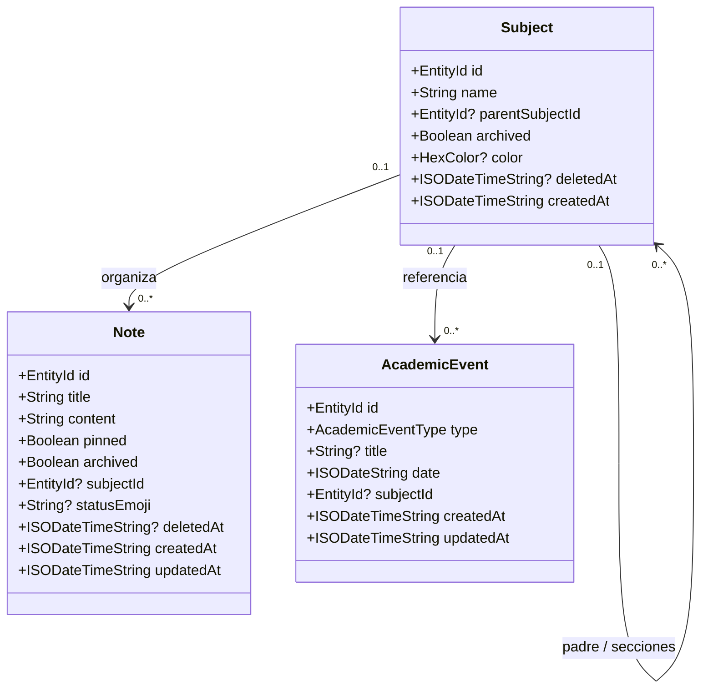
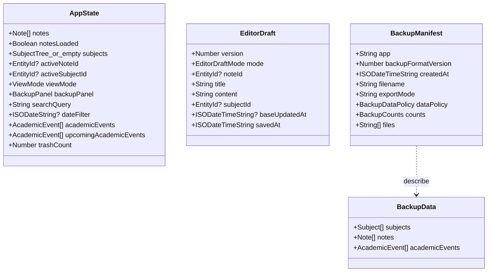

# Modelo de Dominio — Lumapse

**Tipo:** Diagrama UML de Estructura (Clases)  
**Última actualización:** 2026-11-23 (revisión estática del corte `v0.6.0`) 
**Autor:** José David Sandoval

---

## Objetivo del diagrama

Distinguir las tres entidades académicas de Lumapse en el corte `v0.6.0` de los contratos técnicos que apoyan la interfaz, el borrador y la portabilidad. Los servicios se documentan como módulos colaboradores, no como entidades ni como clases instanciadas. El detalle físico permanece en [`database/04-modelo-fisico-ddl.md`](./database/04-modelo-fisico-ddl.md).

> **Frontera de versión:** Modelo contrastado con la fuente del corte `v0.6.0`
> (APK de `bcefe6a`, tag sobre `ac2a747`). [ADR-012](../adr/ADR-012-borrador-sqlite-y-guardado-atomico.md)
> movió el borrador a la tabla `metadata`, sin agregar una tabla ni cambiar las
> entidades de notas, materias y fechas. Esta revisión estática no es una prueba
> funcional ni transfiere al APK los resultados de otros artefactos.

> **Nota de evolución:** El modelo original incluía `Tag` y persistencia IndexedDB. Tras el pivote mobile-first se adoptó SQLite ([ADR-006](../adr/ADR-006-arquitectura-de-persistencia-y-tooling-sqlite-para-desarrollo-web-y-native.md)) y organización por Materia/Sección. En Hito 05 se agregan `AcademicEvent`, borradores persistentes del editor y portabilidad por backup ZIP (`RF-017` / `RF-018`).

---

## Entidades académicas

`?` indica que el valor admite `null`; `deletedAt` también puede omitirse en los
objetos de aplicación. Las fechas del contrato son cadenas ISO, no instancias
JavaScript de `Date`. `AcademicEventType` admite `parcial`, `final`, `tp` y
`exposicion`.

En la relación recursiva, una materia raíz no tiene padre y una sección tiene
exactamente una materia raíz como padre. La cardinalidad general `0..1` recoge
ambos roles; no autoriza subsecciones. La profundidad de dos niveles y la
unicidad de nombres por nivel son reglas de `SubjectService`, no consecuencias
de la cardinalidad o de una FK aislada.

## Contratos técnicos separados del dominio académico

Es una vista de atributos seleccionados, no una copia exhaustiva de cada tipo.
`SubjectTree_or_empty` abrevia `SubjectTree | []`, el contrato de `AppState.subjects`.
`EditorDraftMode` distingue creación y edición; en edición, `noteId` identifica
la nota original. Las clases representan estructuras de datos de los contratos,
no una jerarquía de objetos con herencia o métodos de dominio.

Estos diagramas se conservan como apoyo técnico del repositorio. El capítulo 4
ya desarrolla las entidades y relaciones mediante su tabla de dominio y el
modelo conceptual; no se agrega otra lámina que repita ese contenido.

---

## Entidades del dominio

### Note (Nota)

Entidad central de captura. Representa una nota local, escrita como texto plano o Markdown.

| Atributo | Tipo | Descripción |
|---|---|---|
| `id` | `String` | Identificador UUID v4 generado en cliente. |
| `title` | `String` | Título explícito normalizado; si está vacío, puede resolverse desde un H1 inicial o como `Sin título`. No depende obligatoriamente de `content`. |
| `content` | `String` | Contenido de la nota en texto plano/Markdown. |
| `pinned` | `Boolean` | Indica si la nota se fija al inicio del feed. |
| `archived` | `Boolean` | Indica si la nota se oculta del feed principal y aparece en Archivo. |
| `subjectId` | `String \| null` | Materia o sección asociada. `NULL` representa Entrada. |
| `statusEmoji` | `String \| null` | Marcador académico curado (`📖`, `❓`, `🔥`, `✅`). |
| `deletedAt` | `ISODateTimeString \| null` | Fecha de eliminación lógica; `NULL` significa nota activa. |
| `createdAt` / `updatedAt` | `ISODateTimeString` | Fechas de creación y última modificación. |

### Subject (Materia / Sección)

Entidad de organización jerárquica. Una materia raíz puede contener secciones hijas; la profundidad máxima permitida es de dos niveles ([DP-004](../producto/decisiones-producto.md)).

| Atributo | Tipo | Descripción |
|---|---|---|
| `id` | `String` | Identificador UUID v4. |
| `name` | `String` | Nombre visible de la materia o sección. |
| `parentSubjectId` | `String \| null` | `NULL` para materia raíz; UUID del padre para sección. |
| `archived` | `Boolean` | Indica si la materia queda fuera del árbol principal. |
| `color` | `String \| null` | Color de identificación visual. |
| `deletedAt` | `ISODateTimeString \| null` | Fecha de eliminación lógica usada por Papelera. |
| `createdAt` | `ISODateTimeString` | Fecha de creación. |

### AcademicEvent (Fecha académica)

Recordatorio visual pasivo asociado al calendario/Heatmap. No es una agenda completa: no maneja horarios, recurrencias, notificaciones ni sincronización.

| Atributo | Tipo | Descripción |
|---|---|---|
| `id` | `String` | Identificador UUID v4. |
| `type` | `AcademicEventType` | `parcial`, `final`, `tp` o `exposicion`. |
| `title` | `String \| null` | Nota breve opcional. |
| `date` | `ISODateString` | Fecha obligatoria en formato `YYYY-MM-DD`. |
| `subjectId` | `String \| null` | Materia/sección asociada opcional. |
| `createdAt` / `updatedAt` | `ISODateTimeString` | Fechas de creación y modificación. |

### EditorDraft (Borrador del editor)

Entidad técnica local que protege trabajo en curso. Se persiste como JSON en
`metadata`, clave `lumapse-editor-draft-v1`, y se captura sin debounce. El guardado
o actualización desde el editor confirma la nota y el marcador JSON `null` en una
misma transacción; descartar también espera la limpieza durable. `localStorage`
sólo es origen de migración legacy, no un fallback actual. No se exporta en el ZIP
ni se garantiza la última tecla si el proceso termina antes del commit.

| Atributo | Tipo | Descripción |
|---|---|---|
| `version` | `Number` | Versión del formato de borrador. |
| `mode` | `EditorDraftMode` | `create` o `edit`. |
| `noteId` | `String \| null` | Nota original cuando el borrador corresponde a edición. |
| `title` / `content` | `String` | Texto pendiente. |
| `subjectId` | `String \| null` | Materia/sección seleccionada en el editor. |
| `baseUpdatedAt` | `ISODateTimeString \| null` | Marca temporal de la nota original para restaurar contexto de edición. |
| `savedAt` | `ISODateTimeString` | Última persistencia local del borrador. |

### BackupData y BackupManifest

Modelo de portabilidad local del workspace. Un backup incluye datos estructurados y notas Markdown legibles, sin sincronización automática ni dependencia de nube.

| Entidad | Descripción |
|---|---|
| `BackupData` | Agrupa materias, notas y fechas académicas exportables. Conserva archivados y excluye Papelera; el ZIP no contiene el borrador ni el resto de `metadata`. |
| `BackupManifest` | Describe formato, fecha, nombre de archivo, `dataPolicy`, conteos y archivos incluidos. La política declara exclusión de eliminados y adjuntos, e inclusión de archivados. |

---

## Módulos colaboradores y límites

| Servicio / límite | Responsabilidad | Persistencia |
|---|---|---|
| `NoteStore` | Estado reactivo y operaciones de aplicación: crear, editar, mover, eliminar, filtrar y seleccionar notas. Depende de módulos SQLite y coordina `SubjectService` y `AcademicEventService`; las operaciones del store actualizan `AppState`. | Memoria + acceso directo/delegación a SQLite |
| `SubjectService` | Reglas de materias/secciones: unicidad, profundidad máxima, archivo, papelera y restauración. | SQLite |
| `AcademicEventService` | CRUD de fechas académicas, consultas por mes y próximas fechas. | SQLite |
| `BackupService` | Reúne datos actuales y genera el ZIP restaurable/legible. | Lectura SQLite + ZIP |
| `BackupImportService` | Valida ZIP, prepara preview y aplica importación no destructiva/transaccional. | ZIP + SQLite |
| `EditorDraftService` | Hidrata el cache, persiste snapshots y consume el borrador junto con la escritura de nota del editor. | SQLite (`metadata`); legacy migrado desde `localStorage` |
| `MarkdownService` | Expone `renderMarkdown` y `hasMarkdownSyntax`; la sanitización del HTML ocurre internamente durante el renderizado. | Sin persistencia |
| `SQLite` | Inicializa schema, ejecuta migraciones idempotentes y transacciones. | `@capacitor-community/sqlite` / `sql.js` web |

---

## Relaciones y colaboraciones principales

| Relación | Cardinalidad | Descripción |
|---|---|---|
| Subject → Subject | 0..1 a muchos | Una materia puede contener secciones; una sección no puede contener subsecciones. |
| Subject → Note | 0..1 a muchos | Una materia o sección puede agrupar notas mediante `notes.subjectId`; cada nota puede no tener materia (`NULL`, Entrada) o pertenecer a una. |
| Subject → AcademicEvent | 0..1 a muchos | Una fecha académica puede asociarse opcionalmente a una materia o sección. |
| AppState → Note / Subject / AcademicEvent | 1 a muchos | El store mantiene en memoria datos cargados desde SQLite y estados derivados de UI. |
| NoteStore → AppState | Dependencia | Las operaciones del store actualizan el estado observable de la aplicación. |
| NoteStore → SQLite / SubjectService / AcademicEventService | Dependencia | El store combina acceso directo a módulos SQLite con coordinación mediante servicios de materias y fechas académicas. |
| EditorDraft → Note | Dependencia | Un borrador puede representar una nota nueva o cambios pendientes sobre una nota existente. |
| BackupData → Note / Subject / AcademicEvent | 1 a muchos | El backup ZIP serializa el workspace local relevante para restauración. |

---

## Frontera con el modelo físico

Este documento no duplica el DDL ni las figuras de base de datos. Su detalle de
tablas, claves, restricciones, índices y migraciones permanece en el
[modelo físico](./database/04-modelo-fisico-ddl.md).

---

*Modelado de dominio y contratos · Lumapse · PP3 · 2026*
