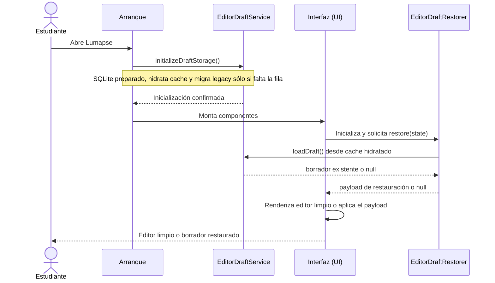
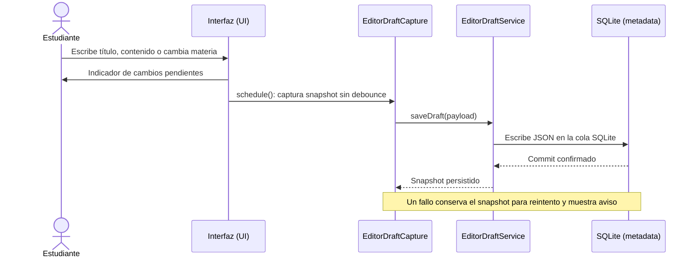
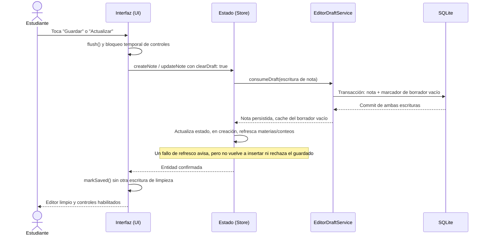
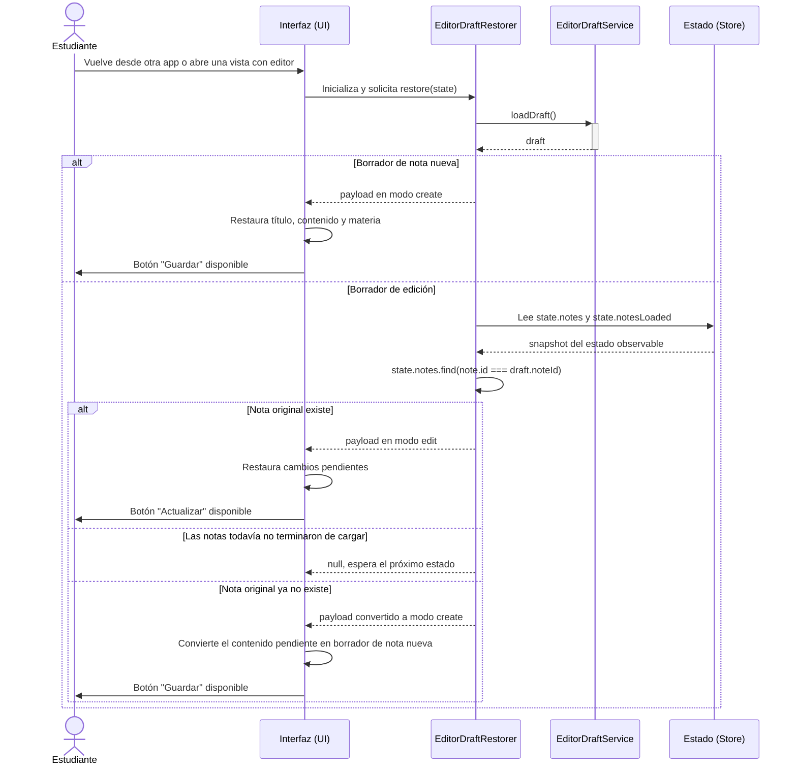
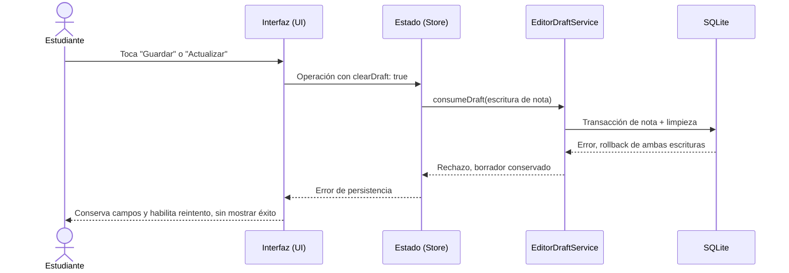

# Diagrama de Secuencia — Crear/Editar Nota con Borrador Persistente

**Tipo:** Diagrama UML de Comportamiento (Secuencia)  
**Última actualización:** 2026-10-26 (revisión estática del corte `v0.6.0`) 
**Autor:** José David Sandoval

---

## Objetivo del diagrama

Modelar la interacción entre los componentes durante el flujo de **crear o editar
una nota protegida por borrador SQLite**. La nota final sólo se crea o actualiza
con `Guardar` o `Actualizar`. La captura protege el trabajo confirmado en SQLite;
no garantiza la última tecla si el proceso termina antes del commit.

> **Alcance:** Este diagrama se mantiene enfocado en `RF-005` (borradores persistentes). Los flujos de backup/importación ZIP, fechas académicas y Acerca de pertenecen a otros casos de uso del Hito 05 y no forman parte de esta secuencia.

> **Frontera de versión:** Secuencia contrastada con la fuente de la RC1 `v0.6.0`
> (APK de `bcefe6a`, tag sobre `ac2a747`) y [ADR-012](../adr/ADR-012-borrador-sqlite-y-guardado-atomico.md).
> No conserva el debounce ni la limpieza separada de `v0.5.0`. Es una revisión
> documental del código, no una nueva comprobación funcional del APK.

---

## Diagrama de Secuencia: Abrir editor de nota nueva

---

## Diagrama de Secuencia: Conservar borrador mientras escribe

---

## Diagrama de Secuencia: Guardar nota final

---

## Diagrama de Secuencia: Volver a Lumapse con borrador pendiente

---

## Participantes del sistema

| Participante | Responsabilidad | Ubicación en el código |
|---|---|---|
| **Estudiante** | Actor principal. Inicia las acciones de crear, editar, cambiar de app y confirmar guardado. | — |
| **Interfaz (UI)** | Capa de presentación. Maneja eventos del DOM, renderiza el listado, el editor, indicadores y confirmaciones. | `src/components/` |
| **Estado (Store)** | Gestión del estado de la aplicación. Coordina las operaciones CRUD definitivas y expone en memoria `state.notes` y `state.notesLoaded` para la restauración. | `src/store/` |
| **EditorDraftRestorer** | Interpreta el borrador y, cuando corresponde a una edición, localiza la nota original directamente en `state.notes`, sin invocar una consulta del store. | `src/components/note-editor/NoteEditorDrafts.js` |
| **Arranque** | Prepara SQLite e hidrata el cache del borrador antes de montar; un fallo de lectura/migración ofrece recuperación, no un editor vacío silencioso. | `src/layout/appStartup.js` |
| **EditorDraftService** | Hidrata y mantiene el cache, persiste snapshots y consume nota/borrador en la misma transacción. Un JSON SQLite inválido falla cerrado; no se sobrescribe como si estuviera vacío. | `src/services/EditorDraftService.ts` |
| **EditorDraftCapture** | Captura cada cambio sin debounce, conserva el snapshot fallido para reintento y marca el éxito del guardado sin otra limpieza SQLite. | `src/components/note-editor/NoteEditorDrafts.js` |
| **SQLite** | Persistencia de notas y del único borrador en `metadata`, mediante la conexión y la cola compartidas. | `src/services/sqlite/notes.js`, `src/services/sqlite/editorDrafts.js` |

---

## Decisiones de diseño reflejadas

| Decisión | Justificación | ADR relacionado |
|---|---|---|
| Borrador SQLite sin debounce | Captura snapshots en `metadata`; migra legacy sólo si falta la fila y no vuelve a usarlo como fallback. | [ADR-012](../adr/ADR-012-borrador-sqlite-y-guardado-atomico.md) |
| Guardado final explícito | Respeta la intención del usuario: la nota definitiva solo se crea o actualiza con `Guardar` o `Actualizar`. | — |
| Consumo atómico | Nota y marcador JSON `null` se confirman juntos; un fallo revierte ambas escrituras. Descartar espera su propio commit antes de limpiar la UI. | [ADR-012](../adr/ADR-012-borrador-sqlite-y-guardado-atomico.md) |
| Refresco separado en creación | Una lectura secundaria fallida permite recuperar conteos sin volver a crear la nota. | [ADR-011](../adr/ADR-011-limite-guardado-y-refresco.md) |
| Conversión segura de edición a creación | Si la nota original desaparece, el contenido pendiente se conserva como nota nueva para evitar pérdida de texto. | — |

---

## Escenario alternativo: error al guardar la nota final

> **Nota:** El manejo de errores de persistencia se relaciona con [RNF-010](../producto/requisitos-no-funcionales.md). El borrador persistente actúa como red de seguridad hasta que la nota final se guarde correctamente.

---

*Documento de la fase Idear · Análisis y Relevamiento · Lumapse · PP3 · 2026*
