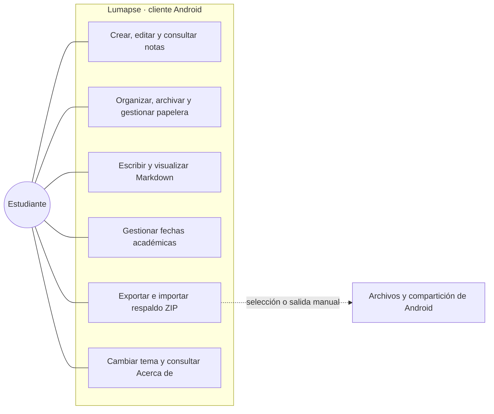
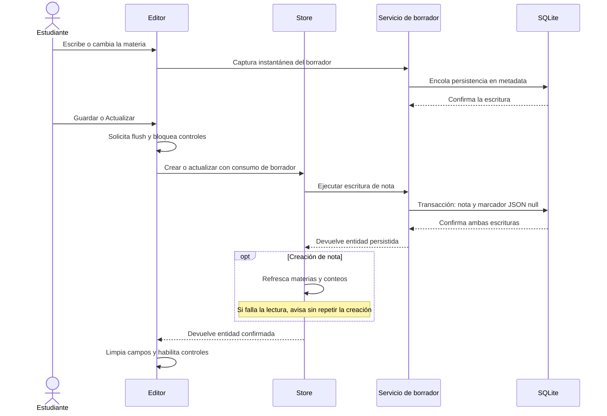
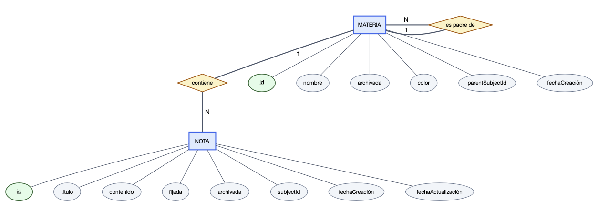
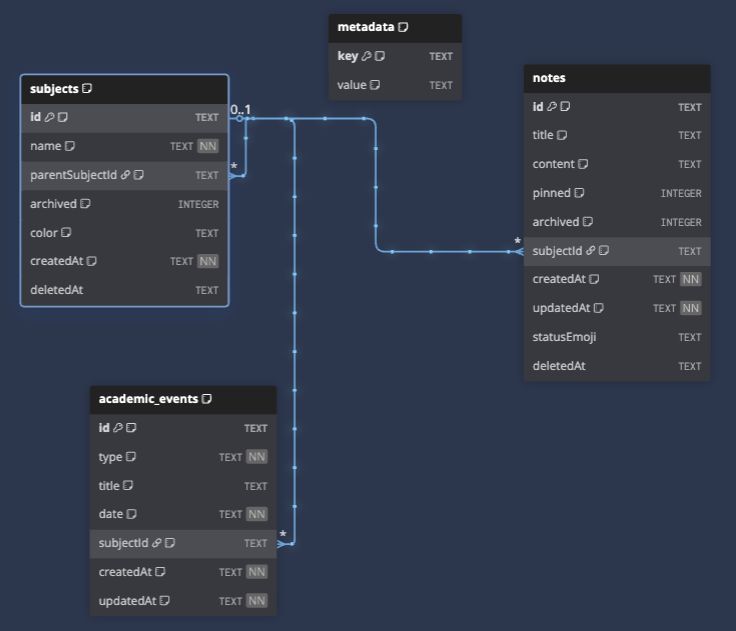

# Capítulo 4: Arquitectura y Diseño

Las necesidades expuestas en el capítulo 3 establecen prioridades de producto, pero no determinan una tecnología por sí solas. En este capítulo explico cómo las traduje en decisiones de plataforma, organización del software, interacción y persistencia, considerando la reutilización del trabajo previo y el alcance académico.

La descripción corresponde al diseño presente en la fuente de **Lumapse 0.6.0/600 — Release Candidate 1**, identificada en la sección 1.4.4. Distingo ese diseño de sus antecedentes y de su validación: comprobar una estructura en el código no demuestra que todos los recorridos del APK hayan sido probados. La implementación se desarrolla en el capítulo 5 y la evidencia, con sus artefactos y límites, en el capítulo 6.

## 4.1. Decisiones arquitectónicas y evolución del diseño

Registré las decisiones significativas mediante *Architecture Decision Records* (ADR), documentos que conservan contexto, alternativas, elección y consecuencias. Su valor es permitir reconstruir razones y costos, no certificar por sí solos que una solución sea correcta. Algunos formalizan retrospectivamente un diseño ya consolidado; no presupongo que la fecha de cada registro demuestre una decisión anterior a su implementación.

| Registros | Decisión y relación con el diseño |
|---|---|
| ADR-001 y ADR-004 | Base web sin framework de interfaz, Vite y separación de responsabilidades en el repositorio |
| ADR-002 | IndexedDB en la propuesta PWA original; decisión reemplazada por ADR-005 y ADR-006 |
| ADR-003 | Gestión adaptada del flujo de trabajo, desarrollada en el capítulo 2 |
| ADR-005 y ADR-006 | Canal Android híbrido, SQLite nativo y entorno SQLite web auxiliar |
| ADR-007 y ADR-008 | Componentes por funcionalidad y monolito modular cliente con capas pragmáticas |
| ADR-009 | Propiedad transaccional explícita y recuperación del arranque |
| ADR-010 | Entorno canónico y una misma definición del control automatizado local y remoto |
| ADR-011 | Separación entre escritura confirmada y refresco secundario de la interfaz |
| ADR-012 | Borrador SQLite y consumo atómico al guardar la nota |
| ADR-013 | Despliegue de desarrollo sin desinstalación implícita; pertenece a las herramientas, no a una nueva capa del producto |

El cambio principal fue pasar de una PWA con IndexedDB a una aplicación Android con interfaz web y SQLite. Comparé mantener el canal de navegador, reutilizar la interfaz mediante Capacitor y afrontar una reescritura con otra tecnología móvil. Adopté la segunda alternativa porque conservaba la base existente, permitía acceder a capacidades del dispositivo y situaba la base de datos del producto fuera del almacenamiento administrado por el navegador.

Capacitor proporciona un contenedor y una API de plugins para integrar código web con capacidades nativas (Ionic, s. f.). En Lumapse, la interfaz se ejecuta en una WebView: no se convirtió en una interfaz escrita completamente con componentes nativos de Android. El costo del pivote fue incorporar herramientas y pruebas específicas de Android y dejar de comprometer una entrega utilizable desde cualquier navegador.

La encuesta respaldó priorizar celular y uso sin conexión; no comparó PWA con APK ni IndexedDB con SQLite. Tampoco demostró que descargar e instalar un APK fuera intuitivo. La elección concreta provino del análisis técnico de ADR-005 y ADR-006. A su vez, SQLite no elimina riesgos como desinstalación, pérdida del dispositivo o eliminación definitiva: la portabilidad mediante respaldo sigue siendo necesaria.

## 4.2. Stack tecnológico y compromisos

Seleccioné tecnologías que permitieran sostener una aplicación local con responsabilidades visibles. La ausencia de un framework de interfaz reduce esa dependencia de ejecución, pero traslada al código propio el manejo de componentes, eventos y suscripciones. No presento esa elección como una superioridad de rendimiento demostrada frente a React o Vue.

| Área | Tecnología | Función y compromiso |
|---|---|---|
| Desarrollo y construcción | Vite | Sirve recursos durante el desarrollo y construye los archivos web del paquete; no ejecuta un backend del producto |
| Lenguaje | JavaScript con módulos ES y TypeScript gradual | Conserva módulos existentes e incorpora contratos estáticos donde reducen riesgos; no todo JavaScript queda comprobado por el sistema de tipos |
| Presentación | DOM y CSS, con componentes propios | Permite controlar interacción y renderizado; exige gestionar explícitamente eventos y ciclo de vida |
| Plataforma | Capacitor y Android | Empaqueta la interfaz web y conecta plugins; requiere comprobar por separado el comportamiento nativo |
| Persistencia del producto | SQLite y el plugin comunitario de Capacitor | Mantiene datos relacionales locales y operaciones transaccionales fuera de la presentación |
| Entorno web auxiliar | `sql.js` y `jeep-sqlite` | Ejecuta SQLite mediante WebAssembly para desarrollo; no reproduce todas las condiciones de Android |
| Contenido y portabilidad | `marked`, DOMPurify y módulos ZIP propios | Procesan Markdown, sanitizan el HTML renderizado y generan o leen el respaldo ZIP; la escritura usa entradas sin compresión y la importación conserva límites propios |
| Verificación | Vitest, runner de pruebas de Node, scripts y GitHub Actions | Comprueban unidades y reglas automatizables; no sustituyen una prueba del plugin o del APK |

La adopción de TypeScript no fue una reescritura de la aplicación. La concentré en contratos de dominio, reglas y servicios con estructuras de datos relevantes, manteniendo módulos JavaScript existentes. Los tipos expresan entradas y resultados, pero no validan por sí solos un archivo importado ni los datos recibidos en ejecución. Por eso la importación conserva comprobaciones de formato, tamaño y relaciones antes de escribir.

Android define el canal presentado. El entorno web se conserva como apoyo para iterar y comprobar lógica compartida, no como PWA soportada ni como evidencia de una entrega para escritorio o iOS. Node y npm pertenecen al entorno de herramientas, no son servidores requeridos para usar la aplicación instalada.

## 4.3. Modelo de dominio

Organicé el núcleo académico alrededor de tres entidades persistentes. Separé esas entidades del estado temporal de navegación y de los contratos técnicos de borrador y respaldo.

| Entidad | Responsabilidad | Relación principal |
|---|---|---|
| Nota (`Note`) | Conserva título, contenido Markdown, marcas de fijado y archivo, estado académico y fechas de creación/modificación | Puede no tener materia o pertenecer a una materia o sección |
| Materia/Sección (`Subject`) | Organiza las notas con nombre, color y estado | Una materia raíz puede contener secciones; cada sección tiene una materia padre |
| Fecha académica (`AcademicEvent`) | Representa un parcial, final, trabajo práctico o exposición en una fecha local | Puede vincularse a una materia o sección, sin que esa asociación sea obligatoria |

Materia y Sección son roles de una misma entidad, no dos tablas independientes. Un `Subject` sin padre representa una materia; uno con padre representa una sección. Según DP-004, la jerarquía admite dos niveles de organización: una sección no contiene subsecciones. La nota no constituye un tercer nivel de carpetas, sino contenido asociado a cualquiera de los dos niveles.

Una nota y una fecha académica tienen, cada una, cero o una referencia a `Subject`; un mismo `Subject` puede agrupar muchas de ambas. En notas, `subjectId = NULL` representa Entrada. Así se evita crear una materia ficticia para las capturas aún no clasificadas. La profundidad y la validación de nombres por nivel se resuelven en el servicio de materias, no por la sola existencia de una clave foránea.

El estado de aplicación mantiene en memoria datos cargados, selección, búsqueda, filtros y vista activa. No es una cuarta entidad académica ni la autoridad durable de los datos. El borrador protege una única edición pendiente; los contratos de respaldo describen los datos exportables y su manifiesto. Diferenciarlos evita confundir una selección de interfaz, una nota confirmada y texto todavía pendiente de guardar.

## 4.4. Casos de uso y frontera del sistema

El actor principal es el estudiante que administra sus notas en el dispositivo. Consultar Acerca de también sirve a la evaluación académica, pero no crea un rol autenticado ni permisos distintos. La figura 4-1 sintetiza las áreas de interacción; no representa módulos internos ni una conexión con un servidor.

*Figura 4-1. Síntesis de los casos de uso y la frontera de interacción. Fuente: elaboración propia.*

La gestión de notas comprende creación, edición, consulta, búsqueda y eliminación lógica, además de fijado y archivo. La escritura puede ser texto plano o Markdown; los comandos de formato son ayudas opcionales, no una condición para crear una nota. El contenido se renderiza en las tarjetas del listado: la existencia de un componente aislado de previsualización no implica una vista dividida activa en el editor.

La protección del borrador forma parte de crear o editar, pero no confirma automáticamente la nota. Organizar después de capturar y restaurar desde Papelera son decisiones posteriores del usuario. Las fechas académicas son recordatorios visuales puntuales: no incorporan horarios, recurrencias o notificaciones.

En portabilidad, exportar genera un ZIP del formato propio e importar permite revisar una propuesta antes de confirmarla. Seleccionar un destino de compartición no es sincronización automática ni asegura que un proveedor externo haya conservado una copia. Compartir o importar una nota Markdown individual queda fuera del alcance presentado, sin confundirse con el respaldo del conjunto.

## 4.5. Secuencia de edición, guardado y recuperación

El flujo de escritura permite explicar una distinción central: **conservar trabajo en curso no equivale a guardar una nota definitiva**. Adopté confirmación explícita con `Guardar` o `Actualizar` y un borrador local independiente, conforme a RF-005. ADR-012 precisa cómo se relacionan ambas persistencias en el corte de presentación.

Antes de montar la interfaz, el arranque prepara SQLite e hidrata el borrador. Sólo si falta su fila se considera migrar el borrador anterior desde `localStorage`; una vez confirmado en SQLite, ese almacenamiento anterior deja de ser una alternativa de lectura. Una fila con JSON `null` significa borrador vacío y se distingue de una fila ausente, para no reimportar texto ya consumido o descartado.

Mientras se escribe, la interfaz captura instantáneas de título, contenido y organización sin esperar un intervalo de inactividad. El servicio las envía a la cola SQLite. El retorno satisfactorio de la operación acredita su confirmación, no solamente el envío al puente nativo. La figura 4-2 muestra la trayectoria de éxito del guardado desde el editor.

*Figura 4-2. Guardado explícito con consumo atómico del borrador. Fuente: elaboración propia a partir de los contratos de ADR-011 y ADR-012.*

Confirmar la nota y vaciar el borrador en una única transacción evita una ventana en la que una nota ya guardada conserve un borrador que luego reaparezca. Si falla una escritura y se confirma el rollback, ninguna de las dos modificaciones queda aplicada. La interfaz conserva los campos y permite reintentar, sin mostrar éxito. Descartar también espera la confirmación de su limpieza antes de vaciar el editor.

Una creación ya confirmada no debe comunicarse como fallida porque después no se pudieron actualizar conteos. ADR-011 separa esas fronteras: se conserva la entidad y se ofrece recuperar las lecturas, sin otro `INSERT`. Ese contrato se aplica a los caminos cubiertos por la decisión y sus extensiones registradas; no lo generalizo a todas las mutaciones del sistema.

La protección tiene límites. Si el proceso termina antes del commit, no se garantiza la última tecla. Si falla la confirmación o persistencia de una operación y su resultado es incierto, el coordinador rechaza y exige recuperar la conexión, sin prometer que nada se escribió ni repetir automáticamente la escritura. El borrador tampoco ofrece recuperación ante desinstalación o pérdida del dispositivo. Estos límites no se sustituyen por una afirmación genérica de «sin pérdida de datos».

## 4.6. Diseño de interfaz y prioridad móvil

La preferencia móvil del relevamiento fundamentó priorizar pantallas pequeñas, según DP-003. No demuestra por sí misma que la interfaz resultante sea fácil de usar. Diseñé la navegación para que capturar, consultar y organizar fueran acciones distinguibles, con el contenido por delante de la configuración.

La estructura combina un panel lateral de navegación, un listado de tarjetas y un editor de título y cuerpo. Materias y secciones delimitan la organización; Archivo reúne contenido apartado de la consulta habitual; Papelera separa eliminar lógicamente de borrar definitivamente. Calendario y próximas fechas aportan contexto académico sin convertir el producto en una agenda completa.

Entrada permite capturar sin clasificación previa, pero no obliga a que toda nota nueva tenga siempre `subjectId = NULL`: el selector del editor y el contexto de una materia permiten asociarla al guardar. La preferencia por carpetas por materia, analizada en el capítulo 3, respalda esa organización dentro de la muestra; la profundidad máxima de dos niveles es una decisión de diseño, no una cantidad elegida por los encuestados.

Los comandos de formato, el modo de enfoque y los temas claro y oscuro complementan la escritura. Mantener Markdown como contenido permite que las ayudas de edición no se conviertan en un formato propietario obligatorio. Para mostrarlo, separé el procesamiento del texto de la inserción de HTML en la interfaz y apliqué sanitización en el servicio correspondiente.

También distinguí tres estados de feedback: error de persistencia, guardado confirmado con lectura secundaria pendiente y recuperación del arranque. Un error al abrir los datos no debe mostrar silenciosamente una aplicación vacía; un aviso de refresco no debe invitar a guardar otra vez. Estas decisiones vinculan el estado visible con el resultado de las operaciones, sin convertir la intención de diseño en cumplimiento demostrado de tiempos, usabilidad o accesibilidad. Esas comprobaciones pertenecen al capítulo 6.

## 4.7. Diseño de base de datos

### 4.7.1. Motor de persistencia

SQLite es la fuente persistente primaria del núcleo académico. En Android se accede mediante el plugin comunitario de Capacitor. En el entorno web auxiliar, `sql.js` y `jeep-sqlite` ejecutan SQLite y requieren persistir los cambios en el almacén web mediante `saveToStore`. Compartir el modelo relacional no vuelve equivalentes ambos entornos ni acredita durabilidad nativa mediante una prueba de navegador.

La capa de acceso concentra conexión, sentencias SQL, traducción de filas y migraciones. Los componentes no ejecutan SQL. La migración histórica de notas IndexedDB se mantiene como compatibilidad de instalaciones de desarrollo anteriores al pivote; no constituye otro motor vigente del producto.

Las migraciones comprueban las columnas existentes antes de agregar una nueva. Un error inesperado detiene la preparación en lugar de tratarse como una columna duplicada o permitir un arranque con estructura incompleta. Esta política permite reintentar la inicialización sin recrear la base para resolver el fallo.

### 4.7.2. Niveles de diseño y representaciones

Desarrollé el diseño en tres niveles: conceptual, para entidades y relaciones; lógico, para tablas y claves; y físico, para el esquema SQLite y sus migraciones. La revisión de normalización complementa esos niveles. Conservé fuentes editables en DOT para el conceptual y DBML para el lógico, mientras el DDL ejecutable determina la estructura efectiva.

Las figuras 4-3 y 4-4 proceden de las exportaciones del 15 de julio de 2026. La estructura efectiva del corte RC1 mantiene las cuatro tablas, 26 columnas y tres claves foráneas representadas; mover el borrador a `metadata` cambió el uso de esa tabla, no agregó una entidad o columna. Conservar las figuras no implica que hayan sido reexportadas para la RC1. Su legibilidad al tamaño definitivo sigue correspondiendo a la maquetación final.

#### 4.7.2.1. Modelo conceptual

*Figura 4-3. Modelo conceptual de Lumapse en notación Chen. Fuente: elaboración propia; exportación desde DOT mediante Graphviz del 15 de julio de 2026.*

El modelo conceptual reúne Materia/Sección, Nota y Fecha académica. La autorreferencia permite distinguir materia raíz y sección, y las asociaciones opcionales permiten notas en Entrada y fechas sin materia. La tabla técnica `metadata` se excluye de este nivel porque sus claves no representan entidades académicas.

#### 4.7.2.2. Modelo lógico relacional

*Figura 4-4. Modelo lógico relacional de Lumapse. Fuente: elaboración propia; exportación desde DBML mediante dbdiagram.io del 15 de julio de 2026.*

El modelo lógico incorpora las tres tablas de dominio y `metadata`. Los identificadores de las entidades son UUID almacenados como texto; la clave de `metadata`, en cambio, es el nombre textual de una propiedad. Los indicadores booleanos se representan con enteros y las fechas con texto; la fecha académica usa `YYYY-MM-DD`, diferenciada de las marcas de creación y actualización.

### 4.7.3. Integridad y reglas de negocio

Las tres relaciones declaradas comparten a `subjects` como tabla referenciada. Sus acciones de eliminación física se interpretan según la semántica de SQLite, con el control de claves foráneas habilitado en la conexión (SQLite Project, s. f.).

| Referencia | Acción declarada | Efecto del borrado físico del registro referenciado |
|---|---|---|
| `subjects.parentSubjectId` → `subjects.id` | `ON DELETE CASCADE` | Elimina las secciones hijas de la materia |
| `notes.subjectId` → `subjects.id` | `ON DELETE SET NULL` | Conserva la nota sin esa asociación |
| `academic_events.subjectId` → `subjects.id` | `ON DELETE SET NULL` | Conserva la fecha académica sin esa asociación |

Enviar una materia a Papelera no ejecuta esas acciones de SQL: asigna `deletedAt` a la materia, sus secciones y las notas afectadas mediante la capa de servicio y una transacción. Las notas eliminadas lógicamente se excluyen de las lecturas del listado activo. La purga definitiva sí elimina registros; si una nota ya estaba marcada para purga, no se afirma que sobreviva por la sola existencia de `SET NULL`.

Las fechas académicas no tienen `deletedAt` ni participan de la papelera: su eliminación es física. El conjunto de tipos admitidos está restringido mediante `CHECK`, y existen índices sobre fecha y materia para las consultas de eventos. Estas decisiones describen estructura y finalidad, no un rendimiento medido.

Otras reglas quedan fuera de las claves foráneas: limitar la jerarquía a dos niveles, validar nombres no vacíos y comprobar nombres repetidos dentro del mismo nivel. Las resuelve el servicio de materias; no las atribuyo a restricciones `UNIQUE` inexistentes en el DDL. Los UUID se conservan estables por diseño, de modo que no se definió una cascada de actualización de esos identificadores.

### 4.7.4. Organización, archivo y borrador técnico

La estructura Entrada/Materias/Archivo de DP-002 y DP-004 relaciona navegación y datos sin crear tablas para cada vista. Entrada es la ausencia de asociación; Materias utiliza la jerarquía de `subjects`; Archivo combina el estado de una nota con el de su organización. Al archivar una materia se actualizan la materia y sus secciones, no se reescribe automáticamente la marca de archivo de todas sus notas: el filtrado considera la organización archivada.

En el corte RC1, `metadata` conserva además el único borrador del editor como JSON bajo la clave `lumapse-editor-draft-v1`. Ese documento contiene modo de creación o edición, referencia a la nota cuando corresponde, título, contenido, materia y marcas temporales. Su formato y validación pertenecen al servicio de borradores, no a columnas académicas adicionales.

Esta separación impide equiparar borrador con una nota más del listado. El respaldo ZIP exporta notas confirmadas, materias/secciones y fechas académicas, incluidos los elementos archivados, pero excluye borradores y papelera. Por lo tanto, disponer de un ZIP no equivale a una copia íntegra de todo el estado local.

### 4.7.5. Normalización y persistencia del título

Revisé las relaciones de dominio con las dependencias funcionales que expresa el modelo:

- **Primera forma normal:** cada nota tiene un título, un cuerpo y, como máximo, una asociación organizativa; no se utilizan columnas repetidas para almacenar una lista de materias. El cuerpo Markdown se trata como un valor textual del dominio.
- **Segunda forma normal:** las claves de las entidades son simples, por lo que no hay dependencia parcial respecto de una clave compuesta. La clave textual de `metadata` también es simple, aunque no sea un UUID.
- **Tercera forma normal:** el identificador determina los atributos de cada entidad. La materia asociada no determina el contenido de la nota ni la fecha del evento; el nombre y el color de la materia permanecen en su propia relación, no repetidos en cada nota.

Esta justificación se limita a las dependencias modeladas. El JSON técnico del borrador se administra como un documento dentro de `metadata`: no afirmo que cada campo interno esté descompuesto o normalizado como una relación adicional. Las formas normales tampoco sustituyen las validaciones de jerarquía, las transacciones o las reglas de eliminación.

El título merece una precisión. El editor admite un valor explícito; si está vacío, utiliza la primera línea no vacía del cuerpo sólo cuando es un encabezado `# `. Si tampoco existe esa alternativa, guarda `Sin título`. En consecuencia, `content → title` no es una dependencia funcional general: dos notas con el mismo cuerpo pueden tener títulos explícitos distintos.

Persistir el título expresa ese contrato y permite presentarlo o incluirlo en el respaldo sin reconstruirlo en cada consumidor. No lo justifico mediante una supuesta mejora cuantificada: la carga actual de notas recupera filas completas y la búsqueda utiliza título y contenido en memoria. Proyectar sólo campos de listado sería una optimización distinta, no una capacidad ya aplicada por almacenar `title`.

## 4.8. Patrones de arquitectura y diseño de software

Clasifiqué Lumapse como un **monolito modular cliente, offline-first, con capas pragmáticas y componentes de interfaz agrupados por funcionalidad**. «Monolito» describe una unidad de despliegue; «modular» describe la separación interna. Los servicios no son aplicaciones desplegadas de manera independiente. ADR-008 formaliza esa clasificación, complementada en la RC1 por los contratos de persistencia, borrador y refresco posteriores.

### 4.8.1. Responsabilidades y dirección de dependencias

| Área | Responsabilidad | Dependencias predominantes |
|---|---|---|
| Composición | Preparar persistencia y datos antes del montaje; conectar vistas, estado y feedback | Servicios, store y componentes necesarios para el arranque |
| Presentación | Renderizar DOM y capturar interacción, con piezas agrupadas por funcionalidad | Store, servicios de aplicación y componentes compartidos |
| Estado y coordinación | Mantener datos cargados, selecciones y filtros; coordinar operaciones | Servicios y módulos SQLite de acceso a datos |
| Aplicación y dominio | Validar reglas, expresar contratos y orquestar casos de uso | Funciones de dominio, fuentes de datos y adaptadores |
| Datos e integración | Ejecutar SQL y traducir capacidades de plataforma | SQLite y plugins de Capacitor, sin dependencia de la presentación |

No existe una cadena obligatoria interfaz → store → servicio → datos. Para notas, el store puede invocar directamente el módulo SQLite; para materias o fechas utiliza servicios con reglas propias. A su vez, una funcionalidad autocontenida como respaldo puede consumir un servicio de aplicación sin pasar por el estado global. Describir estas rutas es más preciso que atribuir una arquitectura de capas estrictamente aisladas.

ADR-009 agrega una cola por conexión y una capacidad transaccional explícita: las operaciones que componen una misma transacción deben recibir su ámbito, mientras las independientes esperan su turno. Así se evita interpretar coincidencia temporal entre operaciones asíncronas como pertenencia a una transacción ajena. El costo es que una lectura externa puede esperar a una operación larga; no se afirma paralelismo ni optimización de consultas por ese mecanismo.

El arranque prepara la base, hidrata el borrador y carga los datos antes de montar consumidores. Ante un error ofrece recuperación sin recrear la base del usuario. Si el montaje quedó incompleto, la recuperación requiere cerrar de forma segura la conexión antes de recargar la WebView, en lugar de duplicar componentes o listeners sobre un estado parcial.

### 4.8.2. Patrones observables y grado de aplicación

El inventario de ADR-008 distingue implementaciones directas, analogías parciales y enfoques de organización. Mantengo esa diferencia para no asignar una etiqueta teórica por la sola existencia de una carpeta o un nombre de archivo.

| Patrón o enfoque | Grado de aplicación | Evidencia y límite |
|---|---|---|
| *Composition Root* | Aplicado | El punto de entrada prepara y conecta dependencias principales; no centraliza todas las decisiones posteriores |
| Observer / publicador-suscriptor | Aplicado | El store notifica cambios y errores mediante suscripciones explícitas; es comunicación dentro del proceso |
| Capa de servicios (*Service Layer*) | Aplicada | Los servicios de materias, fechas y respaldo separan reglas y orquestación de DOM y SQL |
| Adaptador | Aplicado | Los servicios de red y compartición traducen plugins de Capacitor a operaciones del producto |
| Inyección explícita de dependencias | Aplicada en servicios seleccionados | El flujo de respaldo admite funciones reemplazables para red, creación y compartición; no existe un contenedor global |
| Fachada modular / *barrel* | Analogía parcial | Entradas como `NoteStore` y `SubjectService` reúnen módulos especializados; reexportar no constituye por sí solo una fachada completa |
| Acceso a datos similar a Repository | Analogía parcial | Los módulos SQLite encapsulan consultas y mapeo, sin repositorios intercambiables entre motores |
| Registro de comandos | Inspirado en Command | El editor comparte catálogo y acciones; no implementa objetos uniformes de ejecución y deshacer |
| Política funcional | Enfoque funcional | Filtros y reglas de respaldo seleccionan comportamiento mediante funciones, sin una jerarquía de objetos Strategy |
| Componente | Enfoque de interfaz | Las piezas encapsulan DOM y eventos, sin un ciclo de vida uniforme impuesto por un framework |

Estos límites facilitan probar reglas con dependencias controladas, pero no constituyen evidencia de que todas las integraciones nativas estén verificadas. Tampoco una conversión de JavaScript a TypeScript crea un patrón: la clasificación proviene de responsabilidades y dependencias observables.

### 4.8.3. Relación con MVC y límites de la clasificación

Lumapse no implementa MVC estricto. La presentación, el estado, los servicios y el acceso a datos distribuyen responsabilidades que pueden recordar a modelo, vista y controlador, pero no existen controladores formales que concentren todo el flujo de entrada. Por la misma razón, no la presento como Clean Architecture completa: no hay un sistema uniforme de puertos y casos de uso ni una dirección de dependencias impuesta en todas las rutas.

Tampoco identifico cada módulo ES con el patrón Singleton. Compartir un módulo importado no demuestra una decisión explícita de instancia única; varios servicios son funciones sin estado propio. La ventaja defendible del diseño está en separar reglas, efectos y presentación. Sus costos son mantener manualmente suscripciones, convenciones de dependencia y contratos entre JavaScript y TypeScript, con riesgo de crecimiento del store o de las fachadas.

### 4.8.4. Frontera cliente y alcance offline

Lumapse no tiene un backend remoto propio: no despliega una API de producto, autenticación centralizada ni una base de datos en un servidor. Las reglas y SQLite se ejecutan dentro de la unidad cliente Android. Vite es una herramienta de desarrollo, no el backend que necesita la aplicación instalada.

La capacidad de crear, editar, consultar y organizar sin depender de un servicio remoto es una decisión arquitectónica y de producto, no un patrón de diseño de objetos. La generación del ZIP también es local; si el usuario elige compartirlo con otra aplicación, ese destino puede requerir conectividad y queda fuera de la persistencia interna de Lumapse.

Este límite evita prometer sincronización, backup automático o recuperación remota que no existen. A la vez, almacenar localmente no demuestra por sí solo ausencia de tráfico, cifrado o conservación ante cualquier fallo. La RC1 mantiene la validación parcial declarada en la sección 1.4.4. El diseño explica las responsabilidades y sus límites; el capítulo 6 debe sostener por separado qué propiedades fueron comprobadas, sobre qué artefacto y cuáles permanecen sin demostrar.
