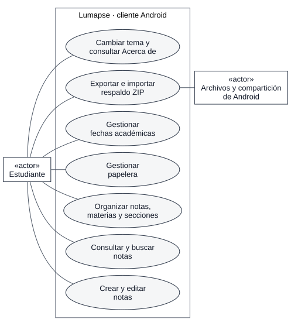
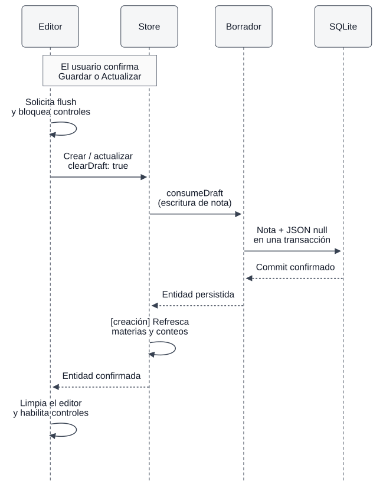
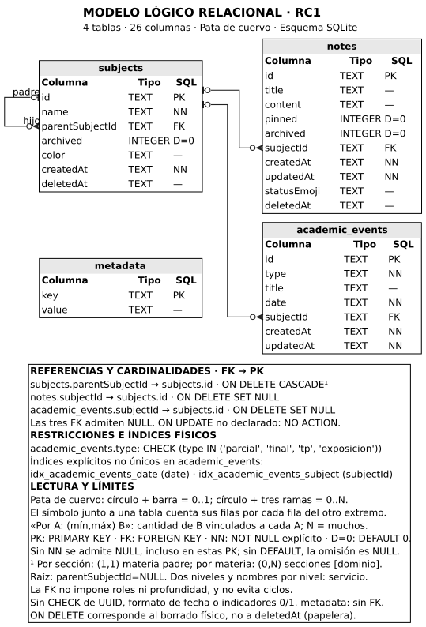
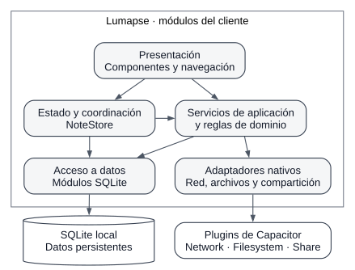

<!--
Generado por scripts/assemble-report.py. Editar las fuentes, no esta salida.
Estado: Documento completo para revisión — pendiente de aprobación final; Hito 06 activo
Corte documental: 2026-11-23
Alcance funcional: v0.6.0/600 — Release Candidate 1, validación parcial
Tag publicado: v0.6.0 / ac2a747
Fuente técnica: bcefe6a @ bcefe6a
-->

# Informe final — Lumapse

**Institución:** IES 6023 «Dr. Alfredo Loutaif»

**Carrera:** Tecnicatura en Análisis de Sistemas y Desarrollo de Software

**Cátedra:** Prácticas Profesionalizantes III

**Alumno:** José David Fernando Sandoval

**Año:** 2026

---

## Autoridades institucionales y responsables académicos

### Rectora

Prof. Andrea del Valle Gorena

### Responsable de la cátedra

Ing. Mauricio Parada

### Tutora

Prof. Melina Daiana Edith Jaquet

---

## Tabla de Contenidos

- [Capítulo 1: Introducción y Planteo del Problema](#capítulo-1-introducción-y-planteo-del-problema)
  - [1.1. Contexto del Proyecto](#11-contexto-del-proyecto)
  - [1.2. Planteo del Problema](#12-planteo-del-problema)
  - [1.3. Objetivos](#13-objetivos)
    - [1.3.1. Objetivo General](#131-objetivo-general)
    - [1.3.2. Objetivos Específicos](#132-objetivos-específicos)
  - [1.4. Justificación y Alcance](#14-justificación-y-alcance)
    - [1.4.1. Justificación académica y de producto](#141-justificación-académica-y-de-producto)
    - [1.4.2. Alcance funcional implementado](#142-alcance-funcional-implementado)
    - [1.4.3. Delimitaciones técnicas y funcionales](#143-delimitaciones-técnicas-y-funcionales)
    - [1.4.4. Corte de presentación y límites de la evidencia](#144-corte-de-presentación-y-límites-de-la-evidencia)
- [Capítulo 2: Marco Metodológico y Modelo de Negocio](#capítulo-2-marco-metodológico-y-modelo-de-negocio)
  - [2.1. Enfoque de Desarrollo y Gestión del Flujo (Kanban Adaptado)](#21-enfoque-de-desarrollo-y-gestión-del-flujo-kanban-adaptado)
    - [2.1.1. Justificación frente a Scrum y RUP](#211-justificación-frente-a-scrum-y-rup)
    - [2.1.2. Sistema de trabajo aplicado](#212-sistema-de-trabajo-aplicado)
    - [2.1.3. Medición y límite de la evidencia](#213-medición-y-límite-de-la-evidencia)
    - [2.1.4. Asistencia de inteligencia artificial](#214-asistencia-de-inteligencia-artificial)
  - [2.2. Análisis de Personas de Usuario](#22-análisis-de-personas-de-usuario)
  - [2.3. Análisis Competitivo](#23-análisis-competitivo)
  - [2.4. Lean Canvas](#24-lean-canvas)
    - [2.4.1. Recursos y costos del desarrollo](#241-recursos-y-costos-del-desarrollo)
  - [2.5. Historias de Usuario como Hipótesis de Valor (Lean UX)](#25-historias-de-usuario-como-hipótesis-de-valor-lean-ux)
    - [2.5.1. Formulación de historias como supuestos de diseño](#251-formulación-de-historias-como-supuestos-de-diseño)
    - [2.5.2. Contraste exploratorio de necesidades mediante la encuesta](#252-contraste-exploratorio-de-necesidades-mediante-la-encuesta)
    - [2.5.3. Revisión de decisiones a partir de necesidades y restricciones técnicas](#253-revisión-de-decisiones-a-partir-de-necesidades-y-restricciones-técnicas)
    - [2.5.4. Materialización en requisitos y código](#254-materialización-en-requisitos-y-código)
  - [2.6. Requisitos del Sistema](#26-requisitos-del-sistema)
    - [2.6.1. Requisitos Funcionales](#261-requisitos-funcionales)
    - [2.6.2. Requisitos No Funcionales](#262-requisitos-no-funcionales)
- [Capítulo 3: Relevamiento y Análisis de Datos](#capítulo-3-relevamiento-y-análisis-de-datos)
  - [3.1. Metodología de Recolección (Población y Muestra)](#31-metodología-de-recolección-población-y-muestra)
    - [3.1.1. Población de referencia y selección](#311-población-de-referencia-y-selección)
    - [3.1.2. Instrumento y ramificaciones](#312-instrumento-y-ramificaciones)
    - [3.1.3. Tratamiento y control de los datos](#313-tratamiento-y-control-de-los-datos)
  - [3.2. Análisis Demográfico](#32-análisis-demográfico)
  - [3.3. Resultados sobre Hábitos de Estudio y Toma de Notas](#33-resultados-sobre-hábitos-de-estudio-y-toma-de-notas)
    - [3.3.1. Método principal y dificultades](#331-método-principal-y-dificultades)
    - [3.3.2. Conectividad y características seleccionadas](#332-conectividad-y-características-seleccionadas)
    - [3.3.3. Utilidad percibida y disposición a una prueba](#333-utilidad-percibida-y-disposición-a-una-prueba)
    - [3.3.4. Dispositivo y organización preferidos](#334-dispositivo-y-organización-preferidos)
    - [3.3.5. Cruces descriptivos](#335-cruces-descriptivos)
  - [3.4. Análisis Cualitativo (Puntos de Dolor)](#34-análisis-cualitativo-puntos-de-dolor)
  - [3.5. Conclusiones del Relevamiento e Impacto en el Producto](#35-conclusiones-del-relevamiento-e-impacto-en-el-producto)
- [Capítulo 4: Arquitectura y Diseño](#capítulo-4-arquitectura-y-diseño)
  - [4.1. Decisiones arquitectónicas y evolución del diseño](#41-decisiones-arquitectónicas-y-evolución-del-diseño)
  - [4.2. Stack tecnológico y compromisos](#42-stack-tecnológico-y-compromisos)
  - [4.3. Modelo de dominio](#43-modelo-de-dominio)
  - [4.4. Casos de uso y frontera del sistema](#44-casos-de-uso-y-frontera-del-sistema)
  - [4.5. Secuencia de edición, guardado y recuperación](#45-secuencia-de-edición-guardado-y-recuperación)
  - [4.6. Diseño de interfaz y prioridad móvil](#46-diseño-de-interfaz-y-prioridad-móvil)
  - [4.7. Diseño de base de datos](#47-diseño-de-base-de-datos)
    - [4.7.1. Motor de persistencia](#471-motor-de-persistencia)
    - [4.7.2. Niveles de diseño y representaciones](#472-niveles-de-diseño-y-representaciones)
    - [4.7.3. Integridad y reglas de negocio](#473-integridad-y-reglas-de-negocio)
    - [4.7.4. Organización, archivo y borrador técnico](#474-organización-archivo-y-borrador-técnico)
    - [4.7.5. Normalización y persistencia del título](#475-normalización-y-persistencia-del-título)
  - [4.8. Patrones de arquitectura y diseño de software](#48-patrones-de-arquitectura-y-diseño-de-software)
    - [4.8.1. Responsabilidades y dirección de dependencias](#481-responsabilidades-y-dirección-de-dependencias)
    - [4.8.2. Patrones observables y grado de aplicación](#482-patrones-observables-y-grado-de-aplicación)
    - [4.8.3. Relación con MVC y límites de la clasificación](#483-relación-con-mvc-y-límites-de-la-clasificación)
    - [4.8.4. Frontera cliente y alcance offline](#484-frontera-cliente-y-alcance-offline)
- [Capítulo 5: Desarrollo e Implementación](#capítulo-5-desarrollo-e-implementación)
  - [5.1. Estructura del repositorio y entorno](#51-estructura-del-repositorio-y-entorno)
  - [5.2. Capa de presentación y edición](#52-capa-de-presentación-y-edición)
  - [5.3. Estado observable, filtros y operaciones asíncronas](#53-estado-observable-filtros-y-operaciones-asíncronas)
  - [5.4. Persistencia, continuidad y respaldo](#54-persistencia-continuidad-y-respaldo)
    - [5.4.1. Acceso SQLite y composición de operaciones](#541-acceso-sqlite-y-composición-de-operaciones)
    - [5.4.2. Borrador y confirmación explícita](#542-borrador-y-confirmación-explícita)
    - [5.4.3. Exportación e importación del conjunto de datos](#543-exportación-e-importación-del-conjunto-de-datos)
  - [5.5. Procesamiento de Markdown y seguridad de presentación](#55-procesamiento-de-markdown-y-seguridad-de-presentación)
  - [5.6. Empaquetado Android e identificación del artefacto](#56-empaquetado-android-e-identificación-del-artefacto)
  - [5.7. Licenciamiento y continuidad académica](#57-licenciamiento-y-continuidad-académica)
  - [5.8. Integración continua y control automatizado](#58-integración-continua-y-control-automatizado)
    - [5.8.1. Entorno y entrada común](#581-entorno-y-entrada-común)
    - [5.8.2. Controles y criterio de fallo](#582-controles-y-criterio-de-fallo)
    - [5.8.3. Relación entre automatización y aceptación](#583-relación-entre-automatización-y-aceptación)
- [Capítulo 6: Pruebas y Validación](#capítulo-6-pruebas-y-validación)
  - [6.1. Estrategia y criterios de interpretación](#61-estrategia-y-criterios-de-interpretación)
  - [6.2. Pruebas automatizadas e integración técnica](#62-pruebas-automatizadas-e-integración-técnica)
    - [6.2.1. Regresiones orientadas a riesgos](#621-regresiones-orientadas-a-riesgos)
    - [6.2.2. Resultados de los cortes y cobertura](#622-resultados-de-los-cortes-y-cobertura)
    - [6.2.3. Alcance de los controles de integración](#623-alcance-de-los-controles-de-integración)
  - [6.3. Evidencia Android, continuidad y actualización](#63-evidencia-android-continuidad-y-actualización)
    - [6.3.1. Antecedentes y funcionamiento offline](#631-antecedentes-y-funcionamiento-offline)
    - [6.3.2. Continuidad del borrador](#632-continuidad-del-borrador)
    - [6.3.3. Identidad y alcance de las pruebas de la versión 0.6.0 RC1](#633-identidad-y-alcance-de-las-pruebas-de-la-versión-060-rc1)
  - [6.4. Rendimiento, usabilidad y accesibilidad](#64-rendimiento-usabilidad-y-accesibilidad)
    - [6.4.1. Métricas medidas y métricas pendientes](#641-métricas-medidas-y-métricas-pendientes)
    - [6.4.2. Revisiones de interacción y presentación](#642-revisiones-de-interacción-y-presentación)
    - [6.4.3. Lighthouse y tratamiento de sus hallazgos](#643-lighthouse-y-tratamiento-de-sus-hallazgos)
    - [6.4.4. Prueba exploratoria voluntaria posterior al corte](#644-prueba-exploratoria-voluntaria-posterior-al-corte)
  - [6.5. Seguridad, privacidad y alcance de las auditorías](#65-seguridad-privacidad-y-alcance-de-las-auditorías)
  - [6.6. Síntesis del estado y límites de la entrega](#66-síntesis-del-estado-y-límites-de-la-entrega)
- [Capítulo 7: Conclusiones](#capítulo-7-conclusiones)
  - [7.1. Cumplimiento de los objetivos y alcance del resultado](#71-cumplimiento-de-los-objetivos-y-alcance-del-resultado)
  - [7.2. Lecciones aprendidas](#72-lecciones-aprendidas)
    - [7.2.1. Relacionar necesidades con decisiones sin confundir sus evidencias](#721-relacionar-necesidades-con-decisiones-sin-confundir-sus-evidencias)
    - [7.2.2. Usar estimaciones como hipótesis y registros como evidencia](#722-usar-estimaciones-como-hipótesis-y-registros-como-evidencia)
    - [7.2.3. Adaptar el entorno sin volver prescindibles los datos de prueba](#723-adaptar-el-entorno-sin-volver-prescindibles-los-datos-de-prueba)
    - [7.2.4. Separar implementación, verificación y aceptación](#724-separar-implementación-verificación-y-aceptación)
    - [7.2.5. Mantener trazabilidad sin confundir documentación con validación](#725-mantener-trazabilidad-sin-confundir-documentación-con-validación)
  - [7.3. Trabajo futuro y posibles mejoras](#73-trabajo-futuro-y-posibles-mejoras)
    - [7.3.1. Validación del núcleo y de los atributos de calidad](#731-validación-del-núcleo-y-de-los-atributos-de-calidad)
    - [7.3.2. Mantenimiento y protección de los datos](#732-mantenimiento-y-protección-de-los-datos)
    - [7.3.3. Opciones de evolución del producto](#733-opciones-de-evolución-del-producto)
  - [7.4. Cierre](#74-cierre)
- [Referencias](#referencias)
  - [8.1. Referencias metodológicas](#81-referencias-metodológicas)
  - [8.2. Normas y documentación técnica oficial](#82-normas-y-documentación-técnica-oficial)
  - [8.3. Bibliografía de apoyo y material de cátedra](#83-bibliografía-de-apoyo-y-material-de-cátedra)
  - [8.4. Fuentes primarias del proyecto](#84-fuentes-primarias-del-proyecto)

---

# Capítulo 1: Introducción y Planteo del Problema

## 1.1. Contexto del Proyecto

Desarrollé Lumapse, una aplicación de captura, organización y recuperación de notas de estudio, como proyecto integrador de Prácticas Profesionalizantes III de la Tecnicatura en Análisis de Sistemas y Desarrollo de Software del IES 6023 «Dr. Alfredo Loutaif». En este informe presento el análisis del problema, el relevamiento de necesidades, la definición de requisitos, el diseño de la solución, su implementación y las verificaciones documentadas. Mi propósito académico fue integrar esas actividades en un producto de software cuyo proceso de construcción y decisiones pudieran examinarse con evidencia.

Tomé como contexto inicial la comunidad estudiantil del instituto. Mi experiencia como estudiante y las conversaciones exploratorias con compañeros me llevaron a formular una primera hipótesis: capturar información durante la cursada no es suficiente si luego resulta difícil conservarla, organizarla o recuperarla cuando se necesita. Utilicé esos antecedentes para orientar el relevamiento, no como entrevistas sistemáticas ni como una medición de la frecuencia del problema. Por ello, distingo la observación inicial de los resultados de la encuesta posterior.

Delimité la propuesta al ciclo de capturar, organizar y volver a consultar apuntes. No busqué sustituir todas las herramientas de estudio ni demostrar, por la sola existencia de la aplicación, una mejora del aprendizaje. Prioricé el uso desde el celular, el almacenamiento local y la disponibilidad del núcleo funcional sin conexión. La rapidez de interacción y la facilidad de uso son objetivos sujetos a verificación, no propiedades que puedan presumirse a partir del diseño.

En el anteproyecto propuse una aplicación web progresiva —PWA, por sus siglas en inglés— con persistencia en IndexedDB, una tecnología de almacenamiento del navegador. Posteriormente adopté una aplicación Android híbrida: la interfaz, construida con tecnologías web, se ejecuta en una WebView dentro de un contenedor Capacitor y utiliza SQLite como base de datos local. El relevamiento respaldó las prioridades móvil y offline, pero no comparó PWA con APK ni evaluó motores de persistencia. Fundamenté la elección de la plataforma y del almacenamiento mediante el análisis técnico de alternativas registrado en las decisiones arquitectónicas ADR-005 y ADR-006, cuyo tratamiento corresponde al capítulo 4.

Para organizar el trabajo combiné prácticas de diseño centrado en las necesidades del usuario, hipótesis de producto y desarrollo iterativo e incremental. Utilicé Design Thinking para organizar los artefactos de comprensión y definición del problema; Lean UX para tratar los supuestos de valor; y un sistema basado en Kanban, adaptado al trabajo individual, para gestionar el flujo por unidades y revisar resultados por hitos. Estas prácticas cumplen funciones distintas y no las considero metodologías intercambiables. En el capítulo 2 desarrollo su aplicación y sus límites.

## 1.2. Planteo del Problema

El problema abordado es la dificultad declarada por una parte del público relevado para conservar y organizar sus notas de estudio, en un contexto donde el acceso estable a internet no está disponible de manera permanente para todas las personas participantes. La oportunidad no se fundamenta en la inexistencia de aplicaciones de notas: existen alternativas con diferentes combinaciones de almacenamiento local, sincronización, organización y complejidad. Lumapse explora una combinación deliberadamente limitada para el contexto institucional estudiado, sin afirmar superioridad general frente a esas herramientas.

Para contrastar los supuestos iniciales realicé un relevamiento mediante una encuesta autoadministrada entre el 11 y el 13 de mayo de 2026. Analicé 120 de las 121 respuestas recolectadas, tras excluir un registro que no cumplía el criterio poblacional definido. La unidad de análisis es la respuesta registrada: el archivo no permite comprobar que cada envío corresponda a una persona distinta. La selección fue no probabilística por conveniencia. Por tanto, los porcentajes siguientes describen las respuestas analizadas; no estiman con un margen de error efectivo la situación de todo el instituto ni de los estudiantes de nivel superior en general. En el capítulo 3 expongo el instrumento, el procesamiento y las limitaciones del relevamiento sobre hábitos y necesidades de toma de notas.

El cuaderno o papel apareció como método principal de toma de notas en 106 de las 120 respuestas (88,3 %). De las 115 que declararon tomar notas, 56 señalaron dificultades con su método actual (48,7 %). Dentro de ese subgrupo de 56, la pérdida de notas y la desorganización recibieron 33 selecciones cada una (58,9 % en ambos casos). La pregunta admitía selección múltiple: los dos porcentajes no describen grupos necesariamente distintos ni prueban una relación causal entre pérdida y desorganización.

La conectividad y el dispositivo preferido delimitan otras condiciones de diseño. Ante la pregunta por acceso estable a internet en el instituto, 98 de las 120 respuestas fueron «A veces», «Raramente» o «Nunca» (81,7 %). Esto expresa una frecuencia declarada de disponibilidad, no una medición técnica de la red. Por otra parte, el celular fue elegido como dispositivo de uso preferido para una aplicación de notas en 87 respuestas (72,5 %) y las carpetas por materia como forma de organización en 83 (69,2 %). Estos resultados respaldan priorizar una interfaz móvil, operaciones locales y organización académica por materias; no demuestran que una implementación concreta ya satisfaga esas necesidades.

En términos de análisis de sistemas, el desafío consiste en conectar tres momentos: registrar información durante la cursada, conservar el trabajo y localizarlo posteriormente mediante una organización comprensible. El diseño debe reducir la dependencia de conectividad para ese ciclo y proporcionar una salida de los datos que no obligue a permanecer en la aplicación. En consecuencia, planteé la siguiente pregunta como guía del proyecto:

> ¿Cómo diseñar e implementar una aplicación móvil de notas que permita capturar, organizar y recuperar información de estudio sin depender de una conexión permanente, atendiendo las necesidades declaradas por los estudiantes relevados y las restricciones de un proyecto académico individual?

El relevamiento aporta un fundamento para desarrollar y examinar esa propuesta, no una prueba de adopción ni de eficacia del producto terminado. Tampoco permite atribuir a toda la población una preferencia por Markdown, por SQLite o por la instalación directa de un APK. Esas decisiones pertenecen al diseño técnico; su viabilidad y las condiciones de uso deben distinguirse del interés declarado en una encuesta.

## 1.3. Objetivos

Formulé los objetivos siguientes a partir del propósito de captura y gestión local de notas del anteproyecto, ajustándolos al alcance resultante de las decisiones documentadas. Con esta formulación explicito la evolución desde la propuesta PWA inicial hacia Android con SQLite, sin reemplazar retroactivamente el anteproyecto presentado. Los objetivos indican qué procuré obtener; su grado de cumplimiento debe juzgarse mediante los resultados y limitaciones de los capítulos de implementación, validación y conclusiones.

### 1.3.1. Objetivo General

Diseñar, implementar y documentar una aplicación Android de captura, organización y recuperación de notas de estudio, con funcionamiento prioritariamente local y sin conexión, fundamentada en el relevamiento del contexto estudiantil del IES 6023 y en un proceso trazable de análisis, diseño, desarrollo y verificación de software.

### 1.3.2. Objetivos Específicos

1. Relevar y analizar hábitos, dificultades y preferencias de los estudiantes participantes, explicitando el instrumento, las bases de cálculo y los límites de la evidencia obtenida.
2. Traducir las necesidades y restricciones identificadas en requisitos funcionales, atributos de calidad, historias de usuario y decisiones de producto con criterios de aceptación rastreables.
3. Diseñar y justificar una arquitectura modular con persistencia local, diferenciando las necesidades respaldadas por el relevamiento de las decisiones técnicas de plataforma y almacenamiento.
4. Implementar la creación, edición, lectura, búsqueda y organización de notas en texto plano y Markdown, con materias y secciones como estructura académica principal.
5. Incorporar mecanismos de continuidad y recuperación: borradores persistentes, guardado explícito, archivo, papelera y respaldo e importación manual del espacio de trabajo, con límites definidos para cada mecanismo.
6. Empaquetar y distribuir un artefacto Android identificable, y documentar las verificaciones automatizadas y en dispositivo con sus métodos, resultados, versiones y cobertura, sin presentar como cumplidos los criterios no medidos.
7. Mantener evidencia versionada de la evolución del proyecto —requisitos, decisiones, hitos, código, pruebas e informe— que permita reconstruir y evaluar el trabajo realizado.

## 1.4. Justificación y Alcance

### 1.4.1. Justificación académica y de producto

La justificación académica reside en abordar un problema de software de manera integral, en lugar de limitar la entrega a una interfaz funcional. Relacioné necesidades de usuarios con requisitos, modelos, decisiones arquitectónicas, persistencia, implementación, pruebas y documentación. En los registros de decisiones arquitectónicas —ADR— documenté las razones y consecuencias de las elecciones técnicas; los requisitos, informes de hito y el historial de versiones permiten contrastar lo planificado con lo implementado y verificado.

Desde la perspectiva de producto, el valor propuesto es disponer de apuntes organizados para su consulta en el contexto relevado, sin exigir una cuenta ni una conexión para las operaciones locales principales. La ausencia de backend propio y el almacenamiento en el dispositivo acotan las dependencias del núcleo de la aplicación. No constituyen, sin embargo, una garantía absoluta de privacidad o conservación: la pérdida del teléfono, la desinstalación y la gestión de copias externas siguen siendo riesgos que deben comunicarse. Una exportación iniciada por el usuario puede entregar el archivo a otra aplicación o servicio elegido por él.

La organización por materias responde a una preferencia declarada de la muestra; la persistencia local y el respaldo atienden la necesidad de conservar información. Markdown se utiliza como texto plano con marcas de formato y permite incluir notas legibles fuera de Lumapse dentro del respaldo. Estas decisiones buscan mantener un alcance comprensible y portabilidad de los contenidos. Su pertinencia no demuestra por sí sola satisfacción sostenida, demanda comercial o una mejora del desempeño académico.

### 1.4.2. Alcance funcional implementado

Definí el alcance mediante requisitos funcionales y criterios de aceptación, cuyo análisis presento en la sección 2.6.1 y cuya implementación desarrollo en el capítulo 5. Las funcionalidades implementadas comprenden:

- **Captura y lectura de notas:** creación y edición de título y contenido, texto plano o Markdown, previsualización sanitizada y herramientas opcionales de formato e inserción. Markdown no es un requisito para comenzar a escribir.
- **Continuidad del trabajo:** conservación local de un borrador del editor, diferenciada de la nota confirmada. Crear o actualizar una nota requiere una acción explícita; recuperar un borrador no equivale a haber guardado una nueva nota definitiva.
- **Organización y recuperación:** materias y secciones, búsqueda por título y contenido, fijación, archivo, marcadores visuales de estado académico y papelera con restauración y eliminación permanente. La papelera no reemplaza a una copia de seguridad externa.
- **Fechas académicas puntuales:** registro de parciales, finales, trabajos prácticos y exposiciones, con asociación opcional a materia o sección. Son recordatorios visuales pasivos, no una agenda con horarios, recurrencias o notificaciones.
- **Respaldo y portabilidad manual:** exportación del espacio de trabajo en ZIP con manifiesto, datos estructurados y notas Markdown legibles; importación de ZIP generado por Lumapse, con validación previa, vista de los elementos a importar, tratamiento no destructivo de duplicados y escritura transaccional. El ZIP no incluye borradores ni elementos en papelera y no es una imagen completa de todo el estado de la aplicación.
- **Interfaz e identificación:** temas claro y oscuro y una sección «Acerca de» con información del producto y de la compilación, además de los controles de navegación asociados a los flujos anteriores.

Esta enumeración describe funcionalidades presentes, no certifica que cada recorrido haya sido probado sobre todo dispositivo o sobre cada binario distribuido. La separación entre implementación y verificación es necesaria para interpretar el alcance de la entrega.

### 1.4.3. Delimitaciones técnicas y funcionales

El producto presentado es una aplicación Android distribuida como paquete instalable APK. Adopté un monolito modular cliente con separación pragmática de responsabilidades, no un sistema cliente-servidor ni una aplicación completamente escrita con interfaces nativas de Android. El entorno web con SQLite/WebAssembly se conserva para desarrollo y pruebas auxiliares; no constituye un canal PWA soportado ni una entrega para escritorio o iOS. Formalicé esta clasificación y sus límites en ADR-008; en la sección 4.8 analizo los patrones y las fronteras de la arquitectura.

Quedan fuera del corte la sincronización automática entre dispositivos, el backend multiusuario, la colaboración en tiempo real, el respaldo automático en la nube, la integración directa con la API de Google Drive, los adjuntos multimedia y una agenda académica completa. También se encuentran postergadas la acción de compartir una nota individual y la importación individual de archivos Markdown. La existencia de notas legibles dentro del ZIP no implica que esos flujos individuales estén disponibles.

La distribución mediante tiendas de aplicaciones, el uso autónomo del canal de instalación por nuevos estudiantes y la extensión a otras instituciones requieren decisiones o validaciones propias. No los considero demostrados por la viabilidad técnica del APK ni por la intención declarada de probar el prototipo. Mantengo los trabajos excluidos y sus condiciones de eventual revisión como trabajo futuro, tratado en la sección 7.3, sin incorporarlos automáticamente a esta entrega.

### 1.4.4. Corte de presentación y límites de la evidencia

Fijé como corte de presentación **Lumapse 0.6.0, código Android 600, Release Candidate 1 (RC1)**, publicado como versión preliminar el 22 de octubre de 2026. Adopté este candidato con validación parcial y con las limitaciones de cobertura expresamente reconocidas. El APK procede del commit de código fuente `bcefe6a`; la etiqueta de versión `v0.6.0` apunta a `ac2a747`, que incluye la integración posterior. No son identificadores intercambiables. La firma, la huella criptográfica y las comprobaciones del binario forman parte de su registro de identificación y de la evidencia que corresponde desarrollar en el capítulo 6. Conservo las betas `v0.4.8` y `v0.5.0` como antecedentes, sin atribuir automáticamente sus resultados a la versión 0.6.0 RC1.

Al evaluar la evidencia, distingo controles sobre el código fuente, pruebas automatizadas y recorridos en un dispositivo y artefacto identificados. La existencia de una funcionalidad, una compilación correcta o una aceptación general de la entrega no equivalen a una verificación exhaustiva. Las métricas de latencia de operaciones, fluidez con 500 notas y tiempo de primera nota de un usuario nuevo conservan sus estados pendientes: corresponden a los requisitos no funcionales RNF-002, RNF-004 y RNF-005, respectivamente. En el capítulo 6 se trata el alcance de su verificación. No considero demostrado un rendimiento óptimo ni facilidad de uso sin las mediciones correspondientes.

Para acotar el cierre académico, decidí congelar el desarrollo y las nuevas comprobaciones de la aplicación hasta después de la presentación. Diferí los recorridos restantes del núcleo offline, organización y búsqueda, fechas, ZIP y tráfico sobre el APK exacto, sin considerarlos aprobados. En este informe utilizo la evidencia existente con sus límites; no presento la entrega como una versión estable ni supongo ausencia de defectos. Esta delimitación permite evaluar el trabajo efectivamente realizado, las decisiones que fundamenté y los aspectos que todavía requieren evidencia.

---

# Capítulo 2: Marco Metodológico y Modelo de Negocio

En este capítulo explico cómo organicé el desarrollo y cómo relacioné las necesidades iniciales con las decisiones de producto y los requisitos. Distingo la gestión del trabajo, el análisis de usuarios y las hipótesis de valor: cumplen funciones complementarias, pero no constituyen una única metodología ni producen el mismo tipo de evidencia.

## 2.1. Enfoque de Desarrollo y Gestión del Flujo (Kanban Adaptado)

Desarrollé Lumapse de forma iterativa e incremental: construí funcionalidades acotadas, revisé su comportamiento y ajusté prioridades y decisiones a medida que avanzaba el proyecto. Para gestionar ese trabajo adopté un sistema basado en Kanban, adaptado a un desarrollo individual y formalizado en ADR-003. El enfoque incremental describe la evolución del producto; Kanban organiza el flujo de las unidades de trabajo.

Los hitos funcionaron como puntos académicos de revisión, entrega y establecimiento de líneas base, no como Sprints. El cronograma inicial y las fechas de cierre registran planificación y evolución del proyecto, sin convertir los hitos en iteraciones de duración fija.

Complementé la gestión con artefactos de Design Thinking para organizar la comprensión del contexto, la definición del problema y las alternativas de solución. Como marco para interpretar esas actividades, Doorley et al. (2018) distinguen empatizar, definir, idear, prototipar y probar, sin imponer un recorrido lineal. En Lumapse, las personas y la encuesta ayudaron a formular y contrastar necesidades; el planteo del problema, el análisis competitivo y el Lean Canvas permitieron delimitar la propuesta. El prototipo evolucionó hacia las betas y la versión 0.6.0 RC1; esa evolución técnica no demuestra que se haya completado una validación sistemática de uso con el público objetivo.

### 2.1.1. Justificación frente a Scrum y RUP

La elección no se basó en una prohibición numérica de Scrum para proyectos individuales. Schwaber y Sutherland (2020) describen equipos de diez personas o menos como situación típica, sin fijar un mínimo explícito. Sin embargo, Scrum define responsabilidades, Sprints, eventos, artefactos y compromisos que deben reconocerse en su aplicación. No organicé Lumapse mediante ese conjunto: utilizar historias de usuario o estimaciones relativas no basta para afirmar que apliqué Scrum.

Tampoco seguí Rational Unified Process —RUP—, que organiza el ciclo de desarrollo en Inicio, Elaboración, Construcción y Transición, con disciplinas y artefactos adaptables (IBM, s. f.). Produje requisitos, casos de uso y modelos de arquitectura por su utilidad técnica y académica, pero no estructuré la gestión según esas fases. La presencia de diagramas UML no identifica por sí sola el proceso utilizado.

Coleman y Vacanti (2025) presentan Kanban como una estrategia de optimización del flujo de valor que combina definición y visualización del flujo, gestión activa de los elementos y mejora del sistema. Esa orientación resultó compatible con reordenar prioridades y terminar unidades pequeñas sin simular responsabilidades o ceremonias de un equipo inexistente. Es una elección contextual, no una afirmación de superioridad general.

### 2.1.2. Sistema de trabajo aplicado

La definición de flujo formalizada en Hito 06 establece cuatro estados:

> Backlog → En Curso → En Revisión → Hecho

Un elemento representa un objetivo concreto con salida verificable, dependencias y criterio de cierre. Comienza cuando pasa a En Curso y termina cuando satisface ese criterio; permanecer En Revisión significa que todavía consume capacidad. Una funcionalidad redactada o implementada no se considera terminada sólo por existir un commit.

El límite global de trabajo en curso —WIP— es de dos elementos entre En Curso y En Revisión, con una política más restrictiva de una sola rama de tarea activa. Seleccioné trabajo mediante un sistema de arrastre o *pull*, priorizando cerrar lo iniciado. Un bloqueo conserva su condición de trabajo en curso, sin liberar capacidad artificialmente.

La prioridad atiende riesgos de pérdida de datos, bloqueos de entrega, evidencia necesaria, dependencias y valor funcional. La definición asigna a GitHub Projects la vista del flujo; los tableros, ADR, informes de hito y el historial Git conservan evidencia complementaria. Un commit o PR permite rastrear cambios, pero no sustituye aceptación ni acredita pruebas por sí solo.

### 2.1.3. Medición y límite de la evidencia

Para la estimación y el seguimiento utilicé como apoyo la obra de Gómez (2014) y la guía didáctica de Parada (2026), elaborada por el Ing. Mauricio Parada, profesor responsable de la cátedra Prácticas Profesionalizantes III. Distingo la obra publicada de ese material de enseñanza, que relaciona la bibliografía con las actividades del proyecto.

Estimé las historias mediante tamaño relativo en Story Points —SP—, utilizando juicio individual y una escala de Fibonacci. Tomé HU-001, crear una nota rápida, como referencia de 2 SP. En comparación, asigné 8 SP a HU-017, organización por materias y secciones, porque reúne jerarquía, validaciones, asociación de notas y filtrado. Los puntos expresan complejidad relativa, no horas de trabajo ni una proporción comprobada entre las duraciones de desarrollo.

Para los riesgos de integración de Capacitor y migración a SQLite documenté escenarios optimista —O—, más probable —M— y pesimista —P—. Para combinarlos utilicé la ponderación PERT, que da mayor peso al escenario más probable: `E = (O + 4 × M + P) / 6`. En Capacitor, los escenarios de 3, 7 y 14 días producen una estimación de 7,5 días; en SQLite, los de 2, 5 y 10 producen aproximadamente 5,33 días. El cronograma registra 8 y 6 días tras redondear cada módulo hacia arriba: los 14 días resultantes son planificación, no duración real observada. La sección 7.2.2 retoma las limitaciones de este registro al evaluar lo aprendido.

El seguimiento por hitos registra Story Points asociados al alcance entregado e incorpora reclasificaciones de historias. Por esas modificaciones, no lo presento como una comparación inalterada entre el plan inicial y lo entregado. Tampoco equiparo los puntos con el *throughput* de Kanban, que cuenta elementos terminados, ni con el tiempo de ciclo. Los escenarios de estimación no son intervalos empíricos de cumplimiento.

La guía de Kanban identifica cuatro métricas mínimas: WIP, cantidad de elementos terminados por unidad de tiempo, edad de los elementos aún activos y tiempo de ciclo de los finalizados (Coleman y Vacanti, 2025). No dispongo de fechas completas y confiables para calcularlas retrospectivamente sobre todo el proyecto. La formalización de su registro en Hito 06 no demuestra que se hayan medido durante las etapas anteriores.

La definición de flujo incorpora una expectativa de nivel de servicio provisional: 85 % de los elementos en siete días calendario o menos, a recalibrar con al menos cinco elementos con fechas confiables. No es cumplimiento observado. Por estas limitaciones, describo el proceso como basado en Kanban y adaptado al contexto individual, sin afirmar conformidad histórica completa.

### 2.1.4. Asistencia de inteligencia artificial

Me apoyé en herramientas de inteligencia artificial durante el desarrollo incremental: inicialmente utilicé Antigravity y posteriormente modelos de OpenAI. Esa asistencia acompañó el trabajo sobre funcionalidades, correcciones y scripts de automatización; no constituye una metodología independiente ni una garantía de corrección. La definición del problema, el alcance y las decisiones aceptadas permanecen bajo mi responsabilidad. No considero validada una propuesta por provenir de un modelo: su fundamento debe examinarse mediante los requisitos, las decisiones y las verificaciones documentadas en los capítulos 4 a 6.

## 2.2. Análisis de Personas de Usuario

Formulé tres personas a partir de mi experiencia en el contexto académico, la observación y conversaciones informales. Son arquetipos de diseño, no participantes identificados en una investigación ni entrevistas sistemáticas. Sus nombres, biografías y citas sintéticas ayudan a representar necesidades; no deben interpretarse como testimonios recolectados.

**Tabla 2-1. Arquetipos y necesidades consideradas en el diseño**

| Arquetipo | Papel en el análisis | Necesidad que orienta el diseño |
|---|---|---|
| Lucía, estudiante organizada | Usuaria primaria, sin exigir conocimientos técnicos | Capturar y recuperar apuntes, disponer de ellos sin red y organizarlos por materia |
| Martín, estudiante práctico | Perfil con familiaridad técnica | Trabajar con Markdown y conservar control y portabilidad de sus contenidos |
| Prof. Ramos, docente evaluador | Parte interesada académica, no segmento comercial demostrado | Comprender el proceso y examinar una entrega identificable con decisiones y evidencia |

*Nota.* Elaboración propia a partir de las personas de diseño del proyecto; no representa testimonios ni perfiles validados mediante entrevistas.

Utilicé los perfiles como preguntas de diseño: si puede escribirse sin aprender Markdown, cómo recuperar un apunte o qué evidencia necesita quien evalúa la entrega. El relevamiento permitió contrastar atributos generales, como preferencia móvil y organización por materia, pero no valida cada biografía ni la satisfacción de los arquetipos mediante uso del prototipo.

## 2.3. Análisis Competitivo

El análisis competitivo documentado incluyó herramientas como Google Keep, Notion, Obsidian, OneNote, Simplenote y Joplin, entre otras. Comparó disponibilidad sin red, necesidad de cuenta, portabilidad, formato de notas, tamaño, costo, alcance entre dispositivos y rapidez de acceso. Esos criterios permitieron ordenar alternativas relevantes para el contexto de diseño.

La matriz conserva apreciaciones del relevamiento competitivo original, sin una revalidación actual de las versiones, planes o dispositivos comparados. Por ello, no reproduzco sus precios, tamaños y tiempos de arranque como mediciones vigentes, ni utilizo sus calificaciones para afirmar que las demás herramientas requieren conexión permanente. Existen alternativas locales y con Markdown; su presencia impide justificar Lumapse por una supuesta ausencia de soluciones.

El posicionamiento buscado es una combinación acotada: captura de apuntes, organización académica, almacenamiento local, ausencia de cuenta obligatoria y respaldo manual. No equivale a mayor potencia, mejor rendimiento o superioridad de usabilidad frente a productos maduros. La distribución vigente es Android; una interfaz adaptable y una base de código web no constituyen una entrega soportada para escritorio o para múltiples plataformas.

El contraste me permitió delimitar qué conservar y qué no intentar reproducir: prioricé la captura local y la salida de los datos, una organización por materias y secciones y un alcance sin colaboración ni sincronización automática. Desarrollar una solución propia respondió también al objetivo formativo de recorrer el proceso completo de ingeniería, no a haber demostrado que ninguna herramienta existente pudiera utilizarse para estudiar.

## 2.4. Lean Canvas

El Lean Canvas, creado por Ash Maurya como adaptación del Business Model Canvas, permite representar en una página los supuestos principales de una propuesta de producto (Maurya, 2024). Su utilidad reside en hacerlos explícitos para examinarlos, no en convertirlos en hechos por completar el esquema.

Elaboré el Lean Canvas como ejercicio de diseño de producto previo al relevamiento. Su función fue relacionar problema, destinatarios, propuesta de valor, solución y condiciones de sostenibilidad, no acreditar un negocio validado. La formulación inicial contemplaba PWA, IndexedDB y un posible empaquetado mediante TWA; esos elementos quedaron reemplazados por las decisiones técnicas ADR-005 y ADR-006.

La tabla 2-2 sintetiza esos supuestos y su relación con el alcance actual; no reproduce el canvas inicial como si todas sus decisiones siguieran vigentes.

**Tabla 2-2. Síntesis de los bloques del Lean Canvas y su evolución en Lumapse**

| Bloque | Aplicación y límite en Lumapse |
|---|---|
| Problema | Pérdida, desorganización y conectividad como cuestiones investigadas; la encuesta describe la muestra, no demuestra causalidad |
| Segmentos | Público estudiantil institucional; extensión a otros contextos todavía hipotética |
| Propuesta de valor | Notas locales sin cuenta; sin garantía absoluta de privacidad o conservación |
| Solución | Captura, organización y consulta en Android con Capacitor y SQLite, dentro del alcance delimitado |
| Canales | APK publicado en GitHub Releases; aceptación del canal por nuevos estudiantes no medida |
| Métricas clave | Primera nota, satisfacción y retención propuestas, sin resultados de uso sostenido acreditados |
| Costos | Menor dependencia de servidores; desarrollo, mantenimiento y distribución no se vuelven gratuitos por ello |
| Ingresos | Modalidades y precios hipotéticos, sin ventas, disposición a pagar o rentabilidad demostradas |
| Ventaja propuesta | Cercanía al contexto como acceso inicial al problema, no como barrera competitiva demostrada |

*Nota.* Elaboración propia a partir del canvas inicial y las decisiones posteriores de producto y arquitectura; canales, ingresos y metas no constituyen resultados comerciales.

La síntesis «Tus notas. En tu equipo. Sin cuenta. Sin internet.» expresa esa orientación con los límites del capítulo 1: el respaldo externo requiere una acción deliberada y la pérdida del dispositivo o la desinstalación siguen siendo riesgos. Portabilidad no equivale a sincronización ni a recuperación garantizada de todo el estado.

El canvas hace visibles los supuestos; no presento una validación económica integral ni un estudio de retención. Sus metas iniciales no reemplazan requisitos medibles ni resultados de usuario.

### 2.4.1. Recursos y costos del desarrollo

Distingo los desembolsos personales, los accesos bonificados y el trabajo no valorizado. Utilicé una suscripción personal de ChatGPT de USD 20 mensuales, cuyo inicio sitúo aproximadamente en abril de 2026. La destiné en gran medida a Lumapse y su mantenimiento, pero también a otros proyectos; por ello, la cuota no representa un costo mensual exclusivo de Lumapse.

Durante el primer mes de desarrollo utilicé Antigravity, una herramienta de programación del ecosistema de Google, mediante el acceso al plan Google AI Pro. Su valor de referencia era de aproximadamente USD 20 mensuales, pero recibí una bonificación por un año por mi condición de estudiante y no realicé ese desembolso.

Google AI Pro es un plan de acceso a servicios del ecosistema de Google, no una licencia exclusiva de Antigravity. Distingo así las suscripciones de las herramientas de programación y de los modelos que estas utilizan. La modalidad gratuita de Antigravity tiene mayores restricciones que los planes de pago; la disponibilidad concreta de modelos y las cuotas dependen del plan y de las condiciones de acceso, incluidas las promociones.

**Tabla 2-3. Recursos utilizados y condiciones del desembolso personal**

| Recurso | Desembolso personal | Condición de uso |
|---|---|---|
| Suscripción de ChatGPT (OpenAI) | USD 20 mensuales | Suscripción compartida con otros proyectos, sin un porcentaje de imputación registrado |
| Google AI Pro | USD 0 | Plan bonificado por un año mediante una promoción estudiantil personal; Antigravity utilizado durante el primer mes de desarrollo |
| Dominio `.tech` | USD 0 | Beneficio personal de GitHub Student Developer Pack, no una compra del proyecto |

*Nota.* Registro propio de recursos y desembolsos declarados; no es una valoración del costo total ni una imputación exclusiva a Lumapse.

Estos recursos apoyan el desarrollo y la difusión; su contratación no es un requisito para utilizar el núcleo local del APK. El trabajo se realizó sin horario fijo y no dispongo de un registro completo de horas para valorizarlo, como explico en la sección 7.2.2. El cuadro no constituye un presupuesto integral: no calculo un total exclusivo a partir de cuotas compartidas ni sumo precios comerciales de recursos que recibí bonificados. Un desembolso nulo tampoco demuestra que su continuidad esté financiada, cuestión retomada en la sección 7.3.2.

## 2.5. Historias de Usuario como Hipótesis de Valor (Lean UX)

Las historias expresan una necesidad y un beneficio esperado desde la perspectiva del usuario. Contienen supuestos de valor, mientras sus criterios de aceptación delimitan comportamientos verificables. Una historia no es, por sí sola, un experimento ni una hipótesis contrastada.

Esta separación es coherente con la orientación de Lean UX hacia supuestos, hipótesis, experimentación y aprendizaje a partir de usuarios, desarrollada por Gothelf y Seiden (2013). En Lumapse distingo el contraste exploratorio de necesidades, las decisiones de diseño y la verificación del software. No presento la existencia de esos artefactos como demostración de haber aplicado íntegramente un programa experimental de Lean UX.

Los apartados siguientes organizan el razonamiento aplicado en Lumapse, desde el supuesto hasta su implementación. No constituyen fases prescritas de Lean UX ni implican que cada actividad se haya realizado una única vez y en ese orden.

### 2.5.1. Formulación de historias como supuestos de diseño

Las personas, el contexto y las restricciones sirvieron para formular necesidades con la estructura «Como [rol], quiero [acción], para [beneficio]». Organizar apuntes por materia expresa una necesidad; elegir una tabla relacional o limitar la profundidad son decisiones de solución. Esta separación permitió revisar supuestos, como priorizar etiquetas, sin tratar las primeras historias como compromisos inmodificables.

### 2.5.2. Contraste exploratorio de necesidades mediante la encuesta

El relevamiento reunió 121 respuestas y permitió analizar 120 después de aplicar el criterio de exclusión. Su selección fue no probabilística por conveniencia. La unidad de análisis es la respuesta registrada, sin comprobar identidades únicas. Los resultados siguientes describen esa base y orientan decisiones; no prueban eficacia del prototipo ni representan una estimación inferencial de toda la población. El capítulo 3 desarrolla el instrumento y sus limitaciones.

**Tabla 2-4. Resultados del relevamiento que orientaron decisiones de producto**

| Cuestión examinada | Evidencia declarada, base de 120 respuestas | Implicación y límite |
|---|---|---|
| Disponibilidad de conexión | En P6, 98 respuestas fueron «A veces», «Raramente» o «Nunca» (81,7 %); en P8, el funcionamiento sin internet recibió 89 selecciones (74,2 %) | Priorizar operaciones locales y su verificación; no es una medición técnica de la red |
| Dispositivo preferido | En P9, el celular recibió 87 selecciones (72,5 %) | Priorizar el diseño móvil; no decide entre PWA y APK |
| Organización principal | En P11, las carpetas por materia recibieron 83 selecciones (69,2 %) y las etiquetas, 24 (20,0 %) | Priorizar materias sin afirmar que las etiquetas carezcan de valor |
| Protección de la escritura | En P8, la opción de guardado automático recibió 63 selecciones (52,5 %) | Investigar continuidad del trabajo; no demuestra preferencia por guardar notas definitivas sin confirmación |

*Nota.* Elaboración propia a partir del relevamiento de mayo de 2026 (Sandoval, 2026b). Cada porcentaje usa como denominador las 120 respuestas analizadas; P8 admite selección múltiple.

P8 indicaba un máximo de tres opciones, pero se registraron 371 marcas y 37 respuestas con cuatro a seis selecciones. Sus porcentajes son frecuencias descriptivas sobre las respuestas analizadas, no un ranking de elección forzada uniforme. La tabla no transforma esas selecciones en requisitos aprobados automáticamente.

La pregunta sobre utilidad combinaba aplicación web, gratuidad, ausencia de cuenta y toma de notas: 97 de las 120 respuestas la valoraron con cuatro o cinco puntos (80,8 %). No permite aislar el atractivo de un atributo ni demostrar intención de pago, adopción real o aceptación de un APK. La disposición declarada a probar un prototipo tampoco equivale a participación efectiva.

### 2.5.3. Revisión de decisiones a partir de necesidades y restricciones técnicas

La preferencia por materias llevó a revisar el protagonismo inicial de las etiquetas y quedó reflejada en DP-002 y DP-004. La solución incorpora Entrada, Materias y Archivo, con materias y secciones opcionales. La encuesta no evaluó esa nomenclatura, el límite de dos niveles ni el recorrido: son decisiones de diseño, no resultados de P11.

La prioridad móvil y offline orientó también la comparación de alternativas técnicas. Adopté Android con Capacitor para reutilizar la interfaz web existente sin una reescritura completa, y SQLite nativo para separar la persistencia del almacenamiento administrado por el navegador. A cambio, asumí la configuración y el mantenimiento del entorno de compilación Android y una distribución mediante APK cuya aceptación por usuarios nuevos no estaba medida; el navegador quedó como entorno auxiliar, no como canal de producto soportado. ADR-005 y ADR-006 registran ese análisis, desarrollado en el capítulo 4. El cuestionario no comparó motores de base de datos ni canales de instalación: no atribuyo a los estudiantes una elección de SQLite o del formato APK.

Otra revisión relevante fue la de RF-005: la protección del trabajo en curso se concretó como borrador persistente, manteniendo una acción explícita para crear o actualizar la nota definitiva. El criterio fue conservar la escritura en curso sin confundirla con una nota confirmada ni sobrescribir silenciosamente la versión guardada durante una edición. Esta solución distingue una necesidad de continuidad de una interpretación literal de «guardado automático». La encuesta no demuestra que el mecanismo elegido resulte comprendido por todos los usuarios.

### 2.5.4. Materialización en requisitos y código

La trazabilidad relaciona necesidad, decisión, historia, requisito, criterio de aceptación, implementación y evidencia. Una prueba o restricción técnica puede obligar a revisar esa relación, como permite examinar el caso de organización por materias.

**Tabla 2-5. Ejemplo de trazabilidad de la organización por materias y secciones**

| Eslabón | Correspondencia documentada |
|---|---|
| Necesidad | Preferencia de P11 por carpetas por materia |
| Decisiones | DP-002 define la navegación; DP-004 delimita materias y secciones |
| Historia y requisito | HU-017 reúne creación, asociación y filtrado; RF-014 identifica el filtrado por materia y sección |
| Criterios de aceptación | HU-017: creación hasta dos niveles (CA-01), filtrado (CA-03), asociación de notas (CA-04) y persistencia de la jerarquía (CA-05) |
| Implementación | Servicio de materias, estado de notas, interfaz de organización y acceso SQLite |
| Evidencia técnica | Pruebas existentes de validación de profundidad y operaciones de materias, junto con los controles documentados |

*Nota.* Elaboración propia a partir de P11, DP-002/004, HU-017, RF-014 y la implementación; la correspondencia no acredita por sí sola validación de uso.

La prueba de profundidad comprueba una regla del software, no su preferencia entre estudiantes. La auditoría documental detecta referencias incoherentes, pero no verifica facilidad de uso ni cobertura completa de un binario. El diseño corresponde al capítulo 4; la implementación, al 5; las pruebas, al 6.

## 2.6. Requisitos del Sistema

Organicé los requisitos en funcionales —qué debe permitir el sistema— y no funcionales —qué atributos y condiciones de calidad deben verificarse—. Sus identificadores permiten seguir cambios de alcance sin borrar la formulación histórica. La prioridad expresa importancia para la entrega, no evidencia de cumplimiento.

### 2.6.1. Requisitos Funcionales

El catálogo conserva 28 RF. En el corte documental vigente, 21 figuran implementados, uno verificado, cuatro postergados y dos obsoletos por el cambio de arquitectura. Mantener esas categorías evita contar una función excluida como pendiente accidental o presentar como implementado un requisito de la antigua PWA.

Los RF abarcan notas y borradores, persistencia, Markdown, organización, fechas puntuales, interfaz e identificación y respaldo/importación ZIP. La sección 1.4.2 delimita esas funciones; no incluyen sincronización, agenda completa ni una copia exacta de todo el estado del dispositivo.

Los cuatro RF postergados son conteo de palabras y caracteres (RF-006), compartir o exportar una nota individual (RF-016), bienvenida inicial (RF-022) e indicador global de conexión (RF-024). Service Workers (RF-009) e instalación PWA (RF-021) quedaron obsoletos. En cambio, el ZIP del espacio de trabajo (RF-017 y RF-018) es distinto del flujo individual postergado. Los estados de implementación no certifican todos los recorridos de la versión 0.6.0 RC1 publicada.

### 2.6.2. Requisitos No Funcionales

El catálogo reúne 26 RNF sobre rendimiento, usabilidad, disponibilidad y confiabilidad, seguridad y privacidad, portabilidad, accesibilidad y mantenibilidad. Cada requisito debe relacionarse con una métrica, un método y evidencia identificable; una propiedad deseada no se demuestra mediante una descripción de arquitectura.

La revisión distingue evidencia verificada en su alcance, evidencia parcial, mediciones pendientes y criterios obsoletos o no aplicables al APK. Por ejemplo, una comprobación de disponibilidad en un debug identificado no se atribuye automáticamente a otro binario; los controles de HTTPS del hosting tampoco equivalen a controles del runtime local Android.

Tres métricas conservan su estado pendiente y sus umbrales:

**Tabla 2-6. Métricas no funcionales pendientes y límites de su evidencia**

| Requisito | Criterio | Límite actual |
|---|---|---|
| RNF-002 | Latencia de crear, editar o eliminar notas ≤ 200 ms | Sin muestras temporales aceptadas; medición diferida a después de la presentación |
| RNF-004 | Fluidez de desplazamiento ≥ 55 FPS con 500 notas | La importación funcional de ese volumen no acredita la tasa de cuadros; medición diferida |
| RNF-005 | Primera nota de un usuario nuevo ≤ 10 s | Sin medición específica con participantes nuevos; evaluación posterior al corte, no bloqueante |

*Nota.* Síntesis del catálogo de requisitos no funcionales y de las decisiones de postergación; no presenta nuevas mediciones ni modifica los umbrales.

La aceptación de esas limitaciones no rebaja los criterios ni convierte una opinión favorable en medición. La navegación por teclado mantiene evidencia parcial y las verificaciones acotadas de accesibilidad no se presentan como certificación exhaustiva.

El corte de presentación es la versión 0.6.0/600 RC1, publicada con validación parcial y desarrollo congelado hasta después de la presentación. Las betas y los builds de prueba conservan identidad y cobertura propias; los recorridos restantes de la versión 0.6.0 RC1 siguen diferidos, no aprobados. Publicar el candidato no equivale a cumplimiento global.

En conjunto, este marco permite seguir el razonamiento desde los supuestos iniciales hasta requisitos y decisiones verificables. El capítulo 3 desarrolla la evidencia del relevamiento; los capítulos 4 a 6 explican cómo se tradujo en diseño, implementación y pruebas. La relación entre esas etapas sostiene la evaluación del proyecto, sin sustituir los resultados que cada una debe demostrar.

---

# Capítulo 3: Relevamiento y Análisis de Datos

En este capítulo presento el relevamiento de mayo de 2026 y explico cómo pasé de las respuestas a los hallazgos que orientaron Lumapse. El propósito fue contrastar hábitos, dificultades y preferencias del contexto estudiantil, no demostrar la eficacia de una aplicación terminada. Distingo los datos observados, su interpretación y las decisiones posteriores.

Las tablas de resultados son de elaboración propia a partir del CSV del relevamiento (Sandoval, 2026b), con 120 respuestas válidas. La ficha técnica resume el diseño y la ejecución; la síntesis final relaciona los resultados con las decisiones de producto. En cada resultado indico la base de cálculo; los porcentajes se redondean a una cifra decimal. Las diferencias de redondeo y las preguntas de selección múltiple impiden suponer que toda tabla deba sumar exactamente 100 %.

## 3.1. Metodología de Recolección (Población y Muestra)

### 3.1.1. Población de referencia y selección

Definí como población objetivo a estudiantes regulares del IES 6023 «Dr. Alfredo Loutaif» durante el ciclo lectivo 2026, excluyendo a quienes asistían únicamente a rendir exámenes. El diseño registra 1.239 estudiantes, tres turnos y siete carreras con matrícula activa como población de referencia. No utilicé una lista nominal para seleccionar participantes al azar.

Distribuí una encuesta autoadministrada en Google Forms mediante grupos de WhatsApp, pósteres con código QR en aulas y colaboración para difundir el enlace. La selección fue no probabilística por conveniencia: dependió del acceso al formulario y de la decisión de responder. Procurar cobertura de distintos turnos no equivale a aplicar cuotas proporcionales ni probabilidades de inclusión conocidas.

**Tabla 3-1. Ficha técnica del relevamiento de mayo de 2026**

| Característica | Registro del estudio |
|---|---|
| Población de referencia consignada en el diseño | 1.239 estudiantes regulares |
| Recolección | 11 al 13 de mayo de 2026 |
| Respuestas recolectadas | 121 |
| Exclusión aplicada | Un registro que indicó asistir sólo a rendir |
| Base analítica | 120 respuestas válidas |
| Selección | No probabilística por conveniencia |
| Instrumento | Doce preguntas numeradas P1–P12 y una adicional condicional, P5b |

La meta operativa mínima fue reunir 90 respuestas. Para dimensionarla utilicé como referencia la fórmula de población finita:

$$
n^* = \frac{N Z^2 p(1-p)}{e^2(N-1)+Z^2p(1-p)}
$$

En la fórmula, N es la población de referencia; Z, el valor normal asociado al nivel nominal de confianza; p, la proporción supuesta, y e, el error absoluto tolerado al estimar una proporción en ese escenario. Con N = 1.239, Z = 1,96, p = 0,5 —máxima variabilidad— y e = 0,10 —diez puntos porcentuales—, el cálculo da aproximadamente 89,2 y el objetivo nominal redondeado hacia arriba es 90. Para 120 respuestas, el error hipotético es de aproximadamente 8,5 puntos porcentuales al nivel nominal de confianza del 95 %. Esos valores suponen selección aleatoria simple: describen el escenario de planificación, no un margen efectivo de este estudio. Superar la meta no corrige el sesgo de selección ni convierte la muestra por conveniencia en probabilística.

La recolección se desarrolló entre el 11 y el 13 de mayo de 2026, durante aproximadamente dos días naturales y en horario de Argentina (UTC−03:00). Al alcanzar 121 respuestas, decidí cerrar la encuesta, ya que se había superado la meta operativa de 90.

### 3.1.2. Instrumento y ramificaciones

El formulario combinó perfil demográfico, método principal de toma de notas, dificultades, conectividad, utilidad percibida y preferencias de funcionalidades, dispositivo y organización. P12 fue una pregunta abierta opcional. Las preguntas cerradas usaron respuesta única, una valoración de cinco puntos o selección múltiple, según el caso.

La ramificación evitó preguntar por dificultades de una actividad que la persona había declarado no realizar:

- Quienes eligieron «No tomo notas» en P4 pasaron a P6, sin responder P5 ni P5b.
- Quienes tomaban notas respondieron P5 sobre dificultad percibida.
- Sólo quienes respondieron afirmativamente a P5 detallaron dificultades en P5b.
- P6–P12 correspondían al conjunto de participantes, con P12 opcional.

Comprobé que las bases resultantes respetan ese recorrido: cinco registros sin toma de notas, 115 a los que aplica P5 y 56 con dificultad declarada a los que aplica P5b. Los saltos son ausencia prevista por diseño, no respuestas que deban completarse artificialmente.

P7 preguntó por una propuesta conjunta: «una app web gratuita, sin cuenta, para tomar notas de estudio». No aisló el efecto de cada atributo. P8 solicitó elegir hasta tres características; la exportación demuestra que ese máximo no quedó asegurado. Estas propiedades del instrumento delimitan las interpretaciones posteriores.

### 3.1.3. Tratamiento y control de los datos

Conservé el CSV original y contrasté las frecuencias con las reglas del análisis documentado en Python. El proceso normaliza finales de línea, identifica las columnas y aplica la exclusión poblacional. Además, reclasifica un registro de doble turno a Tarde y una respuesta de doble carrera a Lengua y Literatura. Son convenciones del tratamiento, no asignaciones aleatorias ni cambios en la composición de la matrícula.

Las marcas temporales del CSV se interpretan en orden mes/día/año. La primera y la última respuesta no identifican por sí solas los momentos exactos de apertura y cierre del formulario.

Para separar respuestas múltiples, el análisis distingue comas fuera de paréntesis. Esa regla preserva opciones como «formato (títulos, listas, tablas, fórmulas)», pero una coma dentro de texto libre puede generar fragmentos adicionales. Por ello diferencio respuestas, opciones predefinidas y fragmentos del procesamiento; no los considero unidades intercambiables.

Los scripts conservados separan limpieza, frecuencias, cruces, clasificación de comentarios y gráficos. Esa estructura permite rastrear operaciones, pero no garantiza calidad semántica ni elimina sesgos del instrumento. Las comprobaciones de este informe no implican una nueva recolección ni validan automáticamente todas las interpretaciones del análisis inicial.

## 3.2. Análisis Demográfico

Los tres turnos estuvieron presentes, con mayor cantidad de respuestas en tarde y noche. La base es de 120 registros después de las reclasificaciones indicadas.

**Tabla 3-2. Distribución por turno, base 120**

| Turno | Respuestas | Porcentaje |
|---|---:|---:|
| Tarde | 56 | 46,7 % |
| Noche | 47 | 39,2 % |
| Mañana | 17 | 14,2 % |

Se observaron seis de las siete carreras consignadas en la población de referencia. No hubo una respuesta válida del Profesorado en Física.

**Tabla 3-3. Distribución por carrera, base 120**

| Carrera | Respuestas | Porcentaje |
|---|---:|---:|
| Educación Primaria | 35 | 29,2 % |
| Educación Especial | 26 | 21,7 % |
| Sistemas | 22 | 18,3 % |
| Lengua y Literatura | 21 | 17,5 % |
| Danzas | 9 | 7,5 % |
| Turismo | 7 | 5,8 % |

Las cuatro carreras con más respuestas reúnen 104 de 120 registros (86,7 %). No dispongo en este análisis de una distribución institucional por turno y carrera que permita evaluar proporcionalidad; la diversidad observada no demuestra representatividad de la matrícula.

En P3, 56 respuestas correspondieron a 18–22 años, 35 a 23–27, 23 a 28–35, cinco a 36–45 y una a 46 o más. Los dos primeros grupos suman 91 de 120 (75,8 %). La edad describe la muestra, no alfabetización digital; el único registro del tramo mayor tampoco permite comparaciones de ese grupo.

## 3.3. Resultados sobre Hábitos de Estudio y Toma de Notas

### 3.3.1. Método principal y dificultades

P4 preguntó por el método principal utilizado en clase, no por todas las herramientas que cada participante pudiera emplear.

**Tabla 3-4. Método principal de toma de notas (P4)**

| Método principal | Respuestas, base 120 | Porcentaje |
|---|---:|---:|
| Cuaderno o papel | 106 | 88,3 % |
| Celular | 7 | 5,8 % |
| No toma notas | 5 | 4,2 % |
| Notebook o PC | 1 | 0,8 % |
| Tablet | 1 | 0,8 % |

Los dispositivos digitales suman nueve respuestas (7,5 %). El predominio del papel caracteriza el hábito de partida, pero no indica por qué se lo prefiere ni permite afirmar que nunca se utilicen aplicaciones como recurso secundario. Tampoco identifica un competidor único de Lumapse.

Entre las 115 respuestas a las que aplica P5, 56 declaran dificultad (48,7 %) y 59 no la declaran (51,3 %). P5b utiliza exclusivamente las 56 afirmativas como denominador:

**Tabla 3-5. Dificultades predefinidas entre las respuestas afirmativas de P5 (P5b)**

| Dificultad predefinida | Respuestas que la incluyen, base 56 | Porcentaje |
|---|---:|---:|
| Pérdida de notas | 33 | 58,9 % |
| Desorganización rápida | 33 | 58,9 % |
| Dificultad para organizar el formato | 22 | 39,3 % |
| No encontrar lo buscado | 13 | 23,2 % |
| No poder acceder sin internet | 3 | 5,4 % |

Son selecciones múltiples: una respuesta puede aparecer en varias filas y los porcentajes no deben sumarse como grupos disjuntos. Pérdida y desorganización tienen igual frecuencia, sin que ello demuestre causalidad, gravedad equivalente o que afecten a personas diferentes.

Cinco respuestas contienen formulaciones libres adicionales. El separador automático produce seis fragmentos de esos textos: la única salida de cuatro fragmentos reúne dos opciones cerradas y una formulación libre con coma. No constituye evidencia suficiente de cuatro opciones seleccionadas ni permite atribuir esos fragmentos a seis personas. Reporto las cinco categorías predefinidas por separado, sin crear una categoría homogénea a partir de fragmentos de redacción.

### 3.3.2. Conectividad y características seleccionadas

P6 recoge frecuencia declarada de acceso estable a internet en el instituto:

**Tabla 3-6. Frecuencia declarada de acceso estable a internet (P6)**

| Frecuencia | Respuestas, base 120 | Porcentaje |
|---|---:|---:|
| Siempre | 7 | 5,8 % |
| Casi siempre | 15 | 12,5 % |
| A veces | 42 | 35,0 % |
| Raramente | 29 | 24,2 % |
| Nunca | 27 | 22,5 % |

Las tres últimas categorías suman 98 respuestas (81,7 %). Es una declaración sobre disponibilidad, no una medición de cobertura, velocidad o tiempo de actividad de la red. Orienta priorizar operaciones locales, sin demostrar todavía el funcionamiento offline de una implementación.

P8 registra las siguientes frecuencias:

**Tabla 3-7. Características seleccionadas para una app de notas (P8)**

| Característica | Respuestas que la seleccionan, base 120 | Porcentaje |
|---|---:|---:|
| Funcionar sin internet | 89 | 74,2 % |
| Organizar por materia | 88 | 73,3 % |
| Funcionar en celular y PC | 64 | 53,3 % |
| Guardar automáticamente | 63 | 52,5 % |
| Ser rápida | 54 | 45,0 % |
| No pedir cuenta | 13 | 10,8 % |

A diferencia del texto libre de P5b, P8 contiene seis opciones cerradas. Se observan 371 selecciones y 37 respuestas con cuatro a seis opciones, aunque la consigna pedía un máximo de tres. Por eso interpreto la tabla como frecuencia descriptiva sobre las 120 respuestas, no como un ranking de elección forzada uniforme. El total no es una muestra de 371 participantes.

Que «no pedir cuenta» tenga menos selecciones no demuestra aceptación de un registro obligatorio. Del mismo modo, elegir rapidez no mide latencia y seleccionar guardado automático no define por sí solo cuándo debe confirmarse una nota definitiva.

### 3.3.3. Utilidad percibida y disposición a una prueba

La valoración de la propuesta conjunta de P7 se distribuyó así:

**Tabla 3-8. Utilidad percibida de la propuesta conjunta (P7)**

| Valoración | Respuestas, base 120 | Porcentaje |
|---|---:|---:|
| 5 — Muy útil | 61 | 50,8 % |
| 4 — Útil | 36 | 30,0 % |
| 3 — Algo útil | 17 | 14,2 % |
| 2 — Poco útil | 4 | 3,3 % |
| 1 — Nada útil | 2 | 1,7 % |

Las valoraciones cuatro y cinco suman 97 respuestas (80,8 %). La media descriptiva de las puntuaciones es 4,25 y la mediana, cinco; no son una medición de satisfacción después de usar Lumapse. La pregunta combinó web, gratuidad, ausencia de cuenta y toma de notas, de modo que no permite atribuir la valoración a un componente aislado.

En P10 hubo 97 respuestas «Sí» y 23 «Tal vez» a una posible prueba, sin respuestas negativas. La suma de ambas categorías es 100 %, pero una disposición condicional no equivale a compromiso de participación. Estos datos no prueban uso efectivo, retención, intención de pago ni demanda comercial.

### 3.3.4. Dispositivo y organización preferidos

En P9, 87 respuestas eligieron celular (72,5 %), 27 «Cualquiera por igual» (22,5 %), cinco notebook o PC (4,2 %) y una tablet (0,8 %). Celular y «Cualquiera por igual» suman 114 de 120 (95,0 %): es una combinación de preferencias declaradas, no prueba de posesión, compatibilidad o disponibilidad permanente de esos dispositivos.

P11 permite contrastar el supuesto inicial de organización por etiquetas:

**Tabla 3-9. Organización preferida de las notas (P11)**

| Organización preferida | Respuestas, base 120 | Porcentaje |
|---|---:|---:|
| Carpetas por materia | 83 | 69,2 % |
| Etiquetas | 24 | 20,0 % |
| Indiferente si puede encontrar las notas | 9 | 7,5 % |
| Lista simple | 4 | 3,3 % |

El resultado respalda priorizar materias dentro de la muestra, sin demostrar que las etiquetas carezcan de valor. La pregunta no probó nombres de navegación, profundidad de carpetas ni recorridos de una interfaz. Esas decisiones requieren una justificación de diseño distinta de la frecuencia observada.

### 3.3.5. Cruces descriptivos

El análisis documentado contempla seis cruces entre turno y dificultades, carrera y dispositivo, dispositivo y organización, edad y método, edad y características, y método actual y dispositivo deseado. Sus tablas son descriptivas; no se presentan pruebas inferenciales de diferencias ni causalidad.

Dos ejemplos muestran su utilidad y su límite. Entre las 106 respuestas cuyo método principal es papel, 79 eligen celular para una aplicación de notas (74,5 %). El contraste distingue hábito actual y preferencia hipotética, sin explicar por qué todavía no usan ese dispositivo como medio principal. Entre quienes prefieren celular, 59 de 87 eligen materias (67,8 %); esto orienta ensayar una organización común, no demuestra que funcione sin dificultad.

Los grupos por carrera y edad son desiguales y algunos muy pequeños. Que una opción lidere en las seis carreras observadas no permite extender el resultado a Física ni afirmar equivalencia estadística entre carreras. Tampoco sumo los márgenes de cruces multirrespuesta como si fueran personas diferentes.

## 3.4. Análisis Cualitativo (Puntos de Dolor)

P12 recibió 41 respuestas no vacías, equivalentes al 34,2 % de la base de 120. Respondieron voluntariamente a una pregunta opcional; esa proporción no mide compromiso sostenido ni convierte sus temas en representativos del conjunto.

La clasificación conservada busca palabras o fragmentos de palabras en el texto convertido a minúsculas. Cada comentario puede recibir varias etiquetas; si no coincide con ninguna, se asigna a «Otros». El recuento reproducible es:

**Tabla 3-10. Clasificación léxica de los 41 comentarios de P12**

| Etiqueta del clasificador | Comentarios asignados |
|---|---:|
| Otros | 10 |
| Positivos o apoyo | 7 |
| Planificaciones docentes | 7 |
| Organización avanzada | 6 |
| Multimedia: fotos o audio | 5 |
| Velocidad de captura | 4 |
| Fórmulas o contenido técnico | 4 |
| Conectividad | 3 |
| Recuperación o historial | 3 |
| Agenda o calendario | 3 |

Los 41 comentarios generan 52 asignaciones y ocho reciben más de una etiqueta. No son 52 personas ni categorías excluyentes. «Otros» significa ausencia de coincidencia con las palabras previstas, no ausencia de una necesidad. Incluso la etiqueta de apoyo es una coincidencia léxica, no una medición validada de intención positiva.

Esta clasificación permite localizar temas para lectura contextual, pero no sustituye una interpretación semántica exhaustiva ni acredita acuerdo entre evaluadores. La propia pregunta ofrecía ejemplos de necesidades por carrera, lo que también pudo orientar las respuestas. No infiero prevalencia de necesidades ni diferencias firmes entre carreras a partir de esos grupos pequeños.

Los temas incluyen recursos de planificación docente, esquemas, contenido técnico, imágenes o audio y recuperación. Su aparición amplía las preguntas de producto, sin convertir cada comentario en un requisito obligatorio. Las fechas académicas puntuales implementadas son distintas de una agenda completa; multimedia y otras extensiones conservan su delimitación como trabajo futuro.

Una respuesta también advierte que no siempre se permite usar el celular en clase. Es una restricción de contexto que el funcionamiento offline no resuelve. Su aparición no permite estimar cuántos cursos presentan esa situación, pero impide equiparar preferencia móvil con posibilidad de uso en toda clase.

## 3.5. Conclusiones del Relevamiento e Impacto en el Producto

El relevamiento aportó evidencia exploratoria donde antes existían principalmente supuestos. La muestra describe un predominio del papel, dificultades de una parte de quienes toman notas, disponibilidad de conexión no permanente y preferencia declarada por celular y materias. Esas observaciones permiten orientar el prototipo, no certificar resultados de uso.

**Tabla 3-11. Relación entre evidencia, decisiones y límites del relevamiento**

| Evidencia | Decisión informada | Lo que la encuesta no demuestra |
|---|---|---|
| P6 y selección de offline en P8 | Prioridad de operaciones locales y su comprobación | Disponibilidad real de todos los flujos del software sin red |
| Preferencia móvil en P9 | Diseño mobile-first, registrado en DP-003 | Preferencia por PWA o APK, aceptación de descarga directa o elección de SQLite |
| Carpetas por materia en P11 | Organización por materias, desarrollada en DP-002 y DP-004 | Validación de nombres, límite de dos niveles o recorridos de navegación |
| Pérdida declarada en P5b y protección de escritura en P8 | Conservación del trabajo; revisión posterior de RF-005 como borrador persistente | Preferencia por crear o actualizar notas definitivas sin confirmación |

La combinación de necesidades y restricciones técnicas dio lugar a decisiones de arquitectura registradas en ADR-005 y ADR-006, no a una elección tecnológica realizada por las personas encuestadas. La preferencia por uso en celular y PC permanece como señal de interés, no como entrega multiplataforma terminada.

Los principales límites son la selección por conveniencia y autoselección, cobertura incompleta y proporcionalidad no comprobada, formulación conjunta de P7, máximo no asegurado en P8 y clasificación léxica de una pregunta abierta opcional. La exportación tampoco acredita por sí sola unicidad de participantes. Conocer esos límites evita atribuir al tamaño de muestra una precisión o un control que el procedimiento no documenta.

La encuesta evaluó una propuesta inicial, no una sesión de uso de la versión 0.6.0 RC1. No midió tiempos de primera nota, latencia, fluidez, comprensión de la instalación ni adopción sostenida. Es distinta de la encuesta exploratoria posterior al corte, cuya base y resultados se presentan en la sección 6.4.4; no combino ambas recolecciones. El capítulo 4 desarrolla las elecciones de diseño; los capítulos 5 y 6 distinguen su implementación y la evidencia de verificación. Esta separación mantiene una historia trazable desde las necesidades declaradas hasta el producto, sin convertir intención en resultado.

---

# Capítulo 4: Arquitectura y Diseño

Las necesidades expuestas en el capítulo 3 establecen prioridades de producto, pero no determinan una tecnología por sí solas. En este capítulo explico cómo las traduje en decisiones de plataforma, organización del software, interacción y persistencia, considerando la reutilización del trabajo previo y el alcance académico.

La descripción corresponde al diseño presente en la fuente de **Lumapse 0.6.0/600 — Release Candidate 1**, identificada en la sección 1.4.4. Distingo ese diseño de sus antecedentes y de su validación: comprobar una estructura en el código no demuestra que todos los recorridos del APK hayan sido probados. La implementación se desarrolla en el capítulo 5 y la evidencia, con sus artefactos y límites, en el capítulo 6.

## 4.1. Decisiones arquitectónicas y evolución del diseño

Registré las decisiones significativas mediante *Architecture Decision Records* (ADR), documentos que conservan contexto, alternativas, elección y consecuencias. Su valor es permitir reconstruir razones y costos, no certificar por sí solos que una solución sea correcta. Algunos formalizan retrospectivamente un diseño ya consolidado; no presupongo que la fecha de cada registro demuestre una decisión anterior a su implementación.

**Tabla 4-1. Decisiones arquitectónicas y su relación con el diseño presentado**

| Registros | Decisión y relación con el diseño |
|---|---|
| ADR-001 y ADR-004 | Base web sin framework de interfaz, Vite y separación de responsabilidades en el repositorio |
| ADR-002 | IndexedDB en la propuesta PWA original; decisión reemplazada por ADR-005 y ADR-006 |
| ADR-003 | Gestión adaptada del flujo de trabajo, desarrollada en el capítulo 2 |
| ADR-005 y ADR-006 | Canal Android híbrido, SQLite nativo y entorno SQLite web auxiliar |
| ADR-007 y ADR-008 | Componentes por funcionalidad y monolito modular cliente con capas pragmáticas |
| ADR-009 | Propiedad transaccional explícita y recuperación del arranque |
| ADR-010 | Entorno canónico y una misma definición del control automatizado local y remoto |
| ADR-011 | Separación entre escritura confirmada y refresco secundario de la interfaz |
| ADR-012 | Borrador SQLite y consumo atómico al guardar la nota |
| ADR-013 | Despliegue de desarrollo sin desinstalación implícita; pertenece a las herramientas, no a una nueva capa del producto |

*Fuente: elaboración propia a partir de ADR-001 a ADR-013.*

El cambio principal fue pasar de una PWA con IndexedDB a una aplicación Android con interfaz web y SQLite. Comparé mantener el canal de navegador, reutilizar la interfaz mediante Capacitor y afrontar una reescritura con otra tecnología móvil. Adopté la segunda alternativa porque conservaba la base existente, permitía acceder a capacidades del dispositivo y situaba la base de datos del producto fuera del almacenamiento administrado por el navegador.

Capacitor proporciona un contenedor y una API de plugins para integrar código web con capacidades nativas (Ionic, s. f.). En Lumapse, la interfaz se ejecuta en una WebView: no se convirtió en una interfaz escrita completamente con componentes nativos de Android. El costo del pivote fue incorporar herramientas y pruebas específicas de Android y dejar de comprometer una entrega utilizable desde cualquier navegador.

La encuesta respaldó priorizar celular y uso sin conexión; no comparó PWA con APK ni IndexedDB con SQLite. Tampoco demostró que descargar e instalar un APK fuera intuitivo. La elección concreta provino del análisis técnico de ADR-005 y ADR-006. A su vez, SQLite no elimina riesgos como desinstalación, pérdida del dispositivo o eliminación definitiva: la portabilidad mediante respaldo sigue siendo necesaria.

## 4.2. Stack tecnológico y compromisos

Seleccioné tecnologías que permitieran sostener una aplicación local con responsabilidades visibles. La ausencia de un framework de interfaz reduce esa dependencia de ejecución, pero traslada al código propio el manejo de componentes, eventos y suscripciones. No presento esa elección como una superioridad de rendimiento demostrada frente a React o Vue.

**Tabla 4-2. Tecnologías y compromisos del corte 0.6.0 RC1**

| Área | Tecnología | Función y compromiso |
|---|---|---|
| Desarrollo y construcción | Vite | Sirve recursos durante el desarrollo y construye los archivos web del paquete; no ejecuta un backend del producto |
| Lenguaje | JavaScript con módulos ES y TypeScript gradual | Conserva módulos existentes e incorpora contratos estáticos donde reducen riesgos; no todo JavaScript queda comprobado por el sistema de tipos |
| Presentación | DOM y CSS, con componentes propios | Permite controlar interacción y renderizado; exige gestionar explícitamente eventos y ciclo de vida |
| Plataforma | Capacitor y Android | Empaqueta la interfaz web y conecta plugins; requiere comprobar por separado el comportamiento nativo |
| Persistencia del producto | SQLite y el plugin comunitario de Capacitor | Mantiene datos relacionales locales y operaciones transaccionales fuera de la presentación |
| Entorno web auxiliar | `sql.js` y `jeep-sqlite` | Ejecuta SQLite mediante WebAssembly para desarrollo; no reproduce todas las condiciones de Android |
| Contenido y portabilidad | `marked`, DOMPurify y módulos ZIP propios | Procesan Markdown, sanitizan el HTML renderizado y generan o leen el respaldo ZIP; la escritura usa entradas sin compresión y la importación conserva límites propios |
| Verificación | Vitest, runner de pruebas de Node, scripts y GitHub Actions | Comprueban unidades y reglas automatizables; no sustituyen una prueba del plugin o del APK |

*Fuente: elaboración propia a partir de las dependencias, la configuración y los módulos del corte, con el criterio arquitectónico de ADR-006 y ADR-008.*

La adopción de TypeScript no fue una reescritura de la aplicación. La concentré en contratos de dominio, reglas y servicios con estructuras de datos relevantes, manteniendo módulos JavaScript existentes. Los tipos expresan entradas y resultados, pero no validan por sí solos un archivo importado ni los datos recibidos en ejecución. Por eso la importación conserva comprobaciones de formato, tamaño y relaciones antes de escribir.

Android define el canal presentado. El entorno web se conserva como apoyo para iterar y comprobar lógica compartida, no como PWA soportada ni como evidencia de una entrega para escritorio o iOS. Node y npm pertenecen al entorno de herramientas, no son servidores requeridos para usar la aplicación instalada.

## 4.3. Modelo de dominio

Organicé el núcleo académico alrededor de tres entidades persistentes. Separé esas entidades del estado temporal de navegación y de los contratos técnicos de borrador y respaldo.

**Tabla 4-3. Entidades académicas y relaciones principales**

| Entidad | Responsabilidad | Relación principal |
|---|---|---|
| Nota (`Note`) | Conserva título, contenido Markdown, marcas de fijado y archivo, estado académico y fechas de creación/modificación | Puede no tener materia o pertenecer a una materia o sección |
| Materia/Sección (`Subject`) | Organiza las notas con nombre, color y estado | Una materia raíz puede contener secciones; cada sección tiene una materia padre |
| Fecha académica (`AcademicEvent`) | Representa un parcial, final, trabajo práctico o exposición en una fecha local | Puede vincularse a una materia o sección, sin que esa asociación sea obligatoria |

*Fuente: elaboración propia a partir de los contratos de dominio y del esquema SQLite de 0.6.0 RC1.*

Materia y Sección son roles de una misma entidad, no dos tablas independientes. Un `Subject` sin padre representa una materia; uno con padre representa una sección. Según DP-004, la jerarquía admite dos niveles de organización: una sección no contiene subsecciones. La nota no constituye un tercer nivel de carpetas, sino contenido asociado a cualquiera de los dos niveles.

Elegí esa profundidad para ofrecer una organización académica acotada y limitar la navegación en pantallas pequeñas, en lugar de exigir que cada estudiante diseñe un árbol arbitrariamente profundo. Por ejemplo, una materia puede contener la sección «Trabajos prácticos» y recibir también notas directamente. Es una hipótesis de diseño de DP-004, no una demostración de que dos niveles satisfagan todas las necesidades. Representar ambos roles en `Subject` permite que notas y fechas utilicen una sola referencia organizativa, sin duplicar asociaciones para materias y secciones.

Una nota y una fecha académica tienen, cada una, cero o una referencia a `Subject`; un mismo `Subject` puede agrupar muchas de ambas. En notas, `subjectId = NULL` representa Entrada. Así se evita crear una materia ficticia para las capturas aún no clasificadas. La profundidad y la validación de nombres por nivel se resuelven en el servicio de materias, no por la sola existencia de una clave foránea.

El estado de aplicación mantiene en memoria datos cargados, selección, búsqueda, filtros y vista activa. No es una cuarta entidad académica ni la autoridad durable de los datos. El borrador protege una única edición pendiente; los contratos de respaldo describen los datos exportables y su manifiesto. Diferenciarlos evita confundir una selección de interfaz, una nota confirmada y texto todavía pendiente de guardar.

## 4.4. Casos de uso y frontera del sistema

El actor principal es el estudiante que administra sus notas en el dispositivo. Consultar Acerca de también sirve a la evaluación académica, pero no crea un rol autenticado ni permisos distintos. La figura 4-1 sintetiza las áreas de interacción; no representa módulos internos ni una conexión con un servidor.



*Figura 4-1. Casos de uso principales y frontera del cliente Android, agrupados por finalidad. Fuente: elaboración propia.*

La gestión de notas comprende creación, edición, consulta, búsqueda y eliminación lógica, además de fijado y archivo. La escritura puede ser texto plano o Markdown; los comandos de formato son ayudas opcionales, no una condición para crear una nota. El contenido se renderiza en las tarjetas del listado: la existencia de un componente aislado de previsualización no implica una vista dividida activa en el editor.

La protección del borrador forma parte de crear o editar, pero no confirma automáticamente la nota. Organizar después de capturar y restaurar desde Papelera son decisiones posteriores del usuario. Las fechas académicas son recordatorios visuales puntuales: no incorporan horarios, recurrencias o notificaciones. Seguí el criterio de DP-007 de aprovechar el calendario de actividad de notas ya existente y asociar fechas a materias, sin ampliar el producto a una agenda completa. Una fecha no necesita una nota para existir.

En portabilidad, exportar genera un ZIP del formato propio e importar permite revisar una propuesta antes de confirmarla. Esa propuesta distingue elementos omitidos por ID ya existente, renombres por colisión de nombres y reparaciones de relaciones; no es un reemplazo exacto del estado local por el contenido del archivo. Seleccionar un destino de compartición no es sincronización automática ni asegura que un proveedor externo haya conservado una copia. Compartir o importar una nota Markdown individual queda fuera del alcance presentado, sin confundirse con el respaldo del conjunto.

## 4.5. Secuencia de edición, guardado y recuperación

El flujo de escritura permite explicar una distinción central: **conservar trabajo en curso no equivale a guardar una nota definitiva**. Adopté confirmación explícita con `Guardar` o `Actualizar` y un borrador local independiente, conforme a RF-005. ADR-012 precisa cómo se relacionan ambas persistencias en el corte de presentación.

La elección de SQLite para el borrador respondió a un problema observado, no sólo a uniformidad tecnológica. La prueba de continuidad anterior a RC1 registró que `localStorage` no recuperaba la última modificación tras una terminación abrupta, aun sin demora programada de captura, y que podían reaparecer borradores consumidos o descartados. Las notas definitivas en SQLite no se habían perdido. ADR-012 trasladó el borrador a la conexión existente y vinculó su limpieza al guardado de la nota; la evidencia y los límites de aquella prueba se desarrollan en la sección 6.3.2.

Antes de montar la interfaz, el arranque prepara SQLite e hidrata el borrador. Sólo si falta su fila se considera migrar el borrador anterior desde `localStorage`; una vez confirmado en SQLite, ese almacenamiento anterior deja de ser una alternativa de lectura. Una fila con JSON `null` significa borrador vacío y se distingue de una fila ausente, para no reimportar texto ya consumido o descartado.

Mientras se escribe, la interfaz captura instantáneas de título, contenido y organización sin esperar un intervalo de inactividad. El servicio las envía a la cola SQLite. El retorno satisfactorio de la operación acredita su confirmación, no solamente el envío al puente nativo. La figura 4-2 concentra la trayectoria de éxito del guardado desde el editor; el participante Borrador representa su servicio de persistencia, no una segunda nota definitiva.



*Figura 4-2. Guardado explícito con consumo atómico del borrador. Fuente: elaboración propia a partir de los contratos de ADR-011 y ADR-012.*

Confirmar la nota y vaciar el borrador en una única transacción evita una ventana en la que una nota ya guardada conserve un borrador que luego reaparezca. Si falla una escritura y se confirma el rollback, ninguna de las dos modificaciones queda aplicada. La interfaz conserva los campos y permite reintentar, sin mostrar éxito. Descartar también espera la confirmación de su limpieza antes de vaciar el editor.

Una creación ya confirmada no debe comunicarse como fallida porque después no se pudieron actualizar conteos. ADR-011 separa esas fronteras: se conserva la entidad y se ofrece recuperar las lecturas, sin otro `INSERT`. Ese contrato se aplica a los caminos cubiertos por la decisión y sus extensiones registradas; no lo generalizo a todas las mutaciones del sistema.

La protección tiene límites. Si el proceso termina antes del commit, no se garantiza la última tecla. Si falla la confirmación o persistencia de una operación y su resultado es incierto, el coordinador rechaza y exige recuperar la conexión, sin prometer que nada se escribió ni repetir automáticamente la escritura. El borrador tampoco ofrece recuperación ante desinstalación o pérdida del dispositivo. Estos límites no se sustituyen por una afirmación genérica de «sin pérdida de datos».

## 4.6. Diseño de interfaz y prioridad móvil

La preferencia móvil del relevamiento fundamentó priorizar pantallas pequeñas, según DP-003. No demuestra por sí misma que la interfaz resultante sea fácil de usar. Diseñé la navegación para que capturar, consultar y organizar fueran acciones distinguibles, con el contenido por delante de la configuración.

La estructura combina un panel lateral de navegación, un listado de tarjetas y un editor de título y cuerpo. Materias y secciones delimitan la organización; Archivo reúne contenido apartado de la consulta habitual; Papelera separa eliminar lógicamente de borrar definitivamente. Calendario y próximas fechas aportan contexto académico sin convertir el producto en una agenda completa.

Entrada permite capturar sin clasificación previa, pero no obliga a que toda nota nueva tenga siempre `subjectId = NULL`: el selector del editor y el contexto de una materia permiten asociarla al guardar. La preferencia por carpetas por materia, analizada en el capítulo 3, respalda esa organización dentro de la muestra; la profundidad máxima de dos niveles es una decisión de diseño, no una cantidad elegida por los encuestados.

Los comandos de formato, el modo de enfoque y los temas claro y oscuro complementan la escritura. Mantener Markdown como contenido permite que las ayudas de edición no se conviertan en un formato propietario obligatorio. Para mostrarlo, separé el procesamiento del texto de la inserción de HTML en la interfaz y apliqué sanitización en el servicio correspondiente.

También distinguí tres estados de feedback: error de persistencia, guardado confirmado con lectura secundaria pendiente y recuperación del arranque. Un error al abrir los datos no debe mostrar silenciosamente una aplicación vacía; un aviso de refresco no debe invitar a guardar otra vez. Estas decisiones vinculan el estado visible con el resultado de las operaciones, sin convertir la intención de diseño en cumplimiento demostrado de tiempos, usabilidad o accesibilidad. Esas comprobaciones pertenecen al capítulo 6.

## 4.7. Diseño de base de datos

### 4.7.1. Motor de persistencia

SQLite es la fuente persistente primaria del núcleo académico. En Android se accede mediante el plugin comunitario de Capacitor. En el entorno web auxiliar, `sql.js` y `jeep-sqlite` ejecutan SQLite y requieren persistir los cambios en el almacén web mediante `saveToStore`. Compartir el modelo relacional no vuelve equivalentes ambos entornos ni acredita durabilidad nativa mediante una prueba de navegador.

La capa de acceso concentra conexión, sentencias SQL, traducción de filas y migraciones. Los componentes no ejecutan SQL. La migración histórica de notas IndexedDB se mantiene como compatibilidad de instalaciones de desarrollo anteriores al pivote; no constituye otro motor vigente del producto.

Las migraciones comprueban las columnas existentes antes de agregar una nueva. Un error inesperado detiene la preparación en lugar de tratarse como una columna duplicada o permitir un arranque con estructura incompleta. Esta política permite reintentar la inicialización sin recrear la base para resolver el fallo.

### 4.7.2. Niveles de diseño y representaciones

Desarrollé el diseño en tres niveles: conceptual, para entidades y relaciones; lógico, para tablas y claves; y físico, para el esquema SQLite y sus migraciones. La revisión de normalización complementa esos niveles. El modelo conceptual utiliza notación Chen con cardinalidades mínimas y máximas y conserva su fuente DOT; el lógico conserva una proyección DBML y una figura vectorial en DOT contrastada con el DDL ejecutable, que determina la estructura efectiva.

La proyección DBML no incluye el `CHECK` ni los índices y conserva las acciones de borrado como comentarios. Por eso no la utilizo como inventario completo de restricciones: las contrasto con el esquema ejecutable y sus migraciones, reproducidos de forma consolidada en 4.7.2.3.

La figura 4-3 representa las entidades y asociaciones del dominio en la versión 0.6.0 RC1; la figura 4-4 detalla las tablas y claves de ese mismo corte, con sus restricciones físicas declaradas. La estructura efectiva del corte mantiene las cuatro tablas, 26 columnas y tres claves foráneas del modelo lógico. Mover el borrador a `metadata` cambió el uso de esa tabla, no agregó una entidad o columna.

#### 4.7.2.1. Modelo conceptual



*Figura 4-3. Modelo conceptual de Lumapse en notación Chen, con atributos seleccionados y detalle de la jerarquía por roles, correspondiente al dominio de la versión 0.6.0 RC1. Fuente: elaboración propia mediante Graphviz.*

La cardinalidad se lee junto a la entidad a la que se aplica, como un par `(mínimo, máximo)` de vínculos en esa relación.
Así, `(0,1)` significa «cero o uno»; `(0,N)`, «cero o muchos»; y `(1,1)`, «exactamente uno».

#### 4.7.2.2. Modelo lógico relacional



*Figura 4-4. Modelo lógico relacional de Lumapse en notación de pata de gallo. Tablas, claves y restricciones físicas declaradas en la versión 0.6.0 RC1. Fuente: elaboración propia mediante Graphviz, contrastada con el esquema SQLite y sus migraciones.*

El modelo lógico incorpora las tres tablas de dominio y `metadata`. Los flujos de creación generan UUID para notas, materias y fechas y los almacenan como texto; la clave de `metadata`, en cambio, es el nombre textual de una propiedad. Esa generación no equivale a una restricción SQL de formato UUID. Los indicadores booleanos se representan con enteros y las fechas con texto; la fecha académica usa `YYYY-MM-DD`, diferenciada de las marcas de creación y actualización.

En la figura, PK señala la clave primaria y FK la columna que referencia una clave de destino. En la pata de gallo, el símbolo junto a una tabla cuenta sus filas vinculadas a una fila del otro extremo:

- **`subjects`:** relación autorreferencial: `parentSubjectId` referencia `id` de la misma tabla para vincular secciones con materias, no para expresar autocontención de una fila.
  La FK admite `(0,1)` padre por registro —la raíz no tiene padre— y `(0,N)` registros hijos por padre.
- **`notes`:** cada nota puede asociarse con `(0,1)` materia o sección mediante `subjectId`.
  Cada materia o sección puede recibir `(0,N)` notas; `NULL` representa una nota en Entrada.
- **`academic_events`:** cada fecha académica puede asociarse con `(0,1)` materia o sección mediante `subjectId`.
  Cada materia o sección puede tener `(0,N)` fechas, independientemente de sus notas.
- **`metadata`:** `key` es la PK textual y `value` conserva la propiedad técnica, incluido el borrador del editor.
  No tiene FK ni relaciones; su aislamiento gráfico es intencional, no una cardinalidad omitida.

En el dominio, cada sección tiene `(1,1)` materia padre distinta de ella: esa regla y los dos niveles dependen del servicio, no de la FK por sí sola. Los bloques inferiores separan referencias y acciones, restricciones e índices físicos y límites de lectura; la sección 4.7.3 explica sus efectos sin confundirlos con reglas de negocio.

#### 4.7.2.3. Implementación física en SQL

El siguiente DDL —lenguaje de definición de datos— expresa el esquema efectivo de la versión 0.6.0 RC1 una vez completadas la creación y las migraciones. Reúne en cada tabla las columnas incorporadas en etapas distintas. No representa una única cadena ejecutada por la app ni un script para actualizar una instalación existente; el orden físico de las columnas puede variar según su historial. Los nombres, tipos, restricciones e índices corresponden a la implementación, sin agregar garantías que el código no declara.

**Materias y secciones.** Ambas se almacenan en `subjects`; la referencia al padre permite representar la jerarquía. Su límite de dos niveles pertenece al servicio, no a esta sentencia.

```sql
CREATE TABLE IF NOT EXISTS subjects (
    id              TEXT PRIMARY KEY,
    name            TEXT NOT NULL,
    parentSubjectId TEXT REFERENCES subjects(id) ON DELETE CASCADE,
    archived        INTEGER DEFAULT 0,
    color           TEXT,
    deletedAt       TEXT,
    createdAt       TEXT NOT NULL
);
```

**Notas.** La asociación organizativa es opcional. `pinned` y `archived` conservan marcas independientes; `statusEmoji` registra el estado académico y `deletedAt` permite la eliminación lógica.

```sql
CREATE TABLE IF NOT EXISTS notes (
    id          TEXT PRIMARY KEY,
    title       TEXT,
    content     TEXT,
    pinned      INTEGER DEFAULT 0,
    archived    INTEGER DEFAULT 0,
    subjectId   TEXT REFERENCES subjects(id) ON DELETE SET NULL,
    statusEmoji TEXT,
    deletedAt   TEXT,
    createdAt   TEXT NOT NULL,
    updatedAt   TEXT NOT NULL
);
```

**Fechas académicas.** El `CHECK` restringe los tipos a los cuatro valores implementados. Los dos índices explícitos no únicos corresponden a la fecha y a la materia asociada; su existencia no acredita un rendimiento medido.

```sql
CREATE TABLE IF NOT EXISTS academic_events (
    id        TEXT PRIMARY KEY,
    type      TEXT NOT NULL
        CHECK(type IN ('parcial', 'final', 'tp', 'exposicion')),
    title     TEXT,
    date      TEXT NOT NULL,
    subjectId TEXT REFERENCES subjects(id) ON DELETE SET NULL,
    createdAt TEXT NOT NULL,
    updatedAt TEXT NOT NULL
);

CREATE INDEX IF NOT EXISTS idx_academic_events_date
    ON academic_events(date);

CREATE INDEX IF NOT EXISTS idx_academic_events_subject
    ON academic_events(subjectId);
```

**Estado técnico.** `metadata` conserva pares clave-valor, sin relaciones con las tablas académicas. El marcador de migración histórica y el borrador del editor son usos de esta tabla, no tablas o columnas nuevas.

```sql
CREATE TABLE IF NOT EXISTS metadata (
    key   TEXT PRIMARY KEY,
    value TEXT
);
```

*Fuente de los listados SQL: elaboración propia a partir del esquema y las migraciones de la fuente de 0.6.0 RC1.*

El conjunto declara cuatro PK, tres FK opcionales, ocho `NOT NULL` explícitos, tres valores `DEFAULT 0`, un `CHECK` y dos índices explícitos. No incorpora `NOT NULL` adicional en las PK textuales, tablas `STRICT` ni validaciones SQL de formato UUID o fecha. Tampoco restringe mediante `CHECK` los indicadores a `0` y `1`: esos valores son una convención de la aplicación, no una consecuencia de `DEFAULT 0`.

El arranque aplica una estructura base y luego revisa siete posibles adiciones de columna mediante `PRAGMA table_info`. En una instalación nueva, esa revisión todavía debe agregar `notes.statusEmoji`, `notes.deletedAt` y `subjects.deletedAt`; las restantes columnas de compatibilidad ya están en el DDL base. También conserva la creación idempotente de la tabla de eventos y sus índices. No ejecuta todos los `ALTER` sin comprobación previa ni acepta errores de columna duplicada como control normal. La comprobación de existencia permite omitir una adición ya aplicada, pero no verifica que una columna existente tenga toda la definición esperada ni constituye una reparación de esquemas modificados externamente.

Esta evolución de estructura es distinta de migrar notas históricas de IndexedDB o trasladar el borrador a SQLite. Las primeras utilizan el marcador `indexeddb_migrated`; el segundo reutiliza `metadata` conforme a ADR-012, sin alterar las 26 columnas. El contrato de continuidad se explicó en 4.5; el uso del borrador se precisa en 4.7.4. La correspondencia del DDL con la fuente no sustituye la evidencia de validación por artefacto del capítulo 6.

### 4.7.3. Integridad y reglas de negocio

Las tres relaciones declaradas comparten a `subjects` como tabla referenciada. Sus acciones de eliminación física se interpretan según la semántica de SQLite, con el control de claves foráneas habilitado en la conexión (SQLite Project, s. f.).

**Tabla 4-4. Acciones referenciales de borrado físico**

| Referencia | Acción declarada | Efecto del borrado físico del registro referenciado |
|---|---|---|
| `subjects.parentSubjectId` → `subjects.id` | `ON DELETE CASCADE` | Elimina las secciones hijas de la materia |
| `notes.subjectId` → `subjects.id` | `ON DELETE SET NULL` | Conserva la nota sin esa asociación |
| `academic_events.subjectId` → `subjects.id` | `ON DELETE SET NULL` | Conserva la fecha académica sin esa asociación |

*Fuente: elaboración propia a partir del DDL de 0.6.0 RC1 y de la semántica de claves foráneas de SQLite.*

Enviar una materia a Papelera no ejecuta esas acciones de SQL: asigna `deletedAt` a la materia, sus secciones y las notas afectadas mediante la capa de servicio y una transacción. Las notas eliminadas lógicamente se excluyen de las lecturas del listado activo. La purga definitiva sí elimina registros; si una nota ya estaba marcada para purga, no se afirma que sobreviva por la sola existencia de `SET NULL`.

La recuperación desde Papelera tampoco es indefinida. Durante el arranque, la aplicación intenta purgar notas y materias cuya eliminación lógica supera los 30 días; también permite vaciar la papelera manualmente. No es una tarea que se ejecute exactamente al cumplirse el plazo: depende del arranque y de que la operación termine correctamente. Este límite es especialmente relevante porque el respaldo ZIP no incluye la papelera.

Las fechas académicas no tienen `deletedAt` ni participan de la papelera: su eliminación es física. El conjunto de tipos admitidos está restringido mediante `CHECK`, y existen índices sobre fecha y materia para las consultas de eventos. Estas decisiones describen estructura y finalidad, no un rendimiento medido.

Otras reglas quedan fuera de las claves foráneas: limitar la jerarquía a dos niveles, validar nombres no vacíos y comprobar nombres repetidos dentro del mismo nivel. Las resuelve el servicio de materias; no las atribuyo a restricciones `UNIQUE` inexistentes en el DDL. Los UUID se conservan estables por diseño, de modo que no se definió una cascada de actualización de esos identificadores. Al omitir `ON UPDATE`, SQLite aplica `NO ACTION`: mantiene la exigencia de integridad, pero no propaga automáticamente un cambio de clave (SQLite Project, s. f.). La estabilidad del identificador es un contrato de aplicación, no una prohibición SQL general de modificarlo.

### 4.7.4. Organización, archivo y borrador técnico

La estructura Entrada/Materias/Archivo de DP-002 y DP-004 relaciona navegación y datos sin crear tablas para cada vista. Entrada es la ausencia de asociación; Materias utiliza la jerarquía de `subjects`; Archivo combina el estado de una nota con el de su organización. Al archivar una materia se actualizan la materia y sus secciones, no se reescribe automáticamente la marca de archivo de todas sus notas: el filtrado considera la organización archivada.

En el corte 0.6.0 RC1, `metadata` conserva además el único borrador del editor como JSON bajo la clave `lumapse-editor-draft-v1`. Ese documento contiene modo de creación o edición, referencia a la nota cuando corresponde, título, contenido, materia y marcas temporales. Su formato y validación pertenecen al servicio de borradores, no a columnas académicas adicionales.

Esta separación impide equiparar borrador con una nota más del listado. El respaldo ZIP exporta notas confirmadas, materias/secciones y fechas académicas, incluidos los elementos archivados, pero excluye borradores y papelera. Por lo tanto, disponer de un ZIP no equivale a una copia íntegra de todo el estado local.

### 4.7.5. Normalización y persistencia del título

Revisé las relaciones de dominio con las dependencias funcionales que expresa el modelo:

- **Primera forma normal:** cada nota tiene un título, un cuerpo y, como máximo, una asociación organizativa; no se utilizan columnas repetidas para almacenar una lista de materias. El cuerpo Markdown se trata como un valor textual del dominio.
- **Segunda forma normal:** las claves de las entidades son simples, por lo que no hay dependencia parcial respecto de una clave compuesta. La clave textual de `metadata` también es simple, aunque no sea un UUID.
- **Tercera forma normal:** el identificador determina los atributos de cada entidad. La materia asociada no determina el contenido de la nota ni la fecha del evento; el nombre y el color de la materia permanecen en su propia relación, no repetidos en cada nota.

Esta justificación se limita a las dependencias modeladas. El JSON técnico del borrador se administra como un documento dentro de `metadata`: no afirmo que cada campo interno esté descompuesto o normalizado como una relación adicional. Las formas normales tampoco sustituyen las validaciones de jerarquía, las transacciones o las reglas de eliminación.

El título merece una precisión. El editor admite un valor explícito; si está vacío, utiliza la primera línea no vacía del cuerpo sólo cuando es un encabezado `# `. Si tampoco existe esa alternativa, guarda `Sin título`. En consecuencia, `content → title` no es una dependencia funcional general: dos notas con el mismo cuerpo pueden tener títulos explícitos distintos.

Persistir el título expresa ese contrato y permite presentarlo o incluirlo en el respaldo sin reconstruirlo en cada consumidor. No lo justifico mediante una supuesta mejora cuantificada: la carga actual de notas recupera filas completas y la búsqueda utiliza título y contenido en memoria. Proyectar sólo campos de listado sería una optimización distinta, no una capacidad ya aplicada por almacenar `title`.

## 4.8. Patrones de arquitectura y diseño de software

Clasifiqué Lumapse como un **monolito modular cliente, offline-first, con capas pragmáticas y componentes de interfaz agrupados por funcionalidad**. «Monolito» describe una unidad de despliegue; «modular» describe la separación interna. Los servicios no son aplicaciones desplegadas de manera independiente. ADR-008 formaliza esa clasificación, complementada en la versión 0.6.0 RC1 por los contratos de persistencia, borrador y refresco posteriores.

### 4.8.1. Responsabilidades y dirección de dependencias

La figura 4-5 muestra las dependencias principales del cliente Android. Permite
seguir dos recorridos que una cadena de capas estricta ocultaría: el acceso del
store a datos y su delegación en servicios. La presentación también puede llamar
directamente a un servicio de aplicación, como ocurre con el respaldo. Las
flechas indican dependencia entre módulos, no un orden temporal de ejecución.



*Figura 4-5. Dependencias principales de presentación, estado, servicios, acceso a datos y adaptadores nativos. Fuente: elaboración propia a partir de ADR-008 y de la fuente de 0.6.0 RC1.*

**Tabla 4-5. Responsabilidades y dependencias de la aplicación**

| Área | Responsabilidad | Dependencias predominantes |
|---|---|---|
| Composición | Preparar persistencia y datos antes del montaje; conectar vistas, estado y feedback | Servicios, store y componentes necesarios para el arranque |
| Presentación | Renderizar DOM y capturar interacción, con piezas agrupadas por funcionalidad | Store, servicios de aplicación y componentes compartidos |
| Estado y coordinación | Mantener datos cargados, selecciones y filtros; coordinar operaciones | Servicios y módulos SQLite de acceso a datos |
| Aplicación y dominio | Validar reglas, expresar contratos y orquestar casos de uso | Funciones de dominio, fuentes de datos y adaptadores |
| Datos e integración | Ejecutar SQL y traducir capacidades de plataforma | SQLite y plugins de Capacitor, sin dependencia de la presentación |

*Fuente: elaboración propia a partir de ADR-008 y de las dependencias observadas en la fuente de 0.6.0 RC1.*

No existe una cadena obligatoria interfaz → store → servicio → datos. Para notas, el store puede invocar directamente el módulo SQLite; para materias o fechas utiliza servicios con reglas propias. A su vez, una funcionalidad autocontenida como respaldo puede consumir un servicio de aplicación sin pasar por el estado global. Describir estas rutas es más preciso que atribuir una arquitectura de capas estrictamente aisladas.

ADR-009 agrega una cola por conexión y una capacidad transaccional explícita: las operaciones que componen una misma transacción deben recibir su ámbito, mientras las independientes esperan su turno. Así se evita interpretar coincidencia temporal entre operaciones asíncronas como pertenencia a una transacción ajena. El costo es que una lectura externa puede esperar a una operación larga; no se afirma paralelismo ni optimización de consultas por ese mecanismo.

El arranque prepara la base, hidrata el borrador y carga los datos antes de montar consumidores. Ante un error ofrece recuperación sin recrear la base del usuario. Si el montaje quedó incompleto, la recuperación requiere cerrar de forma segura la conexión antes de recargar la WebView, en lugar de duplicar componentes o listeners sobre un estado parcial.

### 4.8.2. Patrones observables y grado de aplicación

El inventario de ADR-008 distingue implementaciones directas, analogías parciales y enfoques de organización. Mantengo esa diferencia para no asignar una etiqueta teórica por la sola existencia de una carpeta o un nombre de archivo.

**Tabla 4-6. Patrones observables y límites de su clasificación**

| Patrón o enfoque | Grado de aplicación | Evidencia y límite |
|---|---|---|
| *Composition Root* | Aplicado | El punto de entrada prepara y conecta dependencias principales; no centraliza todas las decisiones posteriores |
| Observer / publicador-suscriptor | Aplicado | El store notifica cambios y errores mediante suscripciones explícitas; es comunicación dentro del proceso |
| Capa de servicios (*Service Layer*) | Aplicada | Los servicios de materias, fechas y respaldo separan reglas y orquestación de DOM y SQL |
| Adaptador | Aplicado | Los servicios de red y compartición traducen plugins de Capacitor a operaciones del producto |
| Inyección explícita de dependencias | Aplicada en servicios seleccionados | El flujo de respaldo admite funciones reemplazables para red, creación y compartición; no existe un contenedor global |
| Fachada modular / *barrel* | Analogía parcial | Entradas como `NoteStore` y `SubjectService` reúnen módulos especializados; reexportar no constituye por sí solo una fachada completa |
| Acceso a datos similar a Repository | Analogía parcial | Los módulos SQLite encapsulan consultas y mapeo, sin repositorios intercambiables entre motores |
| Registro de comandos | Inspirado en Command | El editor comparte catálogo y acciones; no implementa objetos uniformes de ejecución y deshacer |
| Política funcional | Enfoque funcional | Filtros y reglas de respaldo seleccionan comportamiento mediante funciones, sin una jerarquía de objetos Strategy |
| Componente | Enfoque de interfaz | Las piezas encapsulan DOM y eventos, sin un ciclo de vida uniforme impuesto por un framework |

*Fuente: elaboración propia a partir del inventario de ADR-008, contrastado con los módulos de composición, store, servicios, adaptadores y editor.*

Estos límites facilitan probar reglas con dependencias controladas, pero no constituyen evidencia de que todas las integraciones nativas estén verificadas. Tampoco una conversión de JavaScript a TypeScript crea un patrón: la clasificación proviene de responsabilidades y dependencias observables.

### 4.8.3. Relación con MVC y límites de la clasificación

Lumapse no implementa MVC estricto. La presentación, el estado, los servicios y el acceso a datos distribuyen responsabilidades que pueden recordar a modelo, vista y controlador, pero no existen controladores formales que concentren todo el flujo de entrada. Por la misma razón, no la presento como Clean Architecture completa: no hay un sistema uniforme de puertos y casos de uso ni una dirección de dependencias impuesta en todas las rutas.

Tampoco identifico cada módulo ES con el patrón Singleton. Compartir un módulo importado no demuestra una decisión explícita de instancia única; varios servicios son funciones sin estado propio. La ventaja defendible del diseño está en separar reglas, efectos y presentación. Sus costos son mantener manualmente suscripciones, convenciones de dependencia y contratos entre JavaScript y TypeScript, con riesgo de crecimiento del store o de las fachadas.

### 4.8.4. Frontera cliente y alcance offline

Lumapse no tiene un backend remoto propio: no despliega una API de producto, autenticación centralizada ni una base de datos en un servidor. Las reglas y SQLite se ejecutan dentro de la unidad cliente Android. Vite es una herramienta de desarrollo, no el backend que necesita la aplicación instalada.

Los recursos de la interfaz —HTML, CSS, JavaScript y fuentes— se empaquetan dentro del APK. Por eso el acceso local a la interfaz no depende de descargarlos en cada apertura ni de un Service Worker de la antigua propuesta PWA. Esta decisión, junto con SQLite local, sustenta el diseño offline de RF-008; su comprobación funcional conserva el alcance por artefacto del capítulo 6.

La capacidad de crear, editar, consultar y organizar sin depender de un servicio remoto es una decisión arquitectónica y de producto, no un patrón de diseño de objetos. La generación del ZIP también es local; si el usuario elige compartirlo con otra aplicación, ese destino puede requerir conectividad y queda fuera de la persistencia interna de Lumapse.

Este límite evita prometer sincronización, backup automático o recuperación remota que no existen. A la vez, almacenar localmente no demuestra por sí solo ausencia de tráfico, cifrado o conservación ante cualquier fallo. La versión 0.6.0 RC1 mantiene la validación parcial declarada en la sección 1.4.4. El diseño explica las responsabilidades y sus límites; el capítulo 6 debe sostener por separado qué propiedades fueron comprobadas, sobre qué artefacto y cuáles permanecen sin demostrar.

---

# Capítulo 5: Desarrollo e Implementación

En el capítulo 4 expliqué las decisiones de arquitectura y sus compromisos. En este capítulo desarrollo cómo las materialicé en el código: composición de la interfaz, coordinación del estado, acceso a datos, continuidad de la edición, portabilidad y herramientas de verificación. El propósito no es enumerar archivos, sino mostrar cómo colaboran las piezas para resolver los recorridos del producto.

La implementación descrita corresponde a la fuente de **Lumapse 0.6.0/600 — Release Candidate 1**, identificada en la sección 1.4.4. Su inspección permite explicar mecanismos presentes en el programa, pero no demuestra que todos los recorridos del APK estén validados. Mantengo esa diferencia respecto del capítulo 6, donde corresponde atribuir cada resultado a su método, artefacto y alcance.

## 5.1. Estructura del repositorio y entorno

Organicé código, documentación, configuración nativa y automatización en una misma base versionada. Esto permite relacionar una modificación con sus requisitos y decisiones, sin confundir el código fuente con los archivos generados para distribuirlo.

| Ubicación | Responsabilidad en la implementación |
|---|---|
| `src/components/`, `src/layout/` y `src/styles/` | Componentes, composición visual, navegación y estilos |
| `src/store/` | Estado observable, selección, filtros y coordinación de operaciones |
| `src/domain/` | Contratos y reglas de datos compartidos por servicios y consumidores |
| `src/services/` | Servicios de aplicación, reglas de dominio, SQLite e integraciones nativas |
| `android/` | Proyecto nativo de Capacitor, configuración y construcción Android |
| `public/` | Recursos locales que se incorporan a la salida web |
| `tests/` | Pruebas de aplicación y de herramientas; no sólo pruebas de interfaz |
| `scripts/` y `.github/workflows/` | Controles locales y ejecución remota de tareas automatizadas |
| `docs/` | Requisitos, decisiones, gestión, evidencia e informe académico |

El entorno canónico fija **Node.js 22.20.0 y npm 10.9.3**. La declaración se mantiene coherente entre `.nvmrc`, los campos de entorno de `package.json` y el workflow remoto. El control `check:runtime` rechaza una versión distinta antes de ejecutar la suite; no se interpreta un fallo de un entorno no soportado como un defecto del producto. Esta decisión de reproducibilidad se formaliza en ADR-010.

Vite sirve la aplicación durante el desarrollo y construye los archivos web en `dist/`. Para el entorno SQLite de navegador, `copy-wasm` copia el recurso WebAssembly de `sql.js` a los assets locales: se ejecuta antes de desarrollo y construcción, y después de instalar dependencias. El servidor de desarrollo no es un backend requerido por el APK instalado.

La construcción Android utiliza un JDK, el SDK Android, el wrapper de Gradle y herramientas como ADB y `apksigner`. Android Studio puede facilitar la configuración y la inspección del proyecto, pero el script de despliegue realiza la construcción por línea de comandos. Disponer del entorno web no acredita disponer de esas herramientas ni de un teléfono accesible.

Mantuve JavaScript y adopté TypeScript gradualmente en contratos, reglas y servicios. La configuración utiliza comprobación estricta para TypeScript, sin emitir archivos, pero conserva `checkJs: false`: no convierte todo el JavaScript existente en código comprobado estáticamente. Tampoco los tipos validan por sí solos un JSON importado; esa responsabilidad requiere controles en ejecución.

## 5.2. Capa de presentación y edición

La presentación utiliza DOM, JavaScript, auxiliares TypeScript y CSS, sin un framework de interfaz. Los componentes crean su estructura, conectan eventos y reaccionan a las suscripciones pertinentes. La organización por funcionalidad de ADR-007 mantiene juntas las piezas de cada recorrido; no establece un ciclo de vida uniforme ni elimina la necesidad de liberar listeners y suscripciones.

| Área | Piezas principales y colaboración |
|---|---|
| Edición | `NoteEditor`, captura/restauración de borrador, selector de materia y herramientas Markdown |
| Listado | `NoteList`, auxiliares de tarjetas, filtros visibles y `VirtualFeed` |
| Papelera | Vista de elementos eliminados y control de vigencia de sus lecturas |
| Fechas académicas | `Heatmap`, próximas fechas y diálogos de gestión |
| Respaldo | `BackupView` y controladores que separan preparación, confirmación y feedback |
| Navegación e información | Drawer de materias, cambio de vistas y Acerca de |
| Interacción compartida | Confirmaciones, mensajes y utilidades de presentación defensiva |

El punto de entrada prepara SQLite, hidrata el borrador y carga los datos antes de montar los componentes. Así, el editor no intenta restaurar una edición sobre una base todavía sin inicializar. El límite de arranque muestra un estado accesible y permite reintentar la preparación; ante un montaje parcial, exige cerrar de forma segura la conexión antes de recargar, en lugar de volver a instalar los mismos listeners sobre el documento incompleto.

En el editor separé título, cuerpo y asociación organizativa. Los eventos de entrada actualizan la disponibilidad de `Guardar` o `Actualizar` y capturan el trabajo pendiente. El modo de enfoque cambia la disposición visual; no convierte la edición en un guardado automático. Durante guardado o descarte se bloquean los controles y una comprobación explícita impide repetir la operación mientras está en curso.

Las ayudas de RF-028 modifican el texto Markdown, no un documento de edición visual independiente. El registro tipado de comandos comparte definiciones entre `/` y el menú `+`; `Aa` aplica transformaciones sobre la selección. La continuidad de listas y bloques al pulsar Enter también opera sobre el texto y vuelve a emitir el evento de entrada. Esto mantiene el contenido editable sin exigir utilizar los menús. La representación Markdown se realiza en las tarjetas del listado; el editor no incorpora un panel dividido activo de previsualización.

Para el listado, `NoteList` renderiza directamente hasta 50 notas y utiliza `VirtualFeed` cuando el resultado supera ese umbral. Este último calcula una ventana visible con margen, conserva espaciadores y ajusta las alturas a partir de las tarjetas medidas. Agrupa las actualizaciones de desplazamiento mediante `requestAnimationFrame` y retira sus listeners al destruirse.

La virtualización reduce el conjunto de tarjetas presentes en el DOM, **no la cantidad de notas cargadas desde SQLite**. La lectura vigente recupera las notas activas completas y el filtrado trabaja en memoria: no hay paginación de consultas por ese mecanismo. Su existencia tampoco demuestra un valor de FPS, una latencia ni rendimiento óptimo con 500 notas; esas mediciones conservan sus límites y postergaciones.

## 5.3. Estado observable, filtros y operaciones asíncronas

El store mantiene notas, organización, selecciones, búsqueda, fecha, vistas y cachés académicos. `NoteStore.state.js` utiliza un conjunto de suscriptores: al suscribirse, cada consumidor recibe el estado actual y una función para cancelar la suscripción. Las notificaciones posteriores entregan esa misma referencia de estado; no se trata de un sistema general de instantáneas inmutables.

Dividí la coordinación para hacer visibles responsabilidades distintas:

| Módulo | Responsabilidad |
|---|---|
| `NoteStore.state.js` | Estado base y suscripciones |
| `NoteStore.data.js` | Datos y mutaciones de notas y organización |
| `NoteStore.ui.js` | Navegación, selección y filtros de interfaz |
| `NoteStore.academicEvents.js` | Cargas, mutaciones y cachés de fechas académicas |
| `NoteStore.errors.js` | Publicación de errores de persistencia y propagación del rechazo |
| `NoteStore.refresh.js` | Avisos y recuperación de lecturas posteriores a una escritura confirmada |
| `noteFilters.ts` | Selección y ordenamiento de notas sin manipular el DOM |

La búsqueda normaliza mayúsculas y tildes y compara título y contenido en memoria. En Entrada, materia y vista general, una búsqueda activa recorre globalmente las notas activas no archivadas; no queda limitada a la materia desde la que se abrió. Archivo mantiene su propio ámbito. El filtro de fecha utiliza la última modificación de la nota, `updatedAt`, y no la fecha de un evento académico. El orden prioriza notas fijadas y luego la modificación más reciente. Las notas eliminadas lógicamente ya están excluidas de la carga del listado activo.

Las lecturas asíncronas requieren además comprobar su vigencia. Una respuesta de Papelera no debe reemplazar el contenido de otra vista si el usuario ya salió de ella. Para ese recorrido, un propietario de solicitud combina identidad del consumidor, estado activo y versión de lectura. En las fechas académicas, las versiones de solicitud y una revisión de mutaciones evitan aplicar resultados obsoletos o deshacer cambios confirmados mientras una lectura estaba pendiente. Estos mecanismos corresponden a consumidores concretos, no a una cancelación universal de toda operación asíncrona.

El manejo de errores distingue persistencia y presentación. Cuando una acción envuelta por `runStoreAction` recibe un `DatabaseError`, publica el evento y relanza la excepción. La composición conecta ese canal con el feedback visual; el store no importa el componente de mensajes. Así, un formulario puede conservar sus campos ante el rechazo sin generar por sí mismo un segundo mensaje para el mismo error de persistencia.

Una lectura secundaria fallida tampoco equivale a una escritura fallida. Tras crear una nota, el store conserva la entidad recibida y utiliza `refreshAfterWrite` para actualizar materias y conteos. Si esa lectura falla, ofrece recuperarla sin volver a insertar la nota. La misma frontera se aplica a la creación de fechas y a las extensiones registradas para crear materias y actualizar o eliminar fechas académicas, conforme a ADR-011. Otras mutaciones mantienen contratos distintos; no generalizo este comportamiento a todo el store.

## 5.4. Persistencia, continuidad y respaldo

### 5.4.1. Acceso SQLite y composición de operaciones

La evolución desde IndexedDB y la elección del motor se fundamentan en el capítulo 4. En la implementación vigente, `src/services/sqlite/` concentra conexión, esquema, migraciones y operaciones de notas, materias y fechas. La presentación no ejecuta SQL: utiliza el store o servicios de aplicación. Para notas, el store accede directamente a los módulos SQLite; para organización y fechas intervienen servicios con validaciones propias. No existe una cadena rígida de capas que todas las acciones deban recorrer.

Las operaciones parametrizan los valores de las consultas y transforman filas a contratos de aplicación, por ejemplo convirtiendo marcas enteras a booleanos. El esquema y las migraciones permanecen en `connection.js`. Antes de agregar una columna se consulta `PRAGMA table_info`; su existencia permite omitir el cambio, pero un error inesperado aborta la inicialización. No se ignoran indiscriminadamente los errores de migración.

ADR-009 se materializa en una cola por conexión y un ámbito transaccional explícito, `scope`. Las operaciones que componen una transacción reciben ese ámbito; las independientes esperan su turno. El módulo no entrega la conexión nativa a cualquier consumidor. La resolución externa espera la confirmación y, en el entorno web, la persistencia correspondiente. Ante resultados inciertos de confirmación o fallos de recuperación, la conexión se bloquea hasta recuperar un estado comprobable: no se afirma que cualquier error implique que nada se escribió.

La migración legada desde IndexedDB conserva notas y marcador de migración dentro de una transacción y no reemplaza notas SQLite existentes al reintentar. Es compatibilidad con la etapa anterior, no una segunda autoridad de almacenamiento del producto. El entorno web auxiliar conserva SQLite mediante `jeep-sqlite` y `sql.js`, sin equipararlo al plugin nativo.

### 5.4.2. Borrador y confirmación explícita

La continuidad de RF-005 utiliza un único borrador en `metadata`, bajo la clave `lumapse-editor-draft-v1`. `EditorDraftService` valida y normaliza su formato, mantiene la caché hidratada al iniciar y delega la persistencia en el módulo SQLite. Capturar una edición no crea ni actualiza automáticamente la nota definitiva.

La captura toma una instantánea en cada cambio, sin esperar un intervalo de inactividad. Incluye título, contenido, asociación y, en modo edición, referencia a la nota original. Si esa nota ya no existe al restaurar, el texto pendiente puede recuperarse como borrador de una nota nueva, sin recrear silenciosamente el registro desaparecido.

Guardar desde el editor solicita `flush` de la captura y utiliza la opción `clearDraft`; la cola SQLite ordena las escrituras. El store coordina entonces la escritura de la nota y el marcador JSON `null` en una misma transacción. Ese marcador distingue borrador vacío de fila ausente y evita reimportar un borrador legado ya consumido. Los campos se limpian después de recibir la entidad confirmada; descartar también espera la confirmación de la limpieza. La secuencia y los límites de fallo se desarrollan en la sección 4.5.

SQLite es la autoridad del borrador después de su inicialización. La lectura legada de `localStorage` sólo se considera si falta la fila, no como alternativa cuando falla SQLite. El mecanismo no garantiza la última tecla si el proceso termina antes del commit, ni recuperación ante desinstalación o pérdida del dispositivo. Tampoco el ZIP respalda este trabajo pendiente.

### 5.4.3. Exportación e importación del conjunto de datos

Implementé la portabilidad de RF-017 y RF-018 mediante un formato ZIP propio. La exportación reúne notas confirmadas, materias/secciones y fechas académicas, conserva elementos archivados y excluye la papelera y el borrador. El paquete contiene un manifiesto, JSON con los datos restaurables y notas Markdown organizadas en carpetas para lectura fuera de Lumapse. Los Markdown no sustituyen el contrato JSON ni constituyen un flujo de importación de notas individuales.

La generación utiliza los módulos propios `BackupZipService` y `BackupZipArchive`, con entradas `STORE`, sin compresión. JSZip permanece declarado como dependencia, pero sus importaciones observadas pertenecen a las pruebas, no al generador de producción. La lectura está acotada al formato admitido: inspecciona estructura y límites antes de procesar los JSON, verifica tamaño y CRC32 al leerlos y exige texto UTF-8 válido. Los respaldos históricos `DEFLATE` dependen del soporte de descompresión del WebView. CRC32 permite detectar corrupción del contenido leído, no comprobar identidad del emisor ni autenticidad criptográfica.

La importación separa preparación y confirmación. Primero valida manifiesto, entidades y relaciones, y calcula un plan frente a los datos locales. La interfaz presenta elementos a incorporar, omisiones, renombrados y advertencias; sólo después de la confirmación se aplica el plan mediante inserciones dentro de una transacción. La política no destructiva no equivale a reemplazar íntegramente el workspace ni a una sincronización de cambios entre dispositivos.

La salida nativa también tiene una frontera concreta. `BackupShareService` escribe el archivo en caché mediante Filesystem, obtiene una URI y abre el selector con Share. El ZIP y el selector pueden prepararse sin red; un destino externo puede necesitar conectividad. Abrir o completar ese selector no permite demostrar que un proveedor conservó una copia durable. Por ello, respaldo manual, archivo temporal y sincronización automática no se presentan como capacidades equivalentes.

## 5.5. Procesamiento de Markdown y seguridad de presentación

Markdown conserva el contenido como texto, pero su transformación a HTML introduce una frontera de confianza. El riesgo de *cross-site scripting* (XSS) consiste en que el contenido presentado permita ejecutar código no previsto. Que una nota provenga del mismo dispositivo no vuelve seguro todo su contenido: también puede contener material copiado o importado. Parsear ese texto y sanear el resultado son responsabilidades diferentes.

`MarkdownService` concentra el recorrido de renderizado:

1. Procesa los bloques destacados o *callouts* y convierte el Markdown mediante `marked`, con sintaxis GFM (*GitHub Flavored Markdown*) y saltos de línea habilitados.
2. Sanea el HTML con DOMPurify mediante listas explícitas de etiquetas y atributos permitidos y prohibidos. El HTML admitido por el parser no se considera confiable y también pasa por ese control.
3. Aplica reglas de atributos para enlaces y recursos. En particular, elimina fuentes de imagen HTTP/HTTPS y agrega atributos de apertura a enlaces externos.
4. Reconstruye las casillas de tareas con APIs del DOM, identifica su línea y obtiene su nombre accesible del contenido ya saneado; finalmente serializa el fragmento para presentarlo.

El índice de línea permite que una interacción sobre una casilla modifique la tarea correspondiente en el Markdown. Esa correspondencia también contempla el desplazamiento de líneas cuando el título y el cuerpo se presentan por separado. La lógica de las tarjetas consume el HTML procesado; no implementa otro parser en cada vista.

La sanitización de Markdown no protege automáticamente los demás campos que se interpolan en plantillas. Para títulos, nombres e identificadores utilicé utilidades distintas de escape de texto y atributos. Los colores se validan antes de incorporarlos a estilos. Esta separación responde al contexto de salida: un valor apto como texto no es necesariamente apto como atributo o propiedad visual.

La política CSP del documento de entrada complementa estos controles limitando orígenes de recursos y permitiendo los recursos locales necesarios. Conserva permisos para evaluación de scripts y estilos inline, por lo que no se describe como una prohibición absoluta de ejecución. Los enlaces externos pueden abrirse por acción del usuario; restringir la carga automática de recursos no equivale a impedir toda comunicación externa.

La suite contiene casos de Markdown válido, contenido peligroso, atributos, casillas y regresiones específicas del sanitizador. Esos casos comprueban contratos automatizados en su entorno, no ausencia universal de XSS ni falta de tráfico en el APK. La evidencia de seguridad y sus límites corresponden al capítulo 6, sin convertir esta descripción del mecanismo en una certificación.

## 5.6. Empaquetado Android e identificación del artefacto

Capacitor integra los archivos web con un proyecto Android y conecta capacidades nativas mediante plugins (Ionic, s. f.). En Lumapse, `webDir` apunta a `dist/`: Vite produce esos archivos y la sincronización los incorpora al proyecto nativo. Gradle construye el APK. La interfaz sigue ejecutándose en una WebView; ni la construcción optimizada de Vite ni la sincronización crean por sí solas una entrega firmada y publicada.

El despliegue de desarrollo distingue construcción e instalación. Conforme a ADR-013, el script realiza la siguiente secuencia:

1. Identifica el dispositivo y construye la salida web con canal de debug declarado.
2. Sincroniza el proyecto Android y compila mediante el wrapper de Gradle.
3. Verifica el APK con `apksigner` y, si hay una instalación previa en modo normal, comprueba la igualdad de sus certificados de firma.
4. Instala con ADB sin desinstalar previamente y comprueba el éxito explícito antes de abrir la actividad.

Si faltan medios para verificar la firma, ésta difiere o Android rechaza la actualización, el modo normal se detiene. No delega la instalación en un mecanismo que reintente mediante desinstalación. La opción `--clean` es una operación destructiva separada, no una reparación automática: elimina datos locales y requiere autorización y recuperación acordadas. Un ZIP no recupera el borrador ni la papelera que esa operación elimina.

Acerca de muestra versión y procedencia de construcción. Los metadatos distinguen servidor de desarrollo, prueba optimizada y canales Android declarados, e incluyen el commit y el estado conocido de las fuentes. No demuestran firma, publicación ni identidad binaria: el hash del APK y su certificado deben registrarse por separado. Tampoco el paso de CI que construye los assets web produce automáticamente el candidato de presentación.

El corte entregable sigue siendo la versión 0.6.0 RC1 identificada en la sección 1.4.4, con aceptación parcial y desarrollo congelado. Describir el script y los metadatos no significa volver a ejecutarlo, recompilar ese artefacto o completar sus pruebas diferidas. La reproducción de una build y la aceptación de un binario son actividades distintas.

## 5.7. Licenciamiento y continuidad académica

Publiqué el código del proyecto con el texto de la GNU GPL versión 3 y la declaración `GPL-3.0-or-later` en los metadatos del paquete. Esta elección permite que el trabajo pueda estudiarse, modificarse y reutilizarse bajo sus condiciones, en lugar de quedar limitado a una demostración cerrada.

La GPLv3 permite el uso y la modificación privada sin exigir publicar cada cambio. Al redistribuir código o una obra cubierta, establece condiciones de conservación de avisos y de acceso al código fuente correspondiente; no basta entregar un ejecutable sin atender esas obligaciones (Free Software Foundation, 2007). La declaración del proyecto no reemplaza los avisos y condiciones de sus dependencias.

En el contexto académico, busco facilitar que futuras cohortes comprendan tanto la solución como sus decisiones y límites. Un repositorio público y una licencia libre habilitan esa posibilidad, pero no prueban que exista una comunidad de contribuidores, adopción institucional o mantenimiento futuro asegurado.

## 5.8. Integración continua y control automatizado

Utilicé integración continua para ejecutar comprobaciones reproducibles sobre cambios versionados y ofrecer un resultado remoto revisable. La definición vigente supera la separación anterior entre una lista local y otra remota: **`npm run verify` y el workflow de CI ejecutan el mismo gate canónico**, establecido en ADR-010 y mantenido en `scripts/quality.sh`.

### 5.8.1. Entorno y entrada común

El workflow `CI — Quality Gate` se activa ante pushes a `main` y eventos de pull request cuya base es `main`; no ante todo push a cualquier rama por el mero hecho de existir. Prepara Node desde `.nvmrc`, configura Python 3.12, comprueba el entorno antes de instalar e instala las dependencias mediante `npm ci`, usando el archivo de bloqueo. Después invoca literalmente `npm run verify`.

El siguiente fragmento reproduce los tres pasos finales de esa configuración, no un workflow completo:

```yaml
- name: Verificar entorno canónico
  run: npm run check:runtime
- name: Instalar dependencias
  run: npm ci
- name: Ejecutar gate canónico completo
  run: npm run verify
```

El punto de entrada local delega en ese mismo script. Compartir la definición evita mantener dos listas divergentes; no significa que un equipo local y el runner remoto tengan idénticos sistema operativo, recursos o integraciones nativas. Tampoco la ejecución local depende de que exista un hook de Git instalado o un binario auxiliar en una máquina particular.

### 5.8.2. Controles y criterio de fallo

El gate comprueba primero el runtime y luego coordina lint, pruebas de herramientas, suite de aplicación, validación de su reporte, construcción web, tipos y guardias técnicas/documentales. Las herramientas aportan evidencias de naturaleza diferente:

| Control | Qué comprueba y cuál es su límite |
|---|---|
| ESLint | Analiza JS y TS de `src/` con reglas apropiadas a cada lenguaje, sin corregir archivos mediante `--fix`; advertencias no equivalen a errores bloqueantes |
| Pruebas de herramientas y Vitest | Ejecutan escenarios automatizados; la suite de aplicación utiliza el entorno DOM simulado y sus adaptadores de prueba, no el plugin Android instalado |
| Construcción y tipos | Detectan problemas de empaquetado web y contratos estáticos; no producen una APK firmada ni validan todos los valores recibidos en ejecución |
| Versión, base y esquema | Contrastan versiones y aspectos del esquema, ejecutan un smoke SQLite y revisan su representación DBML; cada control conserva un alcance parcial |
| Bundle, diálogos, jerarquía y accesibilidad | Aplican presupuestos y reglas automatizables; una auditoría estática no certifica experiencia de uso o accesibilidad completa |
| Trazabilidad, enlaces, toolchain y offline | Buscan inconsistencias y referencias inválidas o remotas; no comprueban por sí solos la veracidad de un resultado, todos los enlaces posibles ni el tráfico efectivo |

La aceptación de Vitest no se basa sólo en leer un resumen de consola. Se exige salida normal con código cero y un reporte JSON nuevo, completo y coherente con los archivos esperados. El validador rechaza omisiones, duplicados, casos pendientes o totales inconsistentes; la ejecución impide `.only`. Un crash no se acepta porque antes haya impreso resultados exitosos. El gate utiliza un worker para acotar memoria, sin reducir la suite a un subconjunto.

Los controles posteriores agregan sus resultados y un fallo mantiene el resultado global como fallido. Los diagnósticos de tamaño y complejidad conservan advertencias orientativas, sin convertir en advertencia un error de ejecución de la herramienta. La medición de cobertura y las auditorías de dependencias son comprobaciones separadas: no se atribuyen automáticamente a cada ejecución de `verify`.

### 5.8.3. Relación entre automatización y aceptación

El valor de este mecanismo está en hacer explícitos los criterios comprobables, reducir diferencias accidentales entre ejecuciones y asociar resultados a una revisión concreta. Es un mecanismo de control, no una medida general de madurez ni una prueba de ausencia de errores. Un resultado correcto tampoco garantiza el comportamiento de todas las combinaciones de datos o del puente nativo.

La revisión documental, la ejecución de CI, la comprobación Android y la aceptación del artefacto son niveles distintos. El análisis de resultados del capítulo 6 complementa esta descripción distinguiendo controles del candidato, pruebas históricas de otros debugs y recorridos diferidos de la versión 0.6.0 RC1. Así, la implementación explica qué mecanismos existen y cómo colaboran, sin convertir posibilidades de prueba o controles automatizados en resultados que no fueron obtenidos.

---

# Capítulo 6: Pruebas y Validación

La implementación del capítulo 5 describe los mecanismos presentes en Lumapse; este capítulo analiza qué evidencia permite evaluar su funcionamiento y qué queda sin demostrar. El corte de presentación es **0.6.0/600 — Release Candidate 1 (RC1)**, publicado el 22 de octubre de 2026 y aceptado con validación parcial. Distingo ese binario de las betas anteriores, de los debugs privados y de las ejecuciones sobre código fuente: compartir un número de versión no vuelve equivalentes sus resultados. Incorporo además la encuesta exploratoria cerrada el 22 de noviembre, como evidencia de experiencias y barreras declaradas, no como una nueva comprobación técnica del APK.

## 6.1. Estrategia y criterios de interpretación

Prioricé los riesgos que podían afectar el trabajo académico almacenado: pérdida o duplicación de notas, continuidad del borrador, integridad de importaciones y disponibilidad de los flujos sin conexión. Combiné pruebas automatizadas, controles estáticos y comprobaciones Android, sin tratar ninguna capa como sustituto universal de las demás.

**Tabla 6-1. Niveles de comprobación y límites de interpretación**

| Nivel | Qué permite comprobar | Límite principal |
|---|---|---|
| Pruebas de lógica y componentes | Reglas de servicios, estado, filtros, presentación y manejo de errores en un entorno controlado | El DOM simulado no reproduce el WebView ni la interacción física |
| Integración con SQLite en memoria | Colaboración entre servicios, coordinador, store e interfaz ante escrituras y fallos inducidos | Los límites del plugin nativo se reemplazan por adaptadores de prueba |
| Gate de código y documentación | Construcción, tipos, reglas estáticas, consistencia de versiones, esquema y trazabilidad | Un resultado correcto no mide por sí solo latencia, tráfico o accesibilidad real |
| Comprobaciones en Android | Flujos con SQLite, WebView y selectores nativos en una APK identificada | Cada resultado corresponde a un dispositivo, configuración y conjunto de casos |
| Encuesta exploratoria voluntaria | Facilidad y utilidad percibidas, dificultades de uso y barreras para empezar | Autoinforme de quienes respondieron, sin verificar tareas, dispositivo o versión instalada |
| Evaluación con usuarios nuevos | Tiempo a primera nota y dificultades de uso sin instrucciones previas | No se dispone de esa medición; una revisión técnica no la reemplaza |

Para interpretar cada resultado mantengo unidos requisito, método, fecha, fuente o APK, entorno y alcance. Una prueba ejecutada con resultado satisfactorio es distinta de un control previsto, de una aceptación general y de una métrica no medida. También conservo los fallos que motivaron correcciones: sustituirlos por el último resultado impediría explicar por qué cambiaron decisiones de persistencia o despliegue.

La base documental reúne el registro del candidato del 22 de octubre, el checklist Android y los informes de continuidad, offline, tráfico y accesibilidad que identifico en las secciones siguientes. Los reportes y CSV derivados permiten revisar resultados y conteos; no sustituyen los originales completos. Las bases, capturas e informes crudos de esas comprobaciones técnicas se conservan fuera de la publicación. Sus hashes identifican esas copias, pero no ofrecen por sí solos acceso público ni una reproducción independiente de toda la ejecución. Para la encuesta exploratoria, en cambio, conservé públicamente el CSV original y un recuento reproducible; su tratamiento se desarrolla en la sección 6.4.4.

## 6.2. Pruebas automatizadas e integración técnica

### 6.2.1. Regresiones orientadas a riesgos

La suite de aplicación utiliza Vitest con DOM simulado mediante jsdom e incluye código JavaScript y TypeScript. Sus escenarios abarcan Markdown y sanitización, jerarquía de materias, filtrado y visibilidad de notas, fechas, papelera, borradores, importación ZIP y componentes de interacción. No todos son pruebas unitarias aisladas: algunos comprueban colaboraciones entre varias capas.

En las pruebas de persistencia integradas, SQLite se ejecuta realmente en memoria mediante sql.js, mientras que el adaptador permite controlar los límites asíncronos del plugin. Esto posibilita inducir un fallo en una segunda escritura, demorar una operación o rechazar un refresco, y comprobar después las filas y el estado resultantes. Entre los contratos protegidos están el rollback de operaciones compuestas, la migración del borrador, su limpieza atómica al confirmar una nota y la recuperación de lecturas sin repetir una creación ya persistida. Las pruebas de propiedad de solicitudes verifican además que respuestas obsoletas no sustituyan el estado vigente en los caminos cubiertos.

Este enfoque aporta algo más preciso que una secuencia de mocks exitosos: permite relacionar un fallo concreto con sus efectos sobre datos y presentación. Sin embargo, no reproduce durabilidad física, terminación de procesos, renderizado Android ni todos los fallos posibles del puente nativo. Los mecanismos y sus fronteras se desarrollaron en las secciones 4.5, 5.3 y 5.4.

### 6.2.2. Resultados de los cortes y cobertura

El gate vigente comparte definición local y remota conforme a ADR-010 y a la sección 5.8. Usa Node **22.20.0**, npm **10.9.3** y un worker de Vitest; exige salida cero y un reporte completo y coherente, sin aceptar crashes por un resumen favorable. Node 26 no es un entorno soportado por ese corte y se rechaza al inicio. El auditor Rust es optativo y no sustituye controles. La cobertura y las auditorías de dependencias se ejecutan por separado, no como resultados implícitos de cada `npm run verify`.

**Tabla 6-2. Ejecuciones automatizadas registradas por corte**

| Referencia | Fecha del registro | Resultado registrado |
|---|---|---|
| Segunda beta `v0.5.0` | 5 de septiembre de 2026 | Gate aprobado: 67 archivos y 1065 pruebas de aplicación; CI del corte aprobado |
| Candidato inicial `3068455`, `0.6.0/600` | 22 de octubre de 2026 | Gate aprobado: 79 archivos, 1211 pruebas de aplicación y 105 de herramientas |
| Candidato corregido `bcefe6a`, `0.6.0/600` | 22 de octubre de 2026 | Gate final aprobado: 79 archivos, 1214 pruebas de aplicación y 105 de herramientas |

Los conteos describen esas ejecuciones; no se suman entre sí ni expresan un porcentaje de requisitos cumplidos. El gate final del candidato conservó tres advertencias previas de lint y cero errores. Sus controles de construcción, tipos, versión y documentación pasaron, sin que eso equivalga a recorrer toda la aplicación instalada.

Para **RNF-024**, la medición del candidato inicial ejecutó `npm run test:coverage -- --maxWorkers=1 --allowOnly=false`. Registró **96,06 % de statements en servicios: 2095 de 2181, distribuidos en 42 archivos**, incluidos JavaScript, TypeScript y subdirectorios. Superó el mínimo del 70 %. La base anterior del 21 de agosto había registrado 92,43 % sobre otro conjunto de servicios; no interpreto la diferencia como una mejora causada por incrementar la versión.

El porcentaje de 96,06 % pertenece a la fuente `3068455`, no a una nueva ejecución del ajuste posterior. Aunque ese ajuste no modificó el código de servicios, cambió el candidato y no se repitió la cobertura. Tampoco es cobertura de toda la interfaz: la configuración excluye componentes, layout y otros ámbitos, no fija umbrales bloqueantes y medir statements ejecutados no demuestra la calidad de todas las aserciones ni la ausencia de errores.

### 6.2.3. Alcance de los controles de integración

Los controles de esquema, DBML y jerarquía contrastan aspectos de la implementación con sus representaciones documentales. Son complementarios: comparar tablas, columnas y tipos no verifica por completo índices, restricciones `CHECK` o acciones referenciales. El smoke Python ejecuta el DDL extraído en una base temporal y comprueba relaciones seleccionadas, pero sus aserciones explícitas se concentran en `subjects`, `notes` y `metadata`, no en toda la tabla de fechas académicas. No lo presento como una prueba exhaustiva de migraciones o integridad nativa.

Las pruebas JUnit conservadas en Android comprueban el nombre del paquete `com.lumapse.app` y el contexto de la aplicación. No forman parte del gate npm ni constituyen una suite de interfaz de extremo a extremo. Construir correctamente el proyecto Android y comprobar su identidad tampoco acredita automáticamente los recorridos del usuario.

## 6.3. Evidencia Android, continuidad y actualización

### 6.3.1. Antecedentes y funcionamiento offline

La primera beta `v0.4.8` tiene una ejecución manual del 1 de julio de 2026 en Samsung Galaxy S20 FE, Android 13: instalación, apertura offline, notas, organización, búsqueda, fechas, papelera, tema y revisión inicial de presentación. Su valoración de rendimiento fue perceptiva y con pocas notas, no una medición temporal. Para `v0.5.0` distingo la validación incremental con firma debug en Samsung SM-G965F de la aceptación posterior del asset firmado publicado: el 2 de octubre quedó registrada su prueba y aceptación general en **al menos tres dispositivos**. No se conocen los modelos ni resultados granulares de ese conjunto, por lo que no completo casos o métricas por inferencia ni mantengo aquella aceptación como pendiente.

La evidencia offline posterior es más específica. El registro del **6 de octubre**, sobre Samsung **SM-G965F, Android 10**, identifica el debug privado `0.5.0/500` de fuente **`348da88`**, con modo avión, Wi-Fi y datos apagados y sin red activa. Las acciones usaron controles del WebView con SQLite y puente reales, y los selectores Android se operaron mediante ADB; no fue una sesión con participantes nuevos.

**Tabla 6-3. Casos offline ejecutados en el debug `348da88`**

| Caso | Comprobación | Resultado |
|---|---|---|
| OFF-01 | Abrir, crear, editar y volver a la nota | PASS; contenido e identidad comprobados |
| OFF-02 | Buscar, mover, fijar y archivar | PASS; destino y datos conservados |
| OFF-03 | Papelera, restauración y borrado de una auxiliar | PASS; sin vaciar la papelera previa |
| OFF-04 | Crear, modificar, consultar y eliminar una fecha auxiliar | PASS; las fechas anteriores se conservaron |
| OFF-05 | Generar ZIP local, importar y repetir la importación | PASS; auxiliar recuperada y segunda importación sin duplicados |

La ejecución inicial de OFF-05 había fallado porque la exportación local se deshabilitaba sin internet. La corrección separó generación local y disponibilidad de destinos externos; sólo después se repitió el flujo completo. La comparación final conservó las notas originales, materias y fechas, con integridad SQLite correcta. Esto sustenta **RNF-009 en ese alcance**, no garantiza todo destino externo ni transfiere el resultado al asset de `v0.5.0` o a la versión 0.6.0 RC1.

### 6.3.2. Continuidad del borrador

La validación de **RNF-010** mostró por qué una comprobación visible de almacenamiento no basta. En los debugs previos se perdió una modificación reciente al terminar el proceso antes de 500 ms y reapareció el borrador después de ciertas limpiezas. Quitar el debounce hizo inmediata la captura, pero una repetición nativa todavía perdió el último cambio aunque la interfaz y `localStorage` lo mostraran antes de terminar el proceso.

Tras adoptar SQLite y la confirmación atómica de nota y limpieza, el registro del **5 de octubre** identifica el debug limpio **`dbc8940`**, Samsung SM-G965F/Android 10. Pasaron **12 casos** de creación y edición: cambiar de app, bloquear, terminar y reabrir, descartar, y guardar o actualizar. La migración desde el almacenamiento anterior recuperó el borrador sin convertirlo automáticamente en nota. En una repetición con entrada nativa, el timestamp inmediatamente anterior al SIGKILL se registró a **285 ms** de la entrada y el texto se recuperó al reabrir.

Ese intervalo delimita la prueba de interrupción, no una medición de latencia CRUD. La terminación deliberada del proceso tampoco equivale a un apagado físico ni a todos los mecanismos de cierre de Android. El resultado aceptado cubre los casos y el artefacto registrados; **no garantiza conservar la última tecla si el proceso muere antes del commit**. La distinción entre borrador y nota confirmada permanece como se explicó en la sección 5.4.2.

### 6.3.3. Identidad y alcance de las pruebas de la versión 0.6.0 RC1

El binario publicado es `lumapse-v0.6.0.apk`, versión **0.6.0**, código **600**, canal **`android-candidate`**, generado desde fuente limpia **`bcefe6a`**. La etiqueta `v0.6.0` apunta a **`ac2a747`**, que incluye la integración posterior; no es el commit incorporado en la APK. Su identificación registrada incluye:

**SHA-256 de la APK publicada:**

```text
15f8ede5b78387e3fcac1a53eb3bc78dbb1e30df9acf7f4f20c771c48739e042
```

**SHA-256 del certificado de distribución:**

```text
91d719826e632e10f331913c3835c51e38cf780eb139940eb3b0bf1ed6a157cd
```

Se registraron verificación de firma v2, manifest no depurable, alineación y correspondencia de assets web y metadata con la construcción. Son controles de identidad y empaquetado, no pruebas funcionales de todas las pantallas.

**Tabla 6-4. Actualizaciones firmadas comprobadas el 22 de octubre de 2026**

| Recorrido en Samsung SM-G965F/Android 10 | Resultado y alcance |
|---|---|
| APK pública `0.5.0` → candidato inicial `3068455` | Actualización y apertura PASS; cinco notas, dos materias/secciones y una fecha conservadas; borrador completo migrado de localStorage a SQLite y recuperado visiblemente; tema claro conservado |
| Candidato inicial → candidato corregido `bcefe6a` | Actualización y apertura PASS; todas las filas de las cuatro tablas, incluido el borrador, idénticas; etiqueta «Android · candidato» comprobada en Acerca de |

Desde la referencia pública no hubo desinstalación, limpieza, importación ni restauración. Se comprobaron los hashes de las APK instaladas y se compararon filas completas, no sólo cantidades, en copias verificadas de lectura: integridad correcta y claves foráneas sin violaciones. **Son dos recorridos diferentes**; no constituyen una repetición directa de `0.5.0` al candidato corregido ni una garantía para cualquier tamaño de base o dispositivo.

La seguridad de ese procedimiento también tiene un antecedente adverso. Durante el precorte, un despliegue debug con firma distinta provocó una desinstalación implícita del intermediario `native-run` y pérdida del estado de prueba. El incidente se conservó como fallo operativo: se recuperaron tablas, borrador y preferencias, comprobados por hash o valor frente a la referencia previa, y se protegió el instalador conforme a ADR-013. La actualización debug compatible posterior conservó los datos. No atribuyo el borrado a SQLite ni presento la recuperación como si el incidente no hubiera ocurrido; tampoco confundo esa prueba debug con las actualizaciones firmadas de la tabla 6-4.

## 6.4. Rendimiento, usabilidad y accesibilidad

### 6.4.1. Métricas medidas y métricas pendientes

El tamaño del bundle y la construcción correcta aportan evidencia de **RNF-003** y **RNF-025** en los cortes registrados, pero no miden respuesta interactiva. **RNF-002 conserva el límite de 200 ms por operación** y **RNF-004 exige al menos 55 FPS durante el desplazamiento con 500 notas**. Ambos permanecen pendientes y diferidos hasta después de la presentación, sin reducir umbrales.

Los perfiles sintéticos de 50 y 500 notas permitieron preparar datos y comprobar importación y funcionamiento. Los pilotos de trazas no establecieron una atribución suficiente entre entrada, contenido correcto y primera presentación física Android; los datos de SurfaceFlinger y gfxinfo tampoco aportaron frames atribuibles a la superficie de Lumapse. Esta limitación del método no demuestra un defecto de rendimiento ni un cumplimiento. El experimento Python con 5000 notas compara estrategias aisladas sobre SQLite en memoria y con durabilidad desactivada: no mide el tiempo del flujo completo, CPU o renderizado del APK.

**RNF-005**, primera nota de un usuario nuevo en **10 segundos o menos**, continúa sin medición con participantes. El acceso técnico al editor, una valoración durante el desarrollo o una encuesta voluntaria no verifican ese tiempo. La encuesta posterior al corte, presentada en la sección 6.4.4, aporta percepciones de experiencia inicial, pero no mide ese umbral ni acredita adopción. La encuesta de hábitos del capítulo 3 fundamenta decisiones de producto, no es una prueba de uso de la aplicación instalada.

### 6.4.2. Revisiones de interacción y presentación

Las comprobaciones Android de octubre cubrieron dimensiones distintas. La tabla siguiente identifica el origen de los debugs privados, todos sobre Samsung SM-G965F/Android 10; **no son resultados de la versión 0.6.0 RC1 firmada**.

**Tabla 6-5. Evidencia acotada de usabilidad y accesibilidad**

| RNF y fecha de 2026 | Fuente del debug | Método y resultado registrado |
|---|---|---|
| RNF-006, 7 de octubre | `348da88` | Profundidad de entrada: editor visible sin taps adicionales; buscar y organizar accesibles en dos taps |
| RNF-008, 8 de octubre | `9056ab2` | Límites renderizados de controles principales y opciones de materia: al menos 44×44 CSS px |
| RNF-007, 9 de octubre | `f2beef7` | Tamaños computados y revisión visual de lectura/edición: mínimo 16 CSS px en el alcance medido |
| RNF-021, 12 de octubre | `803947e` | Contraste compuesto: 208 muestras de fixtures y 174 de recorridos, ambos temas por encima de 4,5:1 |
| RNF-022, 13 de octubre | `b7c3d31` | Árbol de accesibilidad y revisión de propósito: 2188 observaciones en 24 escenas, sin nombres vacíos o de símbolo solo |
| RNF-020, 19 de octubre | `538c906` | Navegación con entrada ADB/CDP: 16 casos PASS; evidencia parcial, sin teclado físico ni mutaciones completas |

El alcance importa tanto como el valor. RNF-006 mide llegar a una función, no completar todas sus operaciones. Los 44×44 CSS px corresponden a controles principales, no a cada botón de la app. Los 16 CSS px son del texto de lectura y edición, no de toda etiqueta o metadato; el componente preview se midió aisladamente, sin atribuirle una vista activa inexistente.

En contraste se compusieron fondos, alfa y opacidades antes de comparar; algunos estados hover se reprodujeron mediante reglas CSS en fixtures, no con un puntero físico. Las 2188 muestras accesibles son observaciones repetidas, no controles únicos ni interacciones. Los eventos de teclado inyectados permiten estudiar foco, cancelación y retorno, pero no certifican hardware USB/Bluetooth. Tomé **WCAG 2.2** como referencia para interpretar contraste, alternativas y operabilidad, sin declarar conformidad global a partir de estas comprobaciones parciales (World Wide Web Consortium [W3C], 2024).

### 6.4.3. Lighthouse y tratamiento de sus hallazgos

Para **RNF-019**, la medición del **20 de octubre** utilizó Lighthouse **13.5.0** sobre el WebView real del debug **`92deffd`**, no una réplica de escritorio. Los snapshots conservaron la pantalla y el almacenamiento, sin recarga ni emulación de viewport o agente de usuario. Se obtuvieron **40 informes válidos: 20 escenas por tema, 34 puntuaciones de 100/100 y seis de 96/100**. Cada escena superó el umbral de 90; no se promediaron resultados para ocultar un caso inferior.

El resultado no significa cero hallazgos. Los informes registraron **seis auditorías ponderadas fallidas**, de contraste o tamaño disponible de objetivos, además de revisión incompleta y entradas manuales no ejecutadas por el instrumento. Los 3040 registros derivados son entradas de auditoría, no 3040 pruebas humanas; 400 corresponden a comprobaciones manuales. Incluso una puntuación de 100 había coexistido en la referencia anterior con una etiqueta fallida de peso cero. El score y el inventario de problemas deben leerse por separado.

Los informes definitivos se conservaron aunque el runner terminó con error en la limpieza posterior a recolectarlos; la restauración del estado se completó y comprobó por separado. No considero exitosa toda la ejecución por haber obtenido scores favorables.

La revisión del **22 de octubre** reprodujo un defecto adicional: el hover de «Agregar fecha» podía quedar visible con bajo contraste tras cerrar el diálogo con Escape. Se corrigió y midió en el debug **`e0700f6`**: 8,82:1 en oscuro y 6,29:1 en claro en ese estado. Sus seis snapshots nuevos de 100/100 no reemplazan las cuarenta escenas anteriores ni verifican la versión 0.6.0 RC1. Otros límites de superposición, semántica ARIA y cobertura quedaron clasificados y aceptados para el corte: por ejemplo, los botones de opciones de tarjeta seguían midiendo 28×28 CSS px. No se convirtieron en cumplimiento general de RNF-008, teclado completo, control por voz, TalkBack o WCAG exhaustiva.

### 6.4.4. Prueba exploratoria voluntaria posterior al corte

**Diseño y tratamiento de las respuestas**

Después de publicar la versión 0.6.0 RC1, propuse una prueba voluntaria para conocer primeras experiencias y barreras de inicio. La encuesta estuvo abierta del **10 al 22 de noviembre de 2026** y reunió **22 respuestas**, cuyos envíos se registraron entre el 10 y el 20 de noviembre, con offset explícito GMT-3. La convocatoria se dirigió a estudiantes dispuestos a colaborar, sin selección aleatoria ni una meta de tamaño para inferencia poblacional. A diferencia del relevamiento de hábitos y necesidades del capítulo 3, este instrumento consultó la experiencia posterior a la invitación a probar Lumapse; sus resultados no constituyen una comparación antes/después.

La invitación indicaba descargar la versión 0.6.0 RC1 mediante una APK fuera de Google Play. Sugerí dedicar unos diez minutos a crear unas cinco notas, organizarlas por materia, buscar y explorar el calendario. El recorrido era flexible y admitía uso parcial; no fue una ejecución observada ni un requisito de participación. Ofrecí recursos opcionales de apoyo, por lo que tampoco corresponde describir la experiencia como una prueba sin instrucciones previas. No se registraron por respuesta el dispositivo, la versión instalada ni el cumplimiento efectivo de las tareas.

El formulario tenía cinco preguntas distribuidas en cuatro secciones. La primera distinguía no instalar, instalar sin usar, uso parcial y recorrido sugerido completo. Las dos últimas opciones conducían a facilidad percibida, utilidad en texto breve y dificultad principal de uso; las dos primeras, al motivo principal para no empezar. Todas las preguntas mostradas eran obligatorias. Las opciones «Otra dificultad» y «Otro motivo» eran cerradas, sin ampliación escrita.

Conservé las 22 filas sin exclusiones ni imputación de blancos: **13 declararon uso y nueve no lo declararon**. Las preguntas de facilidad, utilidad y dificultad usan base 13; los motivos para no empezar, base nueve. Los blancos del otro recorrido son saltos previstos, no valoraciones negativas. El recuento del CSV original coincide con la salida reproducible y las filas respetan la ramificación. No hay filas exactamente duplicadas, incluida la marca temporal, pero no se recopilaron nombres o correos ni se limitó el envío a una respuesta por cuenta: **22 respuestas no demuestran 22 personas distintas**. La conservación de marcas temporales y textos libres tampoco permite garantizar anonimato absoluto.

**Participación y facilidad percibida**

**Tabla 6-6. Etapa de participación declarada — base: 22 respuestas**

| Etapa | n | % |
|---|---:|---:|
| No llegó a instalarla | 7 | 31,8 |
| Instaló, pero no llegó a usarla | 2 | 9,1 |
| Usó sólo una parte del recorrido sugerido | 6 | 27,3 |
| Usó y realizó el recorrido sugerido | 7 | 31,8 |
| **Total** | **22** | **100,0** |

El uso declarado reúne 13 respuestas (59,1 %); la ausencia de uso, nueve (40,9 %). Las siete que declaran el recorrido completo no acreditan una comprobación independiente de cada función. Tampoco corresponde describir las nueve sin uso como fallos de instalación, pues dos declaran haber instalado la app. No se conoce el total de invitaciones, descargas o visitas al formulario, por lo que estos porcentajes no son tasas de respuesta, conversión o abandono.

**Tabla 6-7. Facilidad de uso percibida — base: 13 respuestas con uso declarado**

| Valoración | n | % |
|---|---:|---:|
| Muy fácil | 4 | 30,8 |
| Fácil | 5 | 38,5 |
| Ni fácil ni difícil | 4 | 30,8 |
| Difícil | 0 | 0,0 |
| Muy difícil | 0 | 0,0 |
| **Total** | **13** | **100,0** |

Nueve respuestas (69,2 %) califican el uso como fácil o muy fácil; las cuatro neutrales no se agregan a ese grupo ni se interpretan como rechazo. La señal favorable se limita a quienes declararon uso y respondieron, no a quienes no empezaron ni a la población estudiantil. Los porcentajes de las tablas se calculan sobre la base indicada y se redondean a un decimal; sus sumas pueden diferir de 100 % por redondeo. Por el tamaño reducido de las bases, priorizo los recuentos absolutos.

**Utilidad percibida y dificultades de uso**

Los trece textos breves de utilidad aportan ejemplos de captura, organización, búsqueda, fijado y edición de apuntes. También aparecen menciones de archivo de notas, fuente y tamaño, actividades académicas y apreciaciones generales favorables. Esta lectura es descriptiva, sin clasificador de sentimiento ni categorías excluyentes de satisfacción. La respuesta «Nuevo a conocer» no permite determinar un beneficio o una valoración; tampoco la ausencia de la frase «No me resultó útil» convierte todos los textos en evidencia inequívoca de utilidad.

Las expresiones sobre rapidez son percepciones, no mediciones de latencia. La mención de «archivos» no demuestra adjuntos, ni la de recordatorios para parciales acredita el uso del calendario o notificaciones automáticas. Así, los comentarios permiten reconocer usos que resultaron significativos para algunas respuestas, sin atribuir funciones o beneficios educativos que el instrumento no comprobó.

En la pregunta sobre dificultad principal, diez respuestas eligieron «Ninguna» (76,9 %). Las otras tres (23,1 %) se distribuyeron entre organizar o encontrar notas, errores o cierres de la app y otra dificultad, con una respuesta en cada opción (7,7 %). No hubo selecciones de crear o guardar notas ni de calendario o fechas. Son **fricciones autoinformadas**, no tres defectos reproducidos: no se solicitaron acción exacta, mensaje, frecuencia ni condiciones del problema. «Ninguna» y los ceros tampoco prueban ausencia de fallos o que todas las funciones se hayan recorrido.

La respuesta que señaló errores o cierres calificó el uso como neutral y expresó una opinión favorable sobre la idea. Esa coexistencia muestra por qué una valoración positiva no debe utilizarse para descartar la dificultad declarada. La señal se conserva sin asignarle causa técnica, severidad o dispositivo.

**Barreras para empezar**

**Tabla 6-8. Motivo principal para no empezar — base: nueve respuestas sin uso declarado**

| Motivo | n | % |
|---|---:|---:|
| Falta de tiempo | 3 | 33,3 |
| Dudas sobre seguridad o procedencia de la APK | 0 | 0,0 |
| Dificultades con descarga o instalación | 2 | 22,2 |
| Falta de orientación para empezar | 1 | 11,1 |
| Falta de interés en continuar | 0 | 0,0 |
| Otro motivo | 3 | 33,3 |
| **Total** | **9** | **100,0** |

La falta de tiempo aparece tanto entre quienes no instalaron como entre quienes instalaron sin usar. Las dos menciones a descarga o instalación pertenecen al primer grupo, pero no permiten distinguir incompatibilidad, descarga, configuración u otra causa. De las tres respuestas «Otro motivo», dos declaran no haber instalado y una, instalación sin uso. El instrumento no consulta sistema operativo ni permite ampliar ese motivo: no se recodifican como iPhone, incompatibilidad, desinterés o problemas de instalación. El cero en seguridad o interés tampoco demuestra confianza general o ausencia de desinterés, porque se pidió un único motivo principal a quienes respondieron.

**Aporte y límites de la prueba**

La encuesta complementa la evidencia técnica con una señal favorable de facilidad percibida, ejemplos de utilidad para apuntes y organización, tres dificultades principales de uso y barreras para iniciar la experiencia. La participación voluntaria y la selección de quienes llegaron a usar la app restringen esa interpretación: no calculo márgenes de error, intervalos de confianza ni significación estadística, ni generalizo los porcentajes al instituto. El formulario tampoco verifica condición de estudiante, identidad o experiencia previa de cada respuesta.

No se midieron tiempo a primera nota, retención, uso sostenido o eficacia educativa. La versión 0.6.0 RC1 fue la invitada, no una identidad binaria comprobada en cada envío. Por ello, estas opiniones no sustituyen las pruebas del APK, la evaluación de accesibilidad ni las métricas CRUD/FPS, y **RNF-005 mantiene su estado pendiente y umbral de 10 segundos o menos**. Las dificultades se conservan como señales para un seguimiento posterior que requerirá acuerdo específico; no reabren el desarrollo ni las comprobaciones diferidas durante la congelación.

## 6.5. Seguridad, privacidad y alcance de las auditorías

La evidencia de **RNF-012 y RNF-013** corresponde al **7 de octubre**, debug **`348da88`**, Samsung SM-G965F/Android 10. Se combinaron revisión estática de integraciones y captura runtime durante arranque, navegación, calendario, Acerca de y apertura de una exportación explícita. El selector se canceló sin elegir destino: no se comprobó la conservación del archivo por una aplicación externa.

Durante una ventana de **240 segundos**, los contadores de recepción y transmisión del UID de Lumapse no variaron: **cero bytes nuevos atribuibles a la app** en esos flujos. La captura global sí contenía tráfico ajeno; no se atribuyó a Lumapse por aparecer en el mismo dispositivo. La revisión estática no encontró una integración declarada de tracking, analytics o cookies de terceros. Son resultados de esa corrida, no una garantía universal ni una captura del APK final. Un escaneo de referencias externas tampoco detecta necesariamente toda comunicación dinámica.

Las auditorías completa y productiva de dependencias del **22 de octubre** finalizaron con cero vulnerabilidades conocidas después de los parches autorizados, incluido DOMPurify **3.4.17** en el candidato corregido. Esa cifra representa la consulta y el grafo examinados en esa fecha, no ausencia permanente de vulnerabilidades. Los avisos del tooling de desarrollo y una vulnerabilidad explotable en el APK son riesgos que deben distinguirse, aunque ambos requieran tratamiento en su ámbito.

Las regresiones de sanitización, escape contextual y validación de ZIP aportan defensas comprobables frente a entradas seleccionadas, como se explicó en las secciones 5.4.3 y 5.5. No constituyen una prueba de penetración completa ni una certificación de ausencia de XSS. Tampoco la firma de distribución certifica privacidad: identifica al firmante y permite comprobar compatibilidad, mientras que el tráfico requiere su propia observación.

## 6.6. Síntesis del estado y límites de la entrega

La clasificación de los **26 requisitos no funcionales** mantiene los estados y artefactos de sus registros, sin elevar una aceptación general a prueba exhaustiva de la versión 0.6.0 RC1.

**Tabla 6-9. Síntesis documental de estados RNF**

| Estado registrado | Cantidad | Identificadores |
|---|---:|---|
| Verificado en el alcance documentado | 16 | RNF-003; RNF-006 a RNF-010; RNF-012 y RNF-013; RNF-018 y RNF-019; RNF-021 a RNF-026 |
| Evidencia parcial | 1 | RNF-020 |
| Pendiente | 3 | RNF-002, RNF-004 y RNF-005 |
| Obsoleto por el pivote | 3 | RNF-001, RNF-011 y RNF-017 |
| No aplica al APK | 3 | RNF-014, RNF-015 y RNF-016 |

Entre los verificados, RNF-018 conserva la inspección del Markdown legible dentro del backup, sin habilitar compartir notas individuales. RNF-023 se apoya en la separación modular descrita en el capítulo 4. RNF-026 tiene un inventario de decisiones contrastado en el precorte, complementado por ADR-013; algunos ADR formalizan retrospectivamente una solución y no prueban que el registro precediera a implementarla. Los requisitos obsoletos corresponden a criterios de carga web, Service Worker e instalación PWA reemplazados; los no aplicables se refieren a hosting HTTPS, headers y paridad multinavegador, no al canal APK vigente.

La tabla no expresa «16 de 26 pruebas de la versión 0.6.0 RC1 aprobadas»: combina requisitos, métodos y checkpoints diferentes. No calculo con ella un índice global de calidad. El tamaño del bundle, la cobertura de servicios, una revisión documental y un recorrido nativo miden propiedades distintas y no compensan entre sí la falta de evidencia.

La versión **0.6.0 RC1 fue aceptada y publicada con validación parcial**. Están documentados sus controles de fuente e identidad, apertura y actualizaciones con el conjunto pequeño descrito. Los recorridos restantes de núcleo offline, organización/búsqueda, fechas y ZIP, así como tráfico y trackers sobre el binario exacto, quedaron **diferidos, no aprobados**. La actualización directa de `0.5.0` al corregido tampoco se repitió. La decisión del 22 de octubre congeló desarrollo y nuevas comprobaciones de app hasta después de la presentación, sin convertir esas ausencias en defectos confirmados ni en resultados positivos.

La encuesta de noviembre añade experiencia declarada sin modificar esa clasificación: nueve de las trece respuestas con uso califican la app como fácil o muy fácil, mientras que las dificultades de uso y las barreras para empezar permanecen visibles. Ese aporte no acredita adopción ni convierte las opiniones en pruebas de la versión 0.6.0 RC1 exacta.

El alcance defendible de la entrega es, por tanto, un prototipo Android identificable, con controles automatizados, evidencia nativa relevante y primeras percepciones voluntarias de uso, pero no una versión estable certificada ni una validación exhaustiva de seguridad, accesibilidad, rendimiento o uso sostenido. Esta delimitación permite fundamentar las conclusiones y el trabajo futuro del capítulo 7 con resultados obtenidos, en lugar de promesas de comprobación.

---

# Capítulo 7: Conclusiones

En este capítulo evalúo los resultados de Lumapse respecto de los objetivos formulados en la sección 1.3, recupero aprendizajes del proceso y delimito posibles líneas de continuidad del producto. El corte de presentación es **0.6.0/600 — Release Candidate 1 (RC1)**, publicado el 22 de octubre de 2026 y aceptado con validación parcial. Las conclusiones se apoyan en la implementación y en las verificaciones expuestas en el capítulo 6, con sus métodos y límites de evidencia.

## 7.1. Cumplimiento de los objetivos y alcance del resultado

El resultado central es una aplicación Android de notas con almacenamiento local, organización académica y mecanismos de continuidad y portabilidad manual, acompañada por evidencia versionada de su construcción. Con ello materialicé el núcleo técnico del objetivo general y documenté las decisiones y verificaciones. No equivale a demostrar que la aplicación mejora el aprendizaje, que fue adoptada de forma sostenida por estudiantes o que satisface universalmente todos los atributos de calidad.

La tabla 7-1 conserva la correspondencia con los siete objetivos específicos de la sección 1.3.2. Distingo lo realizado del alcance de su comprobación, en lugar de asignar un cumplimiento global a partir de la existencia del programa.

**Tabla 7-1. Síntesis de resultados respecto de los objetivos específicos**

| Objetivo | Resultado alcanzado | Alcance y límite |
|---|---|---|
| 1. Relevar y analizar hábitos, dificultades y preferencias | Encuesta con 121 respuestas recolectadas y 120 analizadas; instrumento, procesamiento y bases de cálculo explicitados en el capítulo 3 | Describe una muestra por conveniencia; no representa una prueba de uso ni una estimación inferencial de toda la población |
| 2. Traducir necesidades y restricciones en requisitos trazables | Requisitos, historias de usuario, criterios de aceptación y decisiones de producto relacionados en el capítulo 2 | Un requisito implementado o una preferencia declarada no acreditan satisfacción ni validación completa de un binario |
| 3. Diseñar y justificar una arquitectura modular local | Arquitectura Android/Capacitor con SQLite y separación pragmática de responsabilidades, fundamentada en el capítulo 4 y los ADR | Es una solución contextual, no una demostración de superioridad frente a todas las alternativas ni una arquitectura de capas estricta |
| 4. Implementar creación, edición, lectura, búsqueda y organización | Núcleo de notas en texto plano y Markdown, materias y secciones, búsqueda y controles asociados, descrito en el capítulo 5 | La presencia de las funciones no demuestra por sí sola rapidez, facilidad de uso ni todos los recorridos de la versión 0.6.0 RC1 |
| 5. Incorporar continuidad y recuperación | Borrador persistente, guardado explícito, archivo, papelera y respaldo/importación ZIP, con mecanismos y evidencia delimitados en las secciones 5.4 y 6.3 | No garantizan recuperación ante toda interrupción o pérdida del dispositivo; el ZIP excluye borradores y papelera |
| 6. Distribuir un artefacto identificable y documentar sus verificaciones | 0.6.0 RC1 firmada y publicada; fuente, identidad binaria, controles y actualizaciones distinguidos en la sección 6.3.3 | Aceptación con cobertura parcial; las pruebas de otros debugs y las métricas pendientes no se transfieren al APK publicado |
| 7. Mantener evidencia versionada de la evolución | Requisitos, decisiones, hitos, código, pruebas e informe permiten reconstruir cambios y resultados | La trazabilidad permite examinar el proceso; un plan o registro histórico no acredita por sí solo el comportamiento de un artefacto posterior |

La pregunta del problema planteado en la sección 1.2 encuentra así una respuesta de diseño e implementación: relacioné necesidades declaradas con un núcleo local de captura, organización y consulta, y construí mecanismos para conservar trabajo y extraer datos sin depender de una sincronización propia. La encuesta fundamentó prioridades, mientras que la plataforma y la persistencia se eligieron mediante análisis técnico. No atribuyo a las personas participantes una elección de SQLite, del formato APK o de cada comportamiento de la interfaz.

El capítulo 6 establece hasta dónde llega la comprobación. Los casos offline y de continuidad tienen dispositivos y debugs identificados; la versión 0.6.0 RC1 posee controles de fuente e identidad, apertura y actualizaciones acotadas. Permanecen pendientes las métricas de RNF-002, RNF-004 y RNF-005; se conservan la evidencia parcial de teclado y los recorridos diferidos sobre el binario exacto. Por ello, el resultado es un **prototipo Android con alcance y evidencia delimitados**, no una versión estable certificada ni una validación integral de experiencia de uso, accesibilidad, seguridad o rendimiento.

## 7.2. Lecciones aprendidas

### 7.2.1. Relacionar necesidades con decisiones sin confundir sus evidencias

El relevamiento me permitió revisar la dirección del producto: prioricé el uso móvil, las operaciones sin conexión y la organización por materias. El aprendizaje no consiste en afirmar que los datos determinan automáticamente una tecnología. La encuesta no comparó motores de base de datos ni canales de distribución; esa elección exigió considerar persistencia, reutilización de la interfaz y restricciones del proyecto, como expliqué en las secciones 2.5.3 y 4.1.

La continuidad del editor muestra la misma distinción. La necesidad era proteger el trabajo en curso, pero no obligaba a guardar silenciosamente cada modificación como nota definitiva. La solución de borrador persistente y confirmación explícita conserva esa necesidad mediante un contrato diferente. Aprendí a separar problema, alternativa de solución y criterio de verificación: una preferencia puede orientar el diseño sin demostrar que la implementación elegida ya resulta comprensible o eficaz para todos sus usuarios.

### 7.2.2. Usar estimaciones como hipótesis y registros como evidencia

Para la integración de Capacitor y la migración de IndexedDB a SQLite documenté escenarios optimista, más probable y pesimista, tratados en la sección 2.1.3. Para Capacitor, los valores eran 3, 7 y 14 días; para SQLite, 2, 5 y 10. Esos valores hacían explícitos supuestos y riesgos. Los 14 días del cronograma consolidado, en cambio, sumaban 8 y 6 días tras redondear las estimaciones de cada módulo, no una duración real observada ni el escenario pesimista del conjunto. No puedo atribuir a la estimación un desvío evitado o una holgura efectiva que no medí.

El seguimiento de Story Points también exige interpretar qué se está contando. Sus tablas normalizan el alcance entregado e incorporan reclasificaciones de historias; una igualdad entre puntos planificados y entregados no demuestra ausencia de desvíos temporales ni precisión de la predicción original. Las tablas permiten describir el alcance formalizado, pero no reconstruir por sí solas la secuencia entre estimación y ejecución. Los puntos no se convierten en horas, productividad ni métricas de flujo Kanban.

La principal lección de gestión es conservar desde el inicio los supuestos, cambios de alcance y registros temporales que permitan contrastarlos. No dispongo de horas completas y confiables para calcular un factor de ajuste real entre esfuerzo total y desarrollo puro; tampoco reconstruyo tiempos de ciclo a partir de commits. Las proporciones usadas en la planificación no sustituyen esa medición. Esta carencia limita la evaluación cuantitativa de la planificación y del costo real del proceso.

### 7.2.3. Adaptar el entorno sin volver prescindibles los datos de prueba

El uso de un dispositivo dedicado con pantalla dañada y control remoto mediante scrcpy y ADB permitió sostener el trabajo Android con los recursos disponibles. Ese flujo quedó documentado y facilitó separar las pruebas del entorno de uso personal. No presento, sin embargo, una interacción desde la computadora como prueba de ergonomía con el dedo o como una sesión autónoma con estudiantes.

La separación del entorno tampoco convierte sus datos en desechables. El incidente de despliegue del precorte, desarrollado en la sección 6.3.3, mostró que un intermediario podía desinstalar ante una firma incompatible aunque el flujo anunciara conservación de datos. La recuperación comprobada y la protección posterior del instalador, formalizada en ADR-013, fueron parte del tratamiento del incidente.

Aprendí que reproducibilidad no significa sólo poder compilar: también implica identificar el artefacto, conocer los efectos del procedimiento y disponer de una referencia recuperable. Un dispositivo de pruebas no elimina la necesidad de proteger borradores y papelera; el ZIP de producto no contiene ese estado completo. La adaptación técnica resulta útil cuando conserva esas fronteras, no cuando consigue que una operación termine a cualquier costo.

### 7.2.4. Separar implementación, verificación y aceptación

El diagnóstico del borrador mostró que ver el texto en la interfaz y en `localStorage` no bastaba para acreditar su recuperación tras terminar el proceso. La corrección requirió cambiar la persistencia y el límite de confirmación, y volver a comprobar los casos afectados. Como se expuso en la sección 6.3.2, incluso el resultado favorable con SQLite conserva el límite anterior al commit; no lo transformo en una garantía absoluta de conservación.

Las comprobaciones de accesibilidad enseñaron algo equivalente: una puntuación favorable puede coexistir con hallazgos o comprobaciones manuales pendientes. Aumentar el número de tests, obtener una compilación correcta o superar el umbral de un instrumento no autoriza a extender el resultado más allá de su alcance. Por eso mantuve separados los controles automatizados, los recorridos Android y la aceptación de cada entrega.

La lección es definir qué observación acredita cada afirmación y qué resultado la haría fallar. Identificar fuente, binario, entorno y método evita confundir la evolución de `main` con una APK publicada, o una actualización de datos acotados con todas las migraciones posibles. La aceptación parcial de la versión 0.6.0 RC1 es una decisión de alcance que conserva límites, no una prueba adicional que los elimina.

### 7.2.5. Mantener trazabilidad sin confundir documentación con validación

Mantener las fuentes en Markdown junto al código permitió seguir decisiones y correcciones mediante el historial de Git. Los ADR explican cambios como el pivote de plataforma, el borrador SQLite y el despliegue conservador; los requisitos y reportes permiten relacionarlos con necesidades y resultados. Ese corpus facilita examinar el trabajo, en lugar de depender únicamente de la aplicación funcionando durante una demostración.

La proximidad entre código y documentación no impide que un registro quede desactualizado. Un requisito puede estar implementado en el código vigente mientras que su evidencia de dispositivo corresponde a una versión anterior, como ocurre con las verificaciones diferenciadas en el capítulo 6. Conservar fecha, método y artefacto permite reconocer esa diferencia sin invalidar el resultado histórico ni extenderlo a otra entrega.

La recomendación que extraigo para otros proyectos individuales es registrar los motivos, las alternativas y las consecuencias de cada decisión, junto con los cambios y sus verificaciones. La trazabilidad aporta valor cuando permite reconstruir por qué se decidió algo y con qué evidencia; acumular documentos no sustituye la observación del comportamiento del software.

## 7.3. Trabajo futuro y posibles mejoras

Las líneas de continuidad de Lumapse surgen de los límites de validación, la deuda técnica registrada y las capacidades excluidas del corte presentado. El desarrollo quedó congelado el 22 de octubre de 2026 con aceptación parcial de la versión 0.6.0 RC1. Las validaciones y mejoras siguientes corresponden a una etapa posterior a la presentación; no forman parte de los resultados obtenidos ni modifican la cobertura del candidato publicado.

### 7.3.1. Validación del núcleo y de los atributos de calidad

Los límites de evidencia del capítulo 6 orientan las siguientes líneas de evaluación del producto en un binario identificado:

- Completar los recorridos diferidos del núcleo offline, organización/búsqueda, fechas, ZIP y tráfico/trackers sobre la versión 0.6.0 RC1 exacta, sin heredar resultados de debugs anteriores.
- Establecer un método proporcionado y verificable para RNF-002 y RNF-004, manteniendo sus umbrales de **≤ 200 ms por operación CRUD** y **≥ 55 FPS durante el desplazamiento con al menos 500 notas**. La ausencia actual de métricas no se interpreta como un defecto de rendimiento demostrado ni como cumplimiento.
- Evaluar el uso con participantes nuevos, incluido RNF-005, cuyo límite de primera nota es **10 segundos o menos** desde la primera apertura, sin instrucciones previas. Las opiniones voluntarias no reemplazan esa medición ni un estudio de uso sostenido.
- Ampliar la revisión de accesibilidad a dispositivos, estados y tecnologías de asistencia no cubiertos. La evidencia parcial de teclado, sin teclado físico ni recorridos completos de mutación, delimita uno de esos frentes.

Estas evaluaciones permitirían contrastar respuesta interactiva, facilidad de uso y barreras de interacción que la implementación por sí sola no demuestra. Sus resultados tendrían que conservar la versión, el dispositivo, el método y el alcance observados. Las opiniones sobre una beta anterior no prueban el comportamiento de la versión 0.6.0 RC1 ni acreditan adopción real.

### 7.3.2. Mantenimiento y protección de los datos

La deuda técnica registrada incluye componentes grandes, refrescos posteriores a ciertas mutaciones de notas, materias y papelera aún no caracterizados, y cobertura parcial de herramientas de comprobación. Su tratamiento debería responder a cambios funcionales relacionados o a riesgos verificables, mediante intervenciones acotadas y pruebas focalizadas. No se desprende de esa deuda la necesidad de migrar toda la interfaz a un framework ni de convertir masivamente los módulos a TypeScript.

La protección del despliegue y las comparaciones de datos descritas en la sección 6.3.3 constituyen una referencia para futuras actualizaciones. Los cambios de persistencia, importación o instalación deberían conservar esa atención a notas, borradores, papelera y preferencias, sin suponer que el ZIP permite recuperar todo el estado. La actualización comprobada con un conjunto pequeño tampoco acredita cualquier migración, volumen de datos o dispositivo.

El mantenimiento de dependencias requiere considerar los cambios del grafo y los avisos de seguridad de cada corte. Una auditoría sin vulnerabilidades conocidas en una fecha no demuestra que el grafo conserve ese resultado indefinidamente, ni sustituye la comprobación de los flujos afectados por un parche.

Sostener el proyecto requiere prever tiempo de mantenimiento y revisar los recursos compartidos y bonificados descritos en la sección 2.4.1. Al finalizar los beneficios sería necesario evaluar su renovación o alternativas, sin presumir gratuidad permanente. La disponibilidad de esas herramientas y del dominio afecta al trabajo de mantenimiento y difusión, no al funcionamiento local del APK ya instalado.

### 7.3.3. Opciones de evolución del producto

Las capacidades postergadas pueden revisarse si aparecen necesidades y evidencia que las justifiquen. Entre ellas están compartir e importar notas individuales, adjuntos, búsqueda especializada y mecanismos más avanzados de restauración. No son equivalentes al ZIP manual ya disponible: extender la portabilidad exige definir qué datos y conflictos se resuelven, no sólo agregar otro botón.

La integración directa con servicios externos, la sincronización multidispositivo, la colaboración, otros canales de distribución o el soporte de otras plataformas implican decisiones nuevas sobre privacidad, identidad, conflictos, costos y mantenimiento. Estas alternativas no forman parte del corte presentado y su demanda no quedó demostrada mediante la encuesta inicial. Antes de incorporarlas sería necesario contrastar su valor y sus consecuencias para el uso offline.

El criterio de evolución no es equiparar Lumapse con una plataforma generalista, sino preservar una captura y organización comprensibles para el contexto de estudio. Añadir funciones o migrar tecnologías sólo tendría sentido si resuelve un problema identificado y puede sostenerse sin debilitar la conservación y portabilidad del trabajo.

## 7.4. Cierre

Lumapse concreta una respuesta técnica acotada al problema de capturar, organizar y recuperar apuntes sin depender de una conexión permanente. Su aporte comprende el prototipo Android, el análisis que orientó su alcance y la evidencia que permite examinar decisiones y resultados. No demuestra por sí solo una mejora del aprendizaje, superioridad frente a otras herramientas ni adopción real.

La versión 0.6.0/600 RC1 constituye el corte de presentación, con identidad registrada y validación parcial aceptada. Las betas previas conservan su lugar en la evolución, sin sustituir la evidencia del candidato. Cerrar responsablemente este desarrollo no significa vaciar el backlog o anunciar una versión estable: significa identificar lo construido, sostener sus afirmaciones con resultados y reconocer lo que falta comprobar.

En mi formación, el aprendizaje principal fue relacionar análisis, decisiones técnicas, implementación y verificación sin confundir sus alcances. El trabajo deja fuentes y registros que permiten estudiar el proceso y orientar su continuidad, con resultados y limitaciones identificados. Ese vínculo entre el problema abordado, las decisiones fundamentadas y el software construido constituye el principal aporte formativo del proyecto.

---

# Referencias

Las referencias siguientes identifican las fuentes metodológicas y técnicas citadas en el informe, los materiales de apoyo utilizados en la planificación y las fuentes primarias de Lumapse. Distingo las obras publicadas de los recursos didácticos de la cátedra y de la evidencia producida durante el proyecto.

## 8.1. Referencias metodológicas

- Coleman, J., & Vacanti, D. (2025, 1 de mayo). *The Kanban Guide* (edición 2025.5). Kanban Guides.
- Doorley, S., Holcomb, S., Klebahn, P., Segovia, K., & Utley, J. (2018). *Design thinking bootleg* [Recurso didáctico]. Stanford d.school.
- Gothelf, J., & Seiden, J. (2013). *Lean UX: Applying lean principles to improve user experience*. O’Reilly Media.
- Maurya, A. (2024, 22 de febrero). *What is a Lean Canvas?* [Entrada de blog].
- Schwaber, K., & Sutherland, J. (2020, noviembre). *The Scrum Guide: The definitive guide to Scrum: The rules of the game*.

## 8.2. Normas y documentación técnica oficial

- Free Software Foundation. (2007, 29 de junio). *GNU General Public License* (versión 3) [Licencia de software].
- IBM. (s. f.). *Project planning* [Documentación de IBM Rational ClearQuest 10.0.9]. Recuperado el 3 de noviembre de 2026.
- Ionic. (s. f.). *Capacitor: Cross-platform native runtime for web apps* [Documentación de Capacitor 8]. Recuperado el 3 de noviembre de 2026.
- SQLite Project. (s. f.). *SQLite foreign key support* [Documentación técnica]. Recuperado el 3 de noviembre de 2026.
- World Wide Web Consortium. (2024, 12 de diciembre). *Web Content Accessibility Guidelines (WCAG) 2.2* [Recomendación del W3C].

## 8.3. Bibliografía de apoyo y material de cátedra

Para la estimación y el seguimiento del proyecto utilicé la obra de Gómez (2014) y la guía de Parada (2026). Esta última es un material didáctico de Prácticas Profesionalizantes III, elaborado por el Ing. Mauricio Parada, profesor responsable de la cátedra, para relacionar la bibliografía con las actividades del proyecto; no constituye un libro ni una edición de la obra de Gómez.

- Gómez, J. (2014, abril). *Guía práctica de estimación y medición de proyectos software: ¿Por qué? ¿Para qué? y ¿Cómo?* [Libro electrónico de autor].
- Parada, M. (2026). *Guía de estudio: Etapa de relevamiento y análisis — Estimación de proyectos* [Material de cátedra de Prácticas Profesionalizantes III]. Instituto de Enseñanza Superior N.º 6023 «Dr. Alfredo Loutaif».

## 8.4. Fuentes primarias del proyecto

- Sandoval, J. D. F. (2026a). *Lumapse* [Repositorio de software y documentación]. GitHub.
- Sandoval, J. D. F. (2026b). *Relevamiento sobre hábitos y necesidades de toma de notas en estudiantes del IES 6023* [Conjunto de datos; 121 respuestas recolectadas, 120 válidas]. Lumapse.

El corpus de Lumapse reúne requisitos, historias de usuario, decisiones de producto, registros de decisiones arquitectónicas —ADR-001 a ADR-013—, modelos, código, pruebas y reportes de validación. Esas fuentes sustentan las referencias a identificadores y resultados de los capítulos anteriores; no se confunden con bibliografía externa.

Las versiones publicadas permiten distinguir la primera beta `v0.4.8`, la segunda beta `v0.5.0` y el corte de presentación `v0.6.0/600 — Release Candidate 1`, publicado el 22 de octubre de 2026. Cada resultado conserva el artefacto y el alcance que identifica su reporte. La inclusión de la versión 0.6.0 RC1 como fuente no traslada a ese APK la evidencia de otras compilaciones ni modifica su aceptación con validación parcial.
