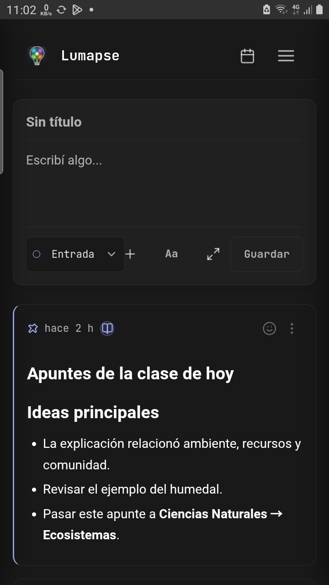
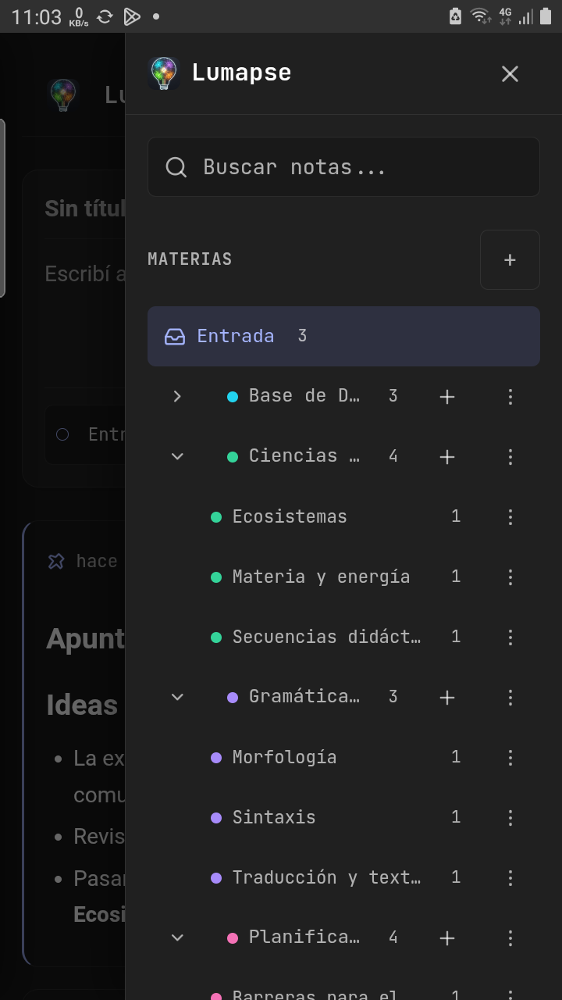
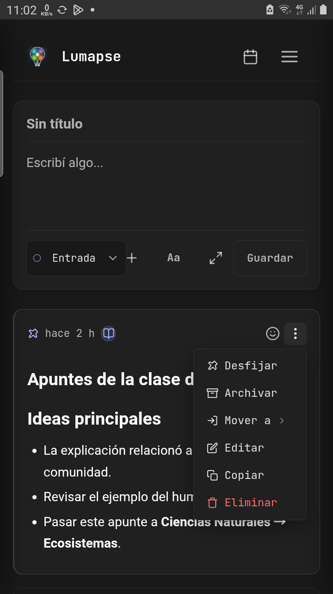
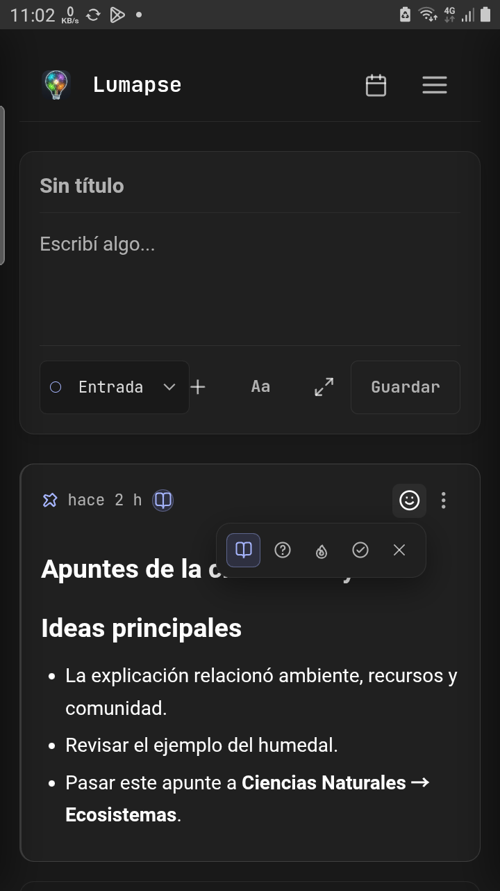
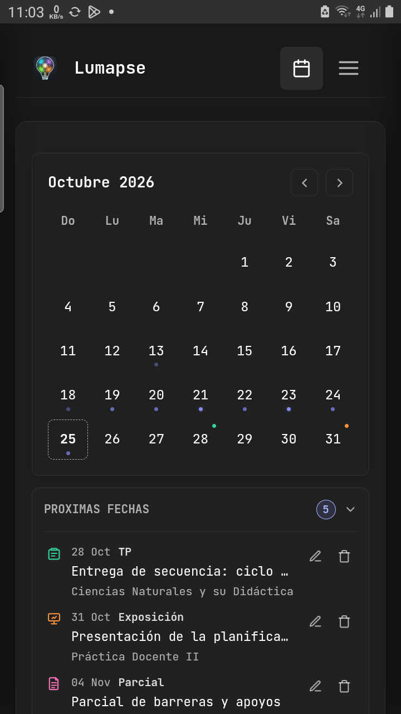
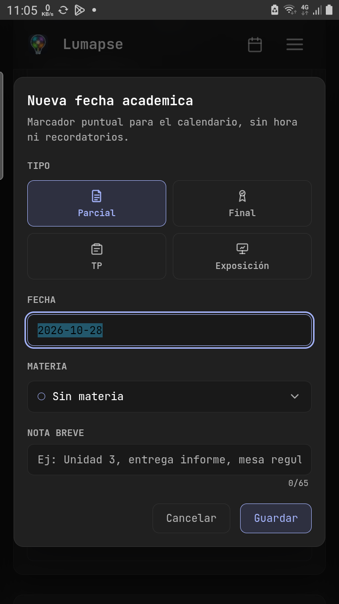
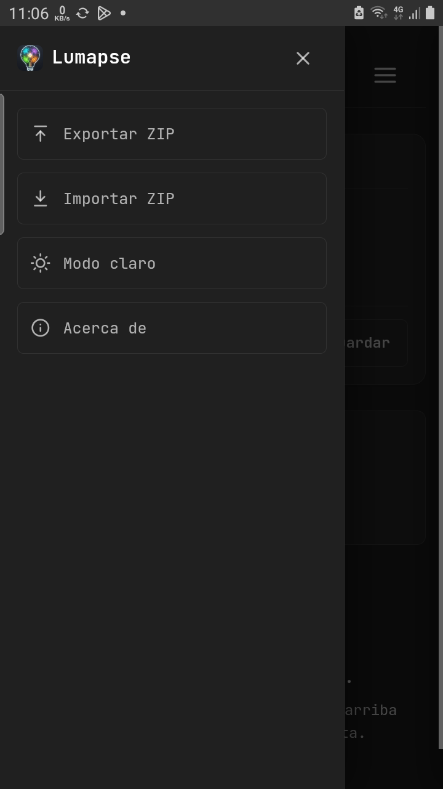

# Lumapse · Manual breve

**Android · Versión 0.6.0**

Tus notas, en tu equipo. Sin cuenta y sin internet para el uso cotidiano.

## 1. Escribí y guardá

  <figure><figcaption>El editor está en la pantalla principal.</figcaption></figure>

1. Empezá a escribir donde dice **Escribí algo…**. **El título es opcional:** no hace falta completarlo para guardar la nota.
2. Si querés, elegí una materia o sección. Si no, dejá **Entrada**: ahí quedan las notas que todavía no clasificaste.
3. Tocá **Guardar**. Tu nota aparece en el listado; las fijadas quedan primero.

**Para dar formato:** tocá **+** para agregar listas, tareas, títulos o tablas. Seleccioná un fragmento y tocá **Aa** para cambiar su formato.

**Modo Enfoque:** tocá las flechas de expansión para escribir con la menor cantidad de distracciones posible. Para volver a la vista habitual, tocá las flechas de la parte superior.

**Para editar:** abrí los **tres puntos** de la nota, elegí **Editar**, hacé los cambios y tocá **Actualizar**.

**Si salís sin guardar**, Lumapse conserva lo que estabas escribiendo como borrador y lo muestra al volver. Tocá **Guardar** o **Actualizar** para conservarlo como nota. **Descartar** borra ese texto pendiente.

## 2. Organizá y encontrá

  <figure><figcaption>Materias, secciones y búsqueda.</figcaption></figure>
  <figure><figcaption>Los tres puntos abren las acciones.</figcaption></figure>
  <figure><figcaption>La cara abre los estados de estudio.</figcaption></figure>

**Agrupá tus notas.** Una materia puede ser «Matemática» y una sección, «Ecuaciones». Abrí las **tres líneas de arriba a la derecha**. Tocá **+** junto a «Materias» para crear una; el **+** de una materia agrega una sección dentro de ella. Tocá su nombre para ver las notas. La flecha muestra u oculta las secciones; los **tres puntos** permiten cambiar el nombre, archivar o eliminar.

**Usá los tres puntos de cada nota** para **Fijar** y dejarla arriba, **Mover a** otra materia o sección, **Copiar** su texto, **Archivar** o **Eliminar**. El botón con una cara permite marcar **Por completar**, **Tengo dudas**, **Importante** o **Repasado**; la cruz quita la marca.

**Para encontrar una nota**, escribí una palabra en **Buscar notas…**. Lumapse la busca en los títulos y el texto de todas tus notas no archivadas, no sólo en la materia que tenías abierta. Para buscar las que archivaste, entrá primero en **Ver archivadas**.

**¿No encontrás lo que buscás?** Si elegiste una palabra o un día, el listado muestra sólo las notas que coinciden. Tocá **Quitar búsqueda** o **Quitar fecha** para volver a ver las demás. Cada botón quita sólo esa selección. Los números junto a las materias indican cuántas notas tienen en total.

**Archivar** aparta una nota del listado sin borrarla; podés recuperarla desde **Ver archivadas**. **Eliminar** la envía a **Papelera**, donde podés tocar **Restaurar** para recuperarla durante 30 días. Si eliminás una materia o sección, también se envían allí sus notas. **Pasados los 30 días, las notas, materias y secciones de la papelera se borran por completo al abrir Lumapse y ya no se pueden recuperar desde allí.** **Vaciar papelera** y **Eliminar permanentemente** también las borran sin posibilidad de recuperarlas.

## 3. Consultá y agregá fechas

  <figure><figcaption>Calendario y próximas fechas.</figcaption></figure>
  <figure><figcaption>Una fecha puede asociarse a una materia.</figcaption></figure>

1. Tocá el **calendario** de la parte superior y elegí un día.
2. Tocá **Agregar fecha** y elegí **Parcial**, **Final**, **TP** o **Exposición**.
3. Revisá la fecha; si querés, elegí una materia y escribí una nota breve.
4. Tocá **Guardar**. Consultala en el calendario o en **Próximas fechas**.

Las flechas cambian de mes. Al tocar un día, verás las notas que se guardaron por última vez en esa fecha. Tocá **Quitar fecha** para volver a ver las demás.

El lápiz permite cambiar una fecha; el icono de papelera la borra después de pedirte confirmación. Esto no borra tus notas ni materias.

> **Las fechas no tienen alarma:** sirven para consultarlas en el calendario; no envían avisos al teléfono.

## 4. Guardá una copia de tus notas

  <figure><figcaption>El icono de Lumapse (la bombilla) abre las opciones.</figcaption></figure>

**Para guardar una copia:**

1. Tocá el **icono de Lumapse (la bombilla)**, arriba a la izquierda, y elegí **Exportar ZIP**.
2. Revisá el resumen y tocá **Exportar ZIP**. Se crea un archivo que reúne tus notas, materias, secciones y fechas.
3. Elegí dónde guardarlo. Por ejemplo, Google Drive si lo tenés instalado; para subirlo necesitás internet. Comprobá que el archivo aparezca en el lugar que elegiste.

> **Tus notas son tuyas: trabajá sin internet y guardá una copia fuera del celular.** Lumapse prioriza que puedas escribir y consultar sin conexión. Para mantener tus notas a salvo, guardá o copiá el archivo `.zip` en Google Drive, un pendrive u otro dispositivo. Las notas de texto suelen ocupar poco espacio, incluso si tenés cientos; el tamaño depende de cuánto escribas. **Si usás la app seguido, hacé una copia al menos una vez por semana**, y después de cambios importantes.

**¿Cuál es la última copia?** El nombre incluye la fecha y la hora. Por ejemplo, `lumapse-2026-10-25-18-30.zip` corresponde al **25 de octubre de 2026 a las 18:30**. Compará esos datos para reconocer la más reciente sin abrir los archivos.

**Tus notas no quedan atadas a Lumapse.** El ZIP también incluye cada nota como archivo **Markdown (`.md`)**: texto simple con marcas sencillas para indicar títulos, listas o negrita. Descomprimí el ZIP y abrí la carpeta `notes` para encontrarlas. Podés leerlas y editarlas con un editor de texto, o usar otra app que admita Markdown para ver el formato. **Si Lumapse no te convence, podés seguir trabajando con tus notas en otro programa. Son tuyas y no dependen de un formato exclusivo de Lumapse.**

**Para recuperar tus notas desde una copia:**

1. Tocá el **icono de Lumapse (la bombilla)** → **Importar ZIP** → **Seleccionar ZIP**.
2. Buscá el archivo que guardaste con Lumapse. Revisá el resumen y tocá **Importar ZIP**.
3. Abrí tus notas para comprobar que estén. Las notas de la copia se agregan a las que ya tenés; las que Lumapse reconoce como repetidas no se agregan de nuevo.

> **Antes de hacer la copia, guardá lo que estés escribiendo.** La copia incluye también lo archivado, pero no los borradores ni lo que está en la papelera. Tenés que crear una nueva copia cada vez que quieras guardar los cambios más recientes.

**Si vas a cambiar de teléfono:** guardá la copia en un lugar al que puedas entrar desde el teléfono nuevo, como Google Drive. Recuperá allí las notas con los pasos anteriores. **No borres Lumapse del teléfono viejo hasta comprobar que tus notas están en el nuevo.**

**Si vas a desinstalar Lumapse o borrar sus datos:** guardá primero una copia. Sin ella, no podrás recuperar las notas que borres.

**También en este menú:** cambiá entre **Modo claro / Modo oscuro** y consultá la versión en **Acerca de**.
