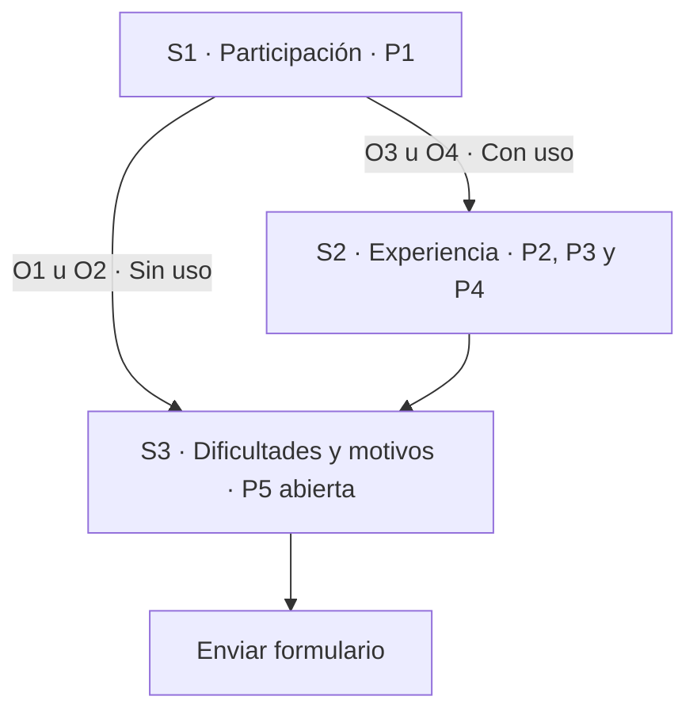
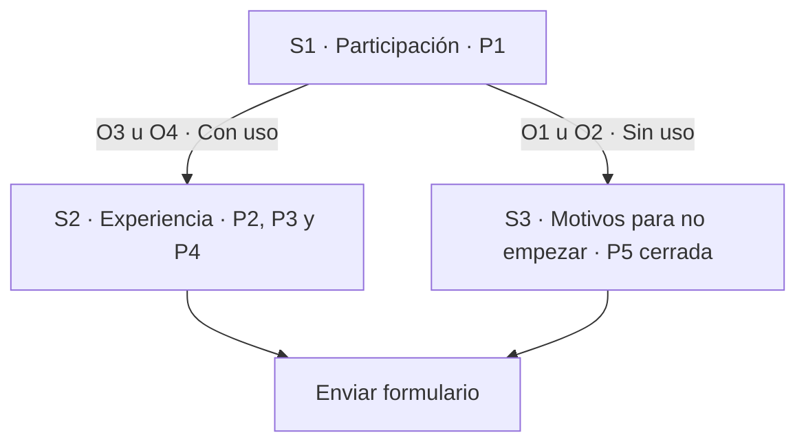
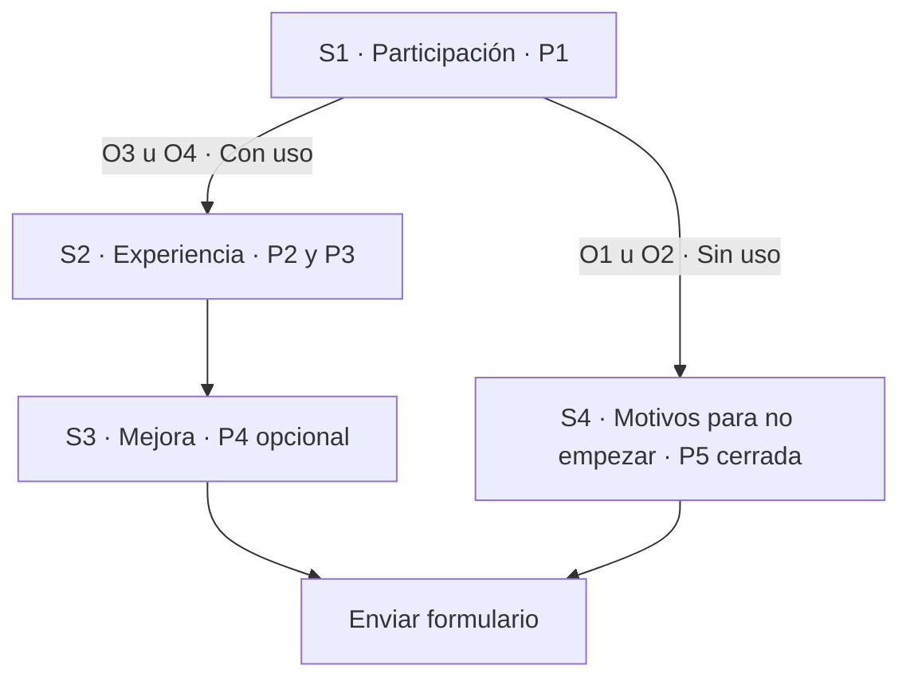

# Prueba exploratoria de Lumapse

> **Estado:** borrador de diseño para revisión. Las alternativas de este documento
> no están seleccionadas ni aplicadas al formulario. A queda descartada en su
> formulación original por permitir respuestas incompatibles; B y C se revisan
> con finales separados.
>
> **Línea de base:** formulario observado el 9 de noviembre de 2026, con cinco
> preguntas, tres secciones y sin publicar. Referencia de producto: `v0.6.0 — RC1`.

## Propósito y límites

La prueba busca dar a conocer Lumapse como una herramienta que podría resultar útil
para estudiar y recoger primeras impresiones, motivos de no participación y
dificultades de instalación o uso. La invitación debe presentar posibilidades
concretas —tomar apuntes, organizarlos por materia y consultarlos sin conexión—,
sin presuponer que la aplicación será útil para todas las personas.

La participación y la instalación son voluntarias. No instalar la APK también
puede aportar información: una duda sobre su procedencia no equivale a un fallo
técnico ni a una respuesta inválida.

No es un estudio destinado a estimar resultados para toda la población estudiantil.
Los comentarios y eventuales recuentos descriptivos no demuestran representatividad,
adopción cotidiana, seguridad del binario ni cumplimiento de tiempos de respuesta.
La instalación como principal cuello de botella es una **hipótesis**, no un resultado
medido. Esta prueba no reabre el desarrollo o las comprobaciones diferidas de la APK.

Se encuadra en el [feedback posterior al corte](../../TODO.md#feedback-posterior-al-corte--no-bloqueante)
y en la [congelación académica](../../BACKLOG.md#congelación-académica--2026-10-22).
Es distinta del [relevamiento de hábitos y necesidades de mayo](../producto/relevamiento-datos.md)
y de su [registro de ejecución](../producto/encuesta/README.md).

## Recorrido previo al formulario

El recorrido de participación comprende conocer la propuesta, consultar su
procedencia, decidir si instalar, probar lo que resulte posible y compartir la
experiencia. No todos tienen que atravesar todas esas etapas para responder.

La orientación incorporada al formulario propone:

- Unos diez minutos de uso, en uno o varios momentos.
- Crear y guardar unas cinco notas breves.
- Intentar organizar algunas por materia y encontrar una mediante la búsqueda.
- Explorar el calendario; agregar una fecha de prueba es opcional.

Son orientaciones, no requisitos estrictos ni controles instrumentados. La experiencia
parcial sigue siendo pertinente. No se exige esperar un día ni se rechazan comentarios
por no alcanzar una cantidad de notas o un tiempo declarado.

### Recursos de apoyo

| Recurso | Función |
|---|---|
| [Sitio de Lumapse](https://lumapse.tech/) | Presentación del proyecto y acceso a la descarga |
| [Publicación de v0.6.0 RC1](https://github.com/jdfesa/lumapse/releases/tag/v0.6.0) | Referencia de la versión preliminar y del instalador `lumapse-v0.6.0.apk` |
| [Tutorial de instalación](https://youtu.be/u8IV2VRYkn8) | Guía general grabada con v0.5.0; su descripción distingue esa grabación de la descarga v0.6.0 RC1 |
| [Manual interactivo](https://lumapse.tech/manual/) | Consulta opcional para escribir, organizar, buscar, consultar fechas y guardar copias |

El formulario observado mantiene el manual en las tres secciones. Su apertura en
otra pestaña se comprobó en el navegador integrado; no se ha comprobado ese
comportamiento en todos los navegadores o teléfonos. Los recursos no deben convertirse
en una obligación de abandonar el formulario para poder responder.

## Instrumento observado

Los identificadores P1–P5 permiten comparar alternativas; no son nuevas preguntas.

| ID | Pregunta | Tipo | Obligatoria |
|---|---|---|---|
| P1 | ¿Hasta dónde llegaste con la prueba? | Opción única | Sí |
| P2 | ¿Qué tan fácil o difícil te resultó usar Lumapse? | Opción única | Sí |
| P3 | ¿En qué te resultó útil Lumapse, si te resultó útil? | Respuesta corta | Sí |
| P4 | Si pudieras mejorar una sola cosa de Lumapse, ¿cuál sería? | Respuesta corta | No |
| P5 | ¿Qué dificultades encontraste o qué te llevó a no realizar toda la prueba? | Respuesta corta | Sí |

Opciones observadas de P1:

| Código | Respuesta |
|---|---|
| O1 | No llegué a instalarla. |
| O2 | La instalé, pero no llegué a usarla. |
| O3 | La usé y realicé sólo una parte del recorrido sugerido. |
| O4 | La usé y realicé el recorrido sugerido. |

O1 y O2 son dos **opciones de P1**, no dos preguntas de la primera sección.

### Árbol observado: tres secciones y cierre común

| Respuesta a P1 | Recorrido observado | Preguntas que se muestran |
|---|---|---|
| O1 u O2 | S1 → S3 → enviar | P1 y P5: 2 |
| O3 u O4 | S1 → S2 → S3 → enviar | P1–P5: 5; P4 es opcional |

La descripción actual de P5 pide el principal motivo a quien no instaló, no usó o
probó sólo una parte; permite «Ninguna» a quien completó el recorrido sin dificultades.
Es una respuesta escrita obligatoria que reúne situaciones diferentes. La auditoría
identifica una carga de interpretación y redacción, no un abandono medido.

En la configuración observada no se recopilan correos, no está activado el límite
de una respuesta que exige iniciar sesión y no se comparte el resumen de resultados.
Hay barra de progreso y no se mezcla el orden de las preguntas. Esto no acredita por
sí solo acceso anónimo en todos los dispositivos: no se comprobó una sesión desconectada.

### Acceso sin inicio de sesión y respuestas repetidas

La [ayuda oficial de Google Forms](https://support.google.com/docs/answer/2839588?hl=es),
consultada el 9 de noviembre de 2026, confirma que **«Limitar a 1 respuesta» exige
iniciar sesión en una cuenta de Google**. La recopilación de correos es un ajuste
separado: se puede mantener desactivada aunque se active el límite. Eso evita
recopilar el correo mediante ese ajuste, pero no convierte la participación en
acceso sin autenticación ni garantiza que el texto libre no identifique a alguien.

| Configuración nativa | Barrera de acceso | Alcance del control |
|---|---|---|
| Sin límite de una respuesta y sin recopilar correos | No exige sesión por esos ajustes; falta comprobar el acceso desconectado | No bloquea respuestas repetidas de una misma persona |
| Límite de una respuesta, sin recopilar correos | Exige cuenta y sesión de Google | Una respuesta por cuenta; no equivale a una persona única |

Por tanto, **no se puede prometer simultáneamente acceso sin cuenta y bloqueo de
una segunda respuesta de la misma persona con el control nativo verificado**.
La distinción entre cuenta y persona es un límite del diseño: alguien puede tener
varias cuentas. Sin una identidad o credencial única tampoco se puede reconocer
de forma fiable a quien vuelve desde otro navegador o dispositivo.

**Tratamiento acordado:** conservar la configuración actual, sin activar el límite
ni recopilar correos. No sustituirla por identificación adicional, complementos,
cookies o controles por IP dentro de esta tarea. Aceptar este límite no significa
que se haya demostrado la ausencia de duplicados.

En la auditoría también estaba activado «Mostrar enlace para enviar otra respuesta».
Ocultarlo podría reducir la invitación a repetir por error, pero no impediría
reabrir el enlace. Queda como mitigación opcional, **no aplicada**, al igual que un
recordatorio breve de responder una sola vez. No son garantías de unicidad ni
justifican borrar respuestas parecidas como si fueran duplicados comprobados.

## Revisión de alternativas

Todas conservan **cinco preguntas en total**. Cambiar de alternativa implica una
decisión sobre qué información recoger y cuántas pantallas recorrer, no solamente
cambiar el número de una sección. B y C bifurcan el cierre: quienes no usaron la
app responden motivos; quienes sí la usaron terminan tras las preguntas de experiencia.

### A · Cierre común simplificado: descartado en su formulación original

La propuesta inicial mantenía el árbol observado y sustituía P5 por la pregunta
de opción única «¿Qué fue lo principal que te frenó para instalar o probar Lumapse?».
Entre sus opciones estaban «Nada, pude probarla» y «La instalé, pero me costó empezar
a usarla».

Esto no es solamente una pérdida de detalle: permite combinaciones incompatibles
con P1. Por ejemplo, O1 («No llegué a instalarla») podría terminar en «Nada, pude
probarla» o en una respuesta que afirma haberla instalado. Una indicación escrita
no impide seleccionar esas opciones.

**Resultado de la revisión:** A no cumple el criterio de coherencia entre recorrido
y respuestas disponibles. Se conserva sólo como antecedente del diseño, no como
alternativa lista para aprobación. No se aplicó al formulario.

### B · Tres secciones, finales diferentes según uso

Interpreta la separación de O1/O2 y O3/O4 como dos recorridos que terminan por
separado. No necesita una cuarta sección: Google Forms permite dirigir según P1
y seleccionar «Enviar formulario» al final de cada sección, según su
[ayuda sobre ramificación](https://support.google.com/docs/answer/141062?hl=es-419).

En esta alternativa P5 se adapta exclusivamente a quienes no llegaron a usarla:

> **¿Qué fue lo principal que te frenó para empezar a usar Lumapse?**
>
> Elegí el motivo principal, aunque haya habido más de uno.

1. Falta de tiempo.
2. Dudas sobre la seguridad o la procedencia de la APK.
3. Dificultades con la descarga o la instalación.
4. Falta de orientación para empezar.
5. Falta de interés en continuar con la prueba.
6. Otro motivo.

P5 sería obligatoria y de opción única, sin respuesta preseleccionada. «Otro motivo»
sería una opción cerrada, sin exigir texto adicional. No se ofrecen «Nada, pude
probarla» ni «Ninguna»: no haber empezado puede deberse a falta de tiempo o interés,
no necesariamente a una dificultad técnica.

Las opciones expresan **motivos**, no afirman etapas ya realizadas. Como O1 y O2
comparten P5, tampoco debe incluirse «La instalé, pero…», incompatible con O1, ni
«No pude instalarla», incompatible con O2. P1 ya registra hasta dónde llegó cada
persona. Una dificultad de instalación pudo superarse antes de desistir; elegir
esa categoría junto con O2 no prueba por sí solo una contradicción.

El cierre tendría un encabezado breve, «Para terminar», y el manual como consulta
opcional, sin instrucciones largas ni obligación de abandonar el formulario.

**Ventaja:** cada persona encuentra un cierre acorde con lo que declaró y recorre
dos secciones. Quien ya la usó no vuelve a contestar motivos de no instalación.

**Límite:** quienes la usaron no contestan P5. Sus dificultades sólo podrían aparecer
en la valoración de facilidad y, si quieren, en la mejora propuesta; no hay una
pregunta cerrada de barreras para ese grupo. P5 recoge un motivo principal, no todos
los motivos ni un diagnóstico técnico; «Otro motivo» no revela su contenido. Sus
respuestas deben leerse junto con O1/O2, no como descripción de todos los participantes.

### C · Cuatro secciones, finales diferentes según uso

Una distribución posible que conserva cinco preguntas separa la mejora de las
otras preguntas de experiencia:

P5 tiene la formulación exclusiva para no usuarios de la alternativa B. **Al terminar
S3 debe seleccionarse «Enviar formulario», no continuar a S4.** S4 también termina
en envío. De lo contrario, los usuarios acabarían contestando motivos de no uso.

**Ventaja:** hace visible una sección específica para O1/O2 y separa la mejora.

**Límite:** recoge la misma información que B, pero quien usó la app atraviesa una
pantalla más. Una cuarta sección no mejora por sí sola la claridad ni la participación.

### Comparación de recorridos

| Diseño | Total de preguntas | Sin uso: preguntas / secciones | Con uso: preguntas / secciones | ¿P5 se muestra a todos? |
|---|---|---|---|---|
| Observado | 5 | 2 / 2 | 5 / 3 | Sí; texto libre |
| A · Descartado en su formulación original | 5 | 2 / 2 | 5 / 3 | Sí; admite contradicciones |
| B · Finales diferentes, tres secciones | 5 | 2 / 2 | 4 / 2 | No |
| C · Finales diferentes, cuatro secciones | 5 | 2 / 2 | 4 / 3 | No |

Los conteos indican preguntas **mostradas**; P4 sigue siendo opcional. No son
mediciones de duración ni de tasa de respuesta.

Duplicar P5 en dos versiones, una para usuarios y otra para no usuarios, produciría
seis preguntas distintas en el formulario. Aunque cada persona viera como máximo
cinco, no cumpliría el límite actual de cinco preguntas en total.

Tampoco basta con agregar una sección para mostrar opciones diferentes de P5 a O1
y O2: la ramificación nativa dirige a secciones, no filtra las opciones de una misma
pregunta según una respuesta previa. Dos preguntas de motivos específicas, una por
etapa, más P1–P4 también sumarían seis. Para mantener cinco habría que reformular
o retirar otra pregunta; ese cambio requiere una decisión aparte y no se aplica
implícitamente en B o C.

**Criterio para la revisión:** bifurcar el cierre evita las incompatibilidades
identificadas. B lo hace con menos pantallas; C hace explícita una cuarta sección,
pero no añade información ni mayor validación. B es la recomendación por brevedad;
C sigue disponible si se prefiere separar la mejora. Ninguna queda aprobada por
esta comparación.

Separar recorridos no cambia el hecho de recoger **un** motivo principal. Si se
quisieran varios motivos, habría que revisar el tipo de respuesta y sus reglas;
agregar una sección no resuelve esa diferencia. Tampoco un árbol coherente prueba
la veracidad de lo declarado por cada participante.

### Reglas de coherencia y lectura de resultados

| Respuesta a P1 | Preguntas pertinentes en B y C | Opciones o recorrido que no deben ofrecerse |
|---|---|---|
| O1 · No instalada | P1 y P5 | Opiniones de uso; «pude probarla»; «la instalé» |
| O2 · Instalada sin uso | P1 y P5 | Opiniones de uso; «pude probarla»; «no pude instalarla» |
| O3 · Uso parcial | P1–P4 | P5 sobre motivos de no haber empezado |
| O4 · Recorrido realizado | P1–P4 | P5 sobre motivos de no haber empezado |

Estas reglas impiden ofrecer las combinaciones incompatibles señaladas; no eliminan
toda ambigüedad del autorreporte. Por ejemplo, «no me resultó útil» es una respuesta
válida de P3 para alguien que sí la usó, no un dato a descartar.

Para leer resultados, P1 delimita el grupo pertinente: P2–P4 sólo para O3/O4 y P5
sólo para O1/O2. Una pregunta no mostrada no se interpreta como «sin dificultades»
ni como falta de colaboración. Antes de distribuir el formulario debe comprobarse
también el retroceso y cambio de P1. No se ha verificado si Forms conserva en el
envío respuestas previas de un ramal abandonado; no se presupone su borrado automático.

## Mensaje de confianza propuesto

Se ubicaría **junto a la descarga**, antes de pedir la instalación, no como explicación
al final del formulario:

> Lumapse es un proyecto académico para Android. Esta versión preliminar
> (v0.6.0 RC1) todavía no se distribuye por Google Play: la APK es su archivo
> instalador y se descarga desde la publicación oficial del proyecto. Instalarla es
> voluntario; si preferís no hacerlo, también podés responder. Mantené Google Play
> Protect activado y no lo desactives para forzar la instalación.

El enlace «publicación oficial» apuntaría a la release v0.6.0 indicada en recursos.
Se conserva, junto al tutorial, la aclaración de que la grabación usa v0.5.0 y la
descarga de esta prueba es v0.6.0 RC1.

Este mensaje identifica procedencia y versión; **no certifica que el binario esté
libre de riesgos**. La autorización para instalar desde una fuente externa no es lo
mismo que una alerta que identifica una aplicación como potencialmente dañina. No
debe prometerse seguridad absoluta ni atribuir cualquier aviso solamente a no estar
en Google Play. Ante una alerta, no se propone sortearla para completar la prueba.

## Decisiones pendientes y comprobación posterior

- [ ] Elegir B o C y aprobar sus destinos y la ausencia de una pregunta cerrada de
  barreras para quienes sí usaron Lumapse. A no es admisible sin rediseño.
- [ ] Aprobar la redacción y opciones de P5, su obligatoriedad y la pérdida de detalle
  de una opción «Otro motivo» sin texto adicional.
- [ ] Aprobar el mensaje de confianza junto a la descarga y la presentación breve
  del manual al cerrar cada recorrido.
- [ ] Después de aplicar la alternativa elegida, comprobar las cuatro respuestas de
  P1 en vista previa: destino correcto, reglas de coherencia anteriores y final en envío.
- [ ] Comprobar el retroceso y cambio de P1 entre sin uso/con uso. La vista previa
  sin envío no demuestra cómo se guardan las respuestas de un ramal abandonado;
  cualquier prueba con envíos requiere autorización y separación de los datos reales.
- [ ] Confirmar cinco preguntas totales, mejora opcional, enlaces correctos y ausencia
  de solicitud de opiniones de uso a quienes no la usaron.
- [ ] Comprobar acceso sin sesión de Google en los dispositivos disponibles, sin
  afirmar unicidad de personas. Mantener los ajustes actuales; cualquier mitigación
  adicional de repetición accidental necesita aprobación específica.
- [ ] Revisar el instrumento aplicado y su correspondencia con este documento antes
  de autorizar publicación y distribución.

La implementación, la aprobación del diseño y la publicación son estados diferentes.
Este borrador no acredita ninguna de las dos últimas. Tampoco contiene resultados de
participantes. Cuando existan observaciones, se registrarán con versión, fecha y
alcance, sin publicar datos identificables, respuestas personales ni capturas de cuentas.

## Fuentes y fundamento de las propuestas

- [Registro del candidato 0.6.0](../gestion/candidato-apk-0.6.0.md): identidad del corte,
  aceptación parcial y límites; no equivale a una nueva validación del binario.
- [Google Forms: publicación y configuración de respuestas](https://support.google.com/docs/answer/2839588?hl=es):
  límite de una respuesta con inicio de sesión; recopilación de correos separada.
- [Google Forms: mostrar preguntas según respuestas](https://support.google.com/docs/answer/141062?hl=es-419):
  destinos por sección y terminación del formulario; no implica opciones dinámicas
  dentro de una misma pregunta.
- [GOV.UK: preguntas abiertas](https://design-system.service.gov.uk/components/textarea/#when-not-to-use-this-component):
  advierte sobre su dificultad y considera alternativas más simples. Sustenta la
  hipótesis de reducir escritura, no demuestra que esta propuesta aumente respuestas.
- [GOV.UK: opción única](https://design-system.service.gov.uk/components/radios/):
  selección de un elemento y ausencia de respuestas preseleccionadas.
- [Android: distribución alternativa](https://developer.android.com/distribute/marketing-tools/alternative-distribution):
  distribución desde un sitio y autorización de fuentes externas.
- [Google: Play Protect](https://support.google.com/android/answer/2812853?hl=es):
  protecciones y recomendación de mantenerlas activadas.
