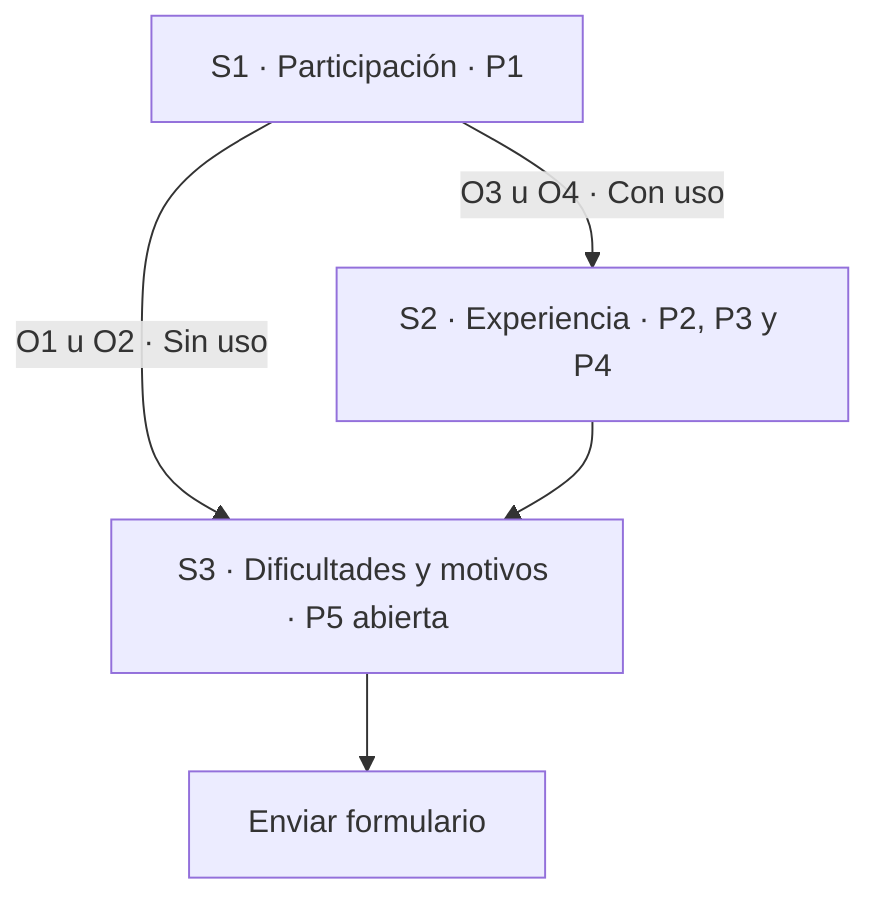
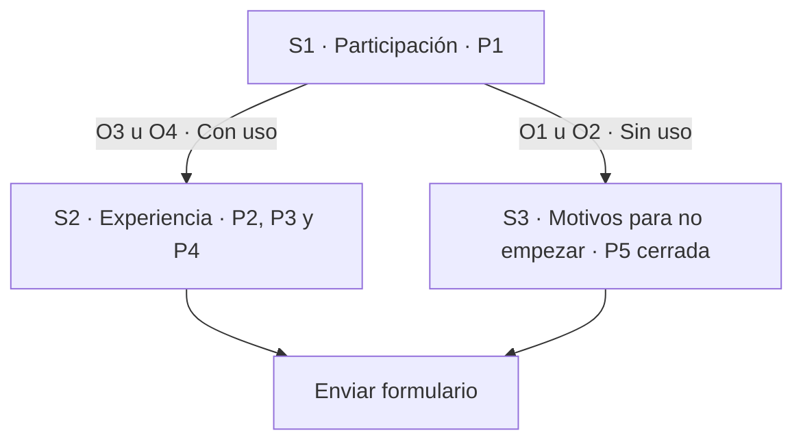
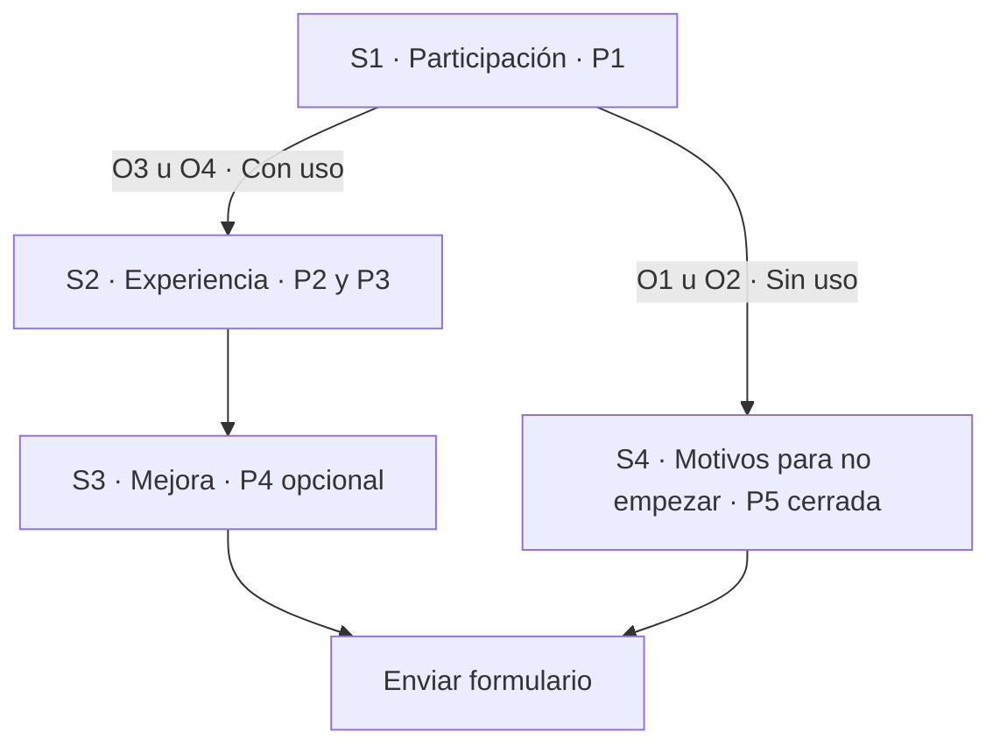

# Prueba exploratoria de Lumapse

> **Estado:** borrador de diseño para revisión. Las alternativas de este documento
> no están seleccionadas ni aplicadas al formulario.
>
> **Línea de base:** formulario observado el 9 de noviembre de 2026, con cinco
> preguntas, tres secciones y sin publicar. Referencia de producto: `v0.6.0 — RC1`.

## Propósito y límites

La prueba busca dar a conocer Lumapse como una herramienta que podría resultar útil
para estudiar y recoger primeras impresiones, motivos de no participación y
dificultades de instalación o uso. La invitación debe presentar posibilidades
concretas —tomar apuntes, organizarlos por materia y consultarlos sin conexión—,
sin presuponer que la aplicación será útil para todas las personas.

La participación y la instalación son voluntarias. No instalar la APK también
puede aportar información: una duda sobre su procedencia no equivale a un fallo
técnico ni a una respuesta inválida.

No es un estudio destinado a estimar resultados para toda la población estudiantil.
Los comentarios y eventuales recuentos descriptivos no demuestran representatividad,
adopción cotidiana, seguridad del binario ni cumplimiento de tiempos de respuesta.
La instalación como principal cuello de botella es una **hipótesis**, no un resultado
medido. Esta prueba no reabre el desarrollo o las comprobaciones diferidas de la APK.

Se encuadra en el [feedback posterior al corte](../../TODO.md#feedback-posterior-al-corte--no-bloqueante)
y en la [congelación académica](../../BACKLOG.md#congelación-académica--2026-10-22).
Es distinta del [relevamiento de hábitos y necesidades de mayo](../producto/relevamiento-datos.md)
y de su [registro de ejecución](../producto/encuesta/README.md).

## Recorrido previo al formulario

El recorrido de participación comprende conocer la propuesta, consultar su
procedencia, decidir si instalar, probar lo que resulte posible y compartir la
experiencia. No todos tienen que atravesar todas esas etapas para responder.

La orientación incorporada al formulario propone:

- Unos diez minutos de uso, en uno o varios momentos.
- Crear y guardar unas cinco notas breves.
- Intentar organizar algunas por materia y encontrar una mediante la búsqueda.
- Explorar el calendario; agregar una fecha de prueba es opcional.

Son orientaciones, no requisitos estrictos ni controles instrumentados. La experiencia
parcial sigue siendo pertinente. No se exige esperar un día ni se rechazan comentarios
por no alcanzar una cantidad de notas o un tiempo declarado.

### Recursos de apoyo

| Recurso | Función |
|---|---|
| [Sitio de Lumapse](https://lumapse.tech/) | Presentación del proyecto y acceso a la descarga |
| [Publicación de v0.6.0 RC1](https://github.com/jdfesa/lumapse/releases/tag/v0.6.0) | Referencia de la versión preliminar y del instalador `lumapse-v0.6.0.apk` |
| [Tutorial de instalación](https://youtu.be/u8IV2VRYkn8) | Guía general grabada con v0.5.0; su descripción distingue esa grabación de la descarga v0.6.0 RC1 |
| [Manual interactivo](https://lumapse.tech/manual/) | Consulta opcional para escribir, organizar, buscar, consultar fechas y guardar copias |

El formulario observado mantiene el manual en las tres secciones. Su apertura en
otra pestaña se comprobó en el navegador integrado; no se ha comprobado ese
comportamiento en todos los navegadores o teléfonos. Los recursos no deben convertirse
en una obligación de abandonar el formulario para poder responder.

## Instrumento observado

Los identificadores P1–P5 permiten comparar alternativas; no son nuevas preguntas.

| ID | Pregunta | Tipo | Obligatoria |
|---|---|---|---|
| P1 | ¿Hasta dónde llegaste con la prueba? | Opción única | Sí |
| P2 | ¿Qué tan fácil o difícil te resultó usar Lumapse? | Opción única | Sí |
| P3 | ¿En qué te resultó útil Lumapse, si te resultó útil? | Respuesta corta | Sí |
| P4 | Si pudieras mejorar una sola cosa de Lumapse, ¿cuál sería? | Respuesta corta | No |
| P5 | ¿Qué dificultades encontraste o qué te llevó a no realizar toda la prueba? | Respuesta corta | Sí |

Opciones observadas de P1:

| Código | Respuesta |
|---|---|
| O1 | No llegué a instalarla. |
| O2 | La instalé, pero no llegué a usarla. |
| O3 | La usé y realicé sólo una parte del recorrido sugerido. |
| O4 | La usé y realicé el recorrido sugerido. |

O1 y O2 son dos **opciones de P1**, no dos preguntas de la primera sección.

### Árbol observado: tres secciones y cierre común

| Respuesta a P1 | Recorrido observado | Preguntas que se muestran |
|---|---|---|
| O1 u O2 | S1 → S3 → enviar | P1 y P5: 2 |
| O3 u O4 | S1 → S2 → S3 → enviar | P1–P5: 5; P4 es opcional |

La descripción actual de P5 pide el principal motivo a quien no instaló, no usó o
probó sólo una parte; permite «Ninguna» a quien completó el recorrido sin dificultades.
Es una respuesta escrita obligatoria que reúne situaciones diferentes. La auditoría
identifica una carga de interpretación y redacción, no un abandono medido.

En la configuración observada no se recopilan correos, no está activado el límite
de una respuesta que exige iniciar sesión y no se comparte el resumen de resultados.
Hay barra de progreso y no se mezcla el orden de las preguntas. Esto no acredita por
sí solo acceso anónimo en todos los dispositivos: no se comprobó una sesión desconectada.

## Alternativas para decidir

Todas conservan **cinco preguntas en total**. Cambiar de alternativa implica una
decisión sobre qué información recoger y cuántas pantallas recorrer, no solamente
cambiar el número de una sección.

### A · Tres secciones, cierre común simplificado

Mantiene el árbol observado y sustituye P5 por una pregunta de opción única. El
encabezado del cierre sería «Para terminar», con una indicación breve para elegir
una opción y un enlace discreto al manual, sin exigir consultarlo.

Texto propuesto de P5:

> **¿Qué fue lo principal que te frenó para instalar o probar Lumapse?**
>
> Elegí una opción.

1. Nada, pude probarla.
2. No tuve tiempo.
3. Me generó dudas instalar una APK fuera de Google Play.
4. Tuve problemas para descargarla o instalarla.
5. La instalé, pero me costó empezar a usarla.
6. Otro motivo.

La propuesta mantiene P5 obligatoria, pero permite responder mediante una selección.
La opción «Otro motivo» se propone como opción cerrada: no exige escribir otra
explicación. Esto reduce el detalle disponible; no se conocerá necesariamente cuál
fue ese otro motivo. No se preselecciona ninguna respuesta.

**Ventaja:** conserva una pregunta sobre barreras para todas las personas, sin
duplicar preguntas ni exigir a todos redactar el cierre.

**Límite:** recoge un motivo principal, no todas las dificultades. Una persona que
la usó también verá opciones referidas a instalación. No permite deducir un error
técnico concreto ni su causa.

### B · Tres secciones, finales diferentes según uso

Interpreta la separación de O1/O2 y O3/O4 como dos recorridos que terminan por
separado. No necesita una cuarta sección.

En esta alternativa P5 se adapta exclusivamente a quienes no llegaron a usarla:

> **¿Qué fue lo principal que te frenó para empezar a usar Lumapse?**

Opciones propuestas: falta de tiempo; dudas sobre instalar una APK fuera de Google
Play; problemas de descarga o instalación; la instalé pero no supe cómo empezar;
otro motivo. No incluye «Nada, pude probarla», porque ese recorrido corresponde a
quien declaró no haberla usado.

**Ventaja:** cada persona encuentra un cierre acorde con lo que declaró y recorre
dos secciones. Quien ya la usó no vuelve a contestar motivos de no instalación.

**Límite:** quienes la usaron no contestan P5. Sus dificultades quedan reflejadas
en facilidad de uso y, si quieren, en la mejora propuesta; se pierde la pregunta
cerrada común de barreras. Las respuestas de P5 no describirían al conjunto de participantes.

### C · Cuatro secciones, finales diferentes según uso

Una distribución posible que conserva cinco preguntas separa la mejora de las
otras preguntas de experiencia:

P5 tiene la formulación exclusiva para no usuarios de la alternativa B. **Al terminar
S3 debe seleccionarse «Enviar formulario», no continuar a S4.** S4 también termina
en envío. De lo contrario, los usuarios acabarían contestando motivos de no uso.

**Ventaja:** hace visible una sección específica para O1/O2 y separa la mejora.

**Límite:** recoge la misma información que B, pero quien usó la app atraviesa una
pantalla más. Una cuarta sección no mejora por sí sola la claridad ni la participación.

### Comparación de recorridos

| Diseño | Total de preguntas | Sin uso: preguntas / secciones | Con uso: preguntas / secciones | ¿P5 se muestra a todos? |
|---|---|---|---|---|
| Observado | 5 | 2 / 2 | 5 / 3 | Sí; texto libre |
| A · Cierre común simplificado | 5 | 2 / 2 | 5 / 3 | Sí; opción única |
| B · Finales diferentes, tres secciones | 5 | 2 / 2 | 4 / 2 | No |
| C · Finales diferentes, cuatro secciones | 5 | 2 / 2 | 4 / 3 | No |

Los conteos indican preguntas **mostradas**; P4 sigue siendo opcional. No son
mediciones de duración ni de tasa de respuesta.

Duplicar P5 en dos versiones, una para usuarios y otra para no usuarios, produciría
seis preguntas distintas en el formulario. Aunque cada persona viera como máximo
cinco, no cumpliría el límite actual de cinco preguntas en total.

**Criterio para la revisión:** A simplifica el cierre conservando la información
común; B prioriza recorridos breves y diferenciados; C sólo resulta preferible si
hay una razón concreta para separar la mejora en otra pantalla. Ninguna alternativa
queda aprobada por esta comparación.

## Mensaje de confianza propuesto

Se ubicaría **junto a la descarga**, antes de pedir la instalación, no como explicación
al final del formulario:

> Lumapse es un proyecto académico para Android. Esta versión preliminar
> (v0.6.0 RC1) todavía no se distribuye por Google Play: la APK es su archivo
> instalador y se descarga desde la publicación oficial del proyecto. Instalarla es
> voluntario; si preferís no hacerlo, también podés responder. Mantené Google Play
> Protect activado y no lo desactives para forzar la instalación.

El enlace «publicación oficial» apuntaría a la release v0.6.0 indicada en recursos.
Se conserva, junto al tutorial, la aclaración de que la grabación usa v0.5.0 y la
descarga de esta prueba es v0.6.0 RC1.

Este mensaje identifica procedencia y versión; **no certifica que el binario esté
libre de riesgos**. La autorización para instalar desde una fuente externa no es lo
mismo que una alerta que identifica una aplicación como potencialmente dañina. No
debe prometerse seguridad absoluta ni atribuir cualquier aviso solamente a no estar
en Google Play. Ante una alerta, no se propone sortearla para completar la prueba.

## Decisiones pendientes y comprobación posterior

- [ ] Elegir A, B o C y aprobar sus destinos, en particular si P5 será común o
  exclusiva de quienes no usaron Lumapse.
- [ ] Aprobar la redacción y opciones de P5, su obligatoriedad y la pérdida de detalle
  de una opción «Otro motivo» sin texto adicional.
- [ ] Aprobar el mensaje de confianza junto a la descarga y la presentación breve
  del manual al cerrar cada recorrido.
- [ ] Después de aplicar la alternativa elegida, comprobar las cuatro respuestas de
  P1 en vista previa: destino correcto, preguntas pertinentes y final en envío.
- [ ] Confirmar cinco preguntas totales, mejora opcional, enlaces correctos y ausencia
  de solicitud de opiniones de uso a quienes no la usaron.
- [ ] Revisar el instrumento aplicado y su correspondencia con este documento antes
  de autorizar publicación y distribución.

La implementación, la aprobación del diseño y la publicación son estados diferentes.
Este borrador no acredita ninguna de las dos últimas. Tampoco contiene resultados de
participantes. Cuando existan observaciones, se registrarán con versión, fecha y
alcance, sin publicar datos identificables, respuestas personales ni capturas de cuentas.

## Fuentes y fundamento de las propuestas

- [Registro del candidato 0.6.0](../gestion/candidato-apk-0.6.0.md): identidad del corte,
  aceptación parcial y límites; no equivale a una nueva validación del binario.
- [GOV.UK: preguntas abiertas](https://design-system.service.gov.uk/components/textarea/#when-not-to-use-this-component):
  advierte sobre su dificultad y considera alternativas más simples. Sustenta la
  hipótesis de reducir escritura, no demuestra que esta propuesta aumente respuestas.
- [GOV.UK: opción única](https://design-system.service.gov.uk/components/radios/):
  selección de un elemento y ausencia de respuestas preseleccionadas.
- [Android: distribución alternativa](https://developer.android.com/distribute/marketing-tools/alternative-distribution):
  distribución desde un sitio y autorización de fuentes externas.
- [Google: Play Protect](https://support.google.com/android/answer/2812853?hl=es):
  protecciones y recomendación de mantenerlas activadas.
