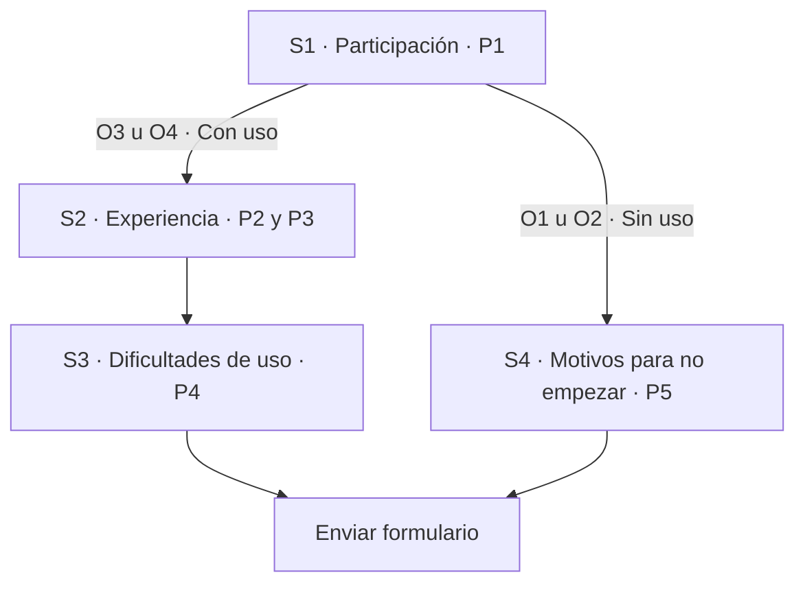

# Prueba exploratoria de Lumapse

> **Estado:** diseño aprobado y aplicado el 9 de noviembre de 2026.
> El formulario tiene **cinco preguntas y cuatro secciones**; sigue sin publicar.
> Este documento describe únicamente el diseño aplicado.

## Objetivo e invitación

Dar a conocer Lumapse y recoger utilidad percibida y barreras de instalación o uso.
Es una colaboración exploratoria voluntaria, no un relevamiento representativo.
No modifica el [corte de la app ni sus pruebas diferidas](../../BACKLOG.md#congelación-académica--2026-10-22).

Mensaje breve junto a la descarga:

> Descargá Lumapse v0.6.0 RC1 desde la [publicación oficial](https://github.com/jdfesa/lumapse/releases/tag/v0.6.0)
> y probala con tus apuntes. Se instala mediante una APK, fuera de Google Play.
> La instalación es voluntaria.

Recorrido sugerido, flexible: unos diez minutos, crear unas cinco notas,
organizar algunas por materia, buscar una y explorar el calendario.
La experiencia parcial también sirve; no es necesario completar todo para responder.

Recursos opcionales: [sitio](https://lumapse.tech/),
[manual interactivo](https://lumapse.tech/manual/) y
[tutorial de instalación](https://youtu.be/u8IV2VRYkn8).
El video fue grabado con v0.5.0; la descarga para esta prueba es v0.6.0 RC1.
El sitio se destaca en la sección 1 y también se ofrece en las secciones 3 y 4.
El manual está en las secciones 1, 2 y 3; en la sección 4 se ofrece el tutorial
de instalación en su lugar. Todos son opcionales, con una indicación breve
de volver al formulario después de consultarlos.

## Las cinco preguntas

Todas son obligatorias. P1, P2, P4 y P5 son de opción única, sin preselección;
P3, de respuesta corta. «Otra dificultad» y «Otro motivo» son opciones cerradas,
sin escritura adicional.

### Sección 1 · Participación

**P1. ¿Hasta dónde llegaste con la prueba?**

- O1 · No llegué a instalarla.
- O2 · La instalé, pero no llegué a usarla.
- O3 · La usé y realicé sólo una parte del recorrido sugerido.
- O4 · La usé y realicé el recorrido sugerido.

### Sección 2 · Experiencia

**P2. ¿Qué tan fácil o difícil te resultó usar Lumapse?**

Muy fácil / Fácil / Ni fácil ni difícil / Difícil / Muy difícil.

**P3. ¿En qué te resultó útil Lumapse, si te resultó útil?**

Se admite una respuesta breve, incluida «No me resultó útil».

### Sección 3 · Dificultades de uso

**P4. ¿Cuál fue tu principal dificultad al usar Lumapse?**

- Ninguna.
- Crear o guardar notas.
- Organizar o encontrar mis notas.
- Usar el calendario o las fechas.
- Errores o cierres de la app.
- Otra dificultad.

### Sección 4 · Motivos para no empezar

**P5. ¿Qué fue lo principal que te frenó para empezar a usar Lumapse?**

- Falta de tiempo.
- Dudas sobre la seguridad o la procedencia de la APK.
- Dificultades con la descarga o la instalación.
- Falta de orientación para empezar.
- Falta de interés en continuar con la prueba.
- Otro motivo.

P5 no ofrece «Ninguna» ni afirmaciones como «La instalé» o «No pude instalarla»:
P1 ya distingue esas etapas. P4 sí permite «Ninguna», porque sólo llega quien la usó.
Ambos cierres recogen un motivo principal, no un diagnóstico exhaustivo.

## Árbol aplicado

Quien no la usó ve **dos preguntas**; quien la usó, **cuatro**.
S3 y S4 terminan en «Enviar formulario», sin pasar de un cierre al otro.

**Cambio aprobado y aplicado:** se reemplazó la pregunta abierta independiente de mejora por
P4, cerrada y específica sobre barreras de uso. Así se conserva el total de cinco
y se consultan barreras en ambos recorridos, sin preguntas incompatibles.

## Configuración y revisión pendiente

Se mantuvieron los ajustes sin recopilar correos ni activar el límite de una
respuesta: [Google exige iniciar sesión para ese límite](https://support.google.com/docs/answer/2839588?hl=es).
Sin él no se garantiza una sola respuesta por persona.

- [x] Aprobadas las cinco preguntas, sus opciones y el reemplazo de la mejora abierta.
- [x] Diseño aplicado y guardado; cuatro opciones de P1 comprobadas en vista previa,
  con destinos correctos, manual disponible y ambos cierres en «Enviar».
  También se comprobó el retroceso y cambio de recorrido. No se enviaron respuestas.
- [ ] Comprobar acceso de participantes sin sesión cuando se autorice habilitar el
  formulario. La vista previa no verifica ese acceso ni la persistencia de respuestas
  de un ramal abandonado tras un envío.
- [ ] Revisar el formulario resultante antes de autorizar su publicación.
